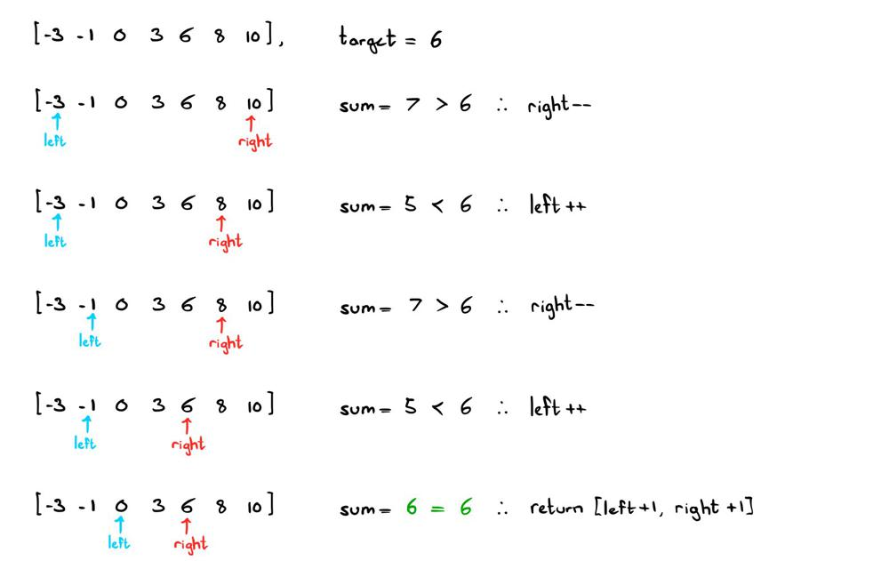

# Two Pointers | Visual Explanation JAVA

**Author:** ciote
**Votes:** 441
**Link:** [https://leetcode.com/problems/two-sum-ii-input-array-is-sorted/solutions/2128501/](https://leetcode.com/problems/two-sum-ii-input-array-is-sorted/solutions/2128501/)

---

### Logic:
The approach to this question differs to that of the classic Two Sum problem in that we have some direction with how we want to search for our target.

Since the array is sorted, we can make some general observations:
* Smaller sums would come from the left half of the array
* Larger sums would come from the right half of the array

Therefore, using two pointers starting at the end points of the array, we can choose to increase or decrease our current sum however we like. Pay attention to the example below:



The basic idea is that:
> If our current sum is too small, move closer to the right.
> If our current sum is too large, move closer to the left.

That's really all there is to it! Since the array is sorted and we're guarranteed that there exists an answer, we have everything we need to start coding :)
___
### How would I come up with this during an interview?
In an interview, whenever you're given a question where the input array is sorted, here are some super useful things to consider:
* Binary Search
* Two (or three) pointers
* A sliding window 
* Traversing from the right

Make sure to write down a couple examples and try experimenting with these approaches. Even understanding that these approaches may aid in finding an answer with a sorted array, you're showing your interviewer that you have a good understanding of the array datastructure. Be mindful of negative values and duplicates as you're experimenting! 

___
### Code:
If you have any questions, suggestions or improvements, feel free to let me know. Thanks for reading!
```java
public int[] twoSum(int[] nums, int target) {
	int l = 0, r = nums.length - 1;
	
	while (nums[l] + nums[r] != target) {
		if (nums[l] + nums[r] < target) l++;
		else r--;
	}

	return new int[] {l+1, r+1};
}
```
**Time Complexity:** `O(n)` 
**Space Complexity:** `O(1)`