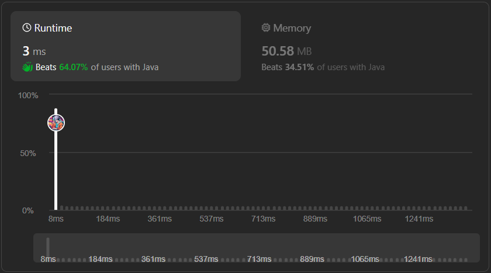

# Very Easy 100% || majority-element➕ || 🔥Beats 100%🔥|| with Explaination

**Author:** adoutsh
**Votes:** 27
**Link:** [https://leetcode.com/problems/majority-element/solutions/4682021/](https://leetcode.com/problems/majority-element/solutions/4682021/)

---




---


# **PLEASE UPVOTE IF IT HELPED**\uD83D\uDE4C

---


# Intuition \uD83D\uDCA1
To find the majority element in the given array, we can sort the array in ascending order.

Once the array is sorted, the majority element will always be the element at index nums.length / 2. This is because the majority element appears more than \u230An / 2\u230B times, meaning it will occupy the middle position in the sorted array.

By returning nums[nums.length / 2], we can easily obtain the majority element.

In simple terms, we sort the array and return the element in the middle position. Since the majority element always exists, it will be our answer.

# Approach \uD83D\uDE80
1. Sort the array in ascending order using the Arrays.sort() method. This allows us to group all the same elements together.
2. Once the array is sorted, the majority element will always be the element at index nums.length / 2. This is because the majority element appears more than \u230An / 2\u230B times, meaning it will occupy the middle position in the sorted array.
3. Return nums[nums.length / 2] as the majority element.

# Complexity \uD83D\uDCCA
- Time complexity:O(nlogn)
The dominant factor in the time complexity is the sorting operation, and sorting an array of n elements has a time complexity of O(nlogn).
Therefore, the overall time complexity of the solution is O(nlogn).

# Code \uD83D\uDC68\u200D\uD83D\uDCBB
```java []
class Solution {
    public int majorityElement(int[] nums) {
        Arrays.sort(nums);
        return nums[nums.length / 2];
    }
}
```
```c# []
public class Solution {
    public int MajorityElement(int[] nums) {
        Array.Sort(nums);
        return nums[nums.Length / 2];
    }
}
```
```c++ []
class Solution {
public:
    int majorityElement(vector<int>& nums) {
        sort(nums.begin(), nums.end());
        return nums[nums.size() / 2];
    }
};
```

```python []
class Solution(object):
    def majorityElement(self, nums):
        """
        :type nums: List[int]
        :rtype: int
        """
        nums.sort()
        return nums[len(nums) / 2]
        
```
```python3 []
class Solution:
    def majorityElement(self, nums: List[int]) -> int:
        nums.sort()
        return nums[len(nums) // 2]   
  
```

---


---


# ***# PLEASE UPVOTE IF IT HELPED***

---


