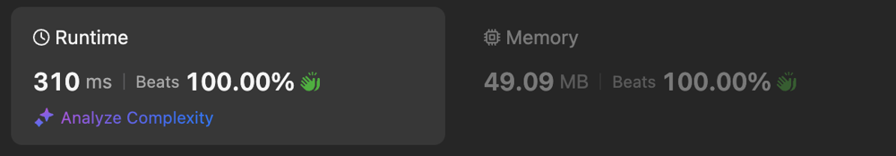

# beats 100% kotlin solution

**Author:** nanemomain
**Votes:** 0
**Link:** [https://leetcode.com/problems/two-sum-iii-data-structure-design/solutions/5599161/](https://leetcode.com/problems/two-sum-iii-data-structure-design/solutions/5599161/)

---



# Complexity
- Time complexity:
$$O(n)$$

- Space complexity:
$$O(n)$$

# Code
```
class TwoSum() {
    private val nums = mutableListOf<Int>()

    fun add(number: Int) {
        val index = nums.binarySearch(number)
        if (index < 0) {
            nums.add(-index - 1, number)
        } else {
            nums.add(index, number)
        }
    }

    fun find(value: Int): Boolean {
        var low = 0
        var high = nums.size - 1

        while (low < high) {
            val sum = nums[low] + nums[high]
            when {
                sum > value -> high -= 1
                sum < value -> low += 1
                else -> return value == sum
            }
        }
        return false        
    }
}

/**
 * Your TwoSum object will be instantiated and called as such:
 * var obj = TwoSum()
 * obj.add(number)
 * var param_2 = obj.find(value)
 */
```