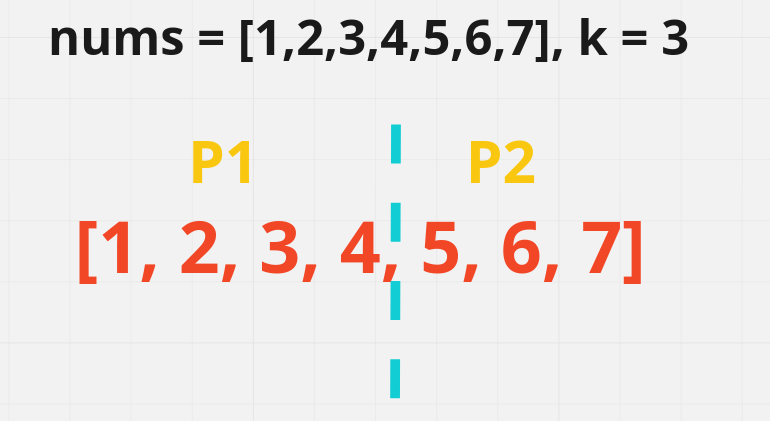
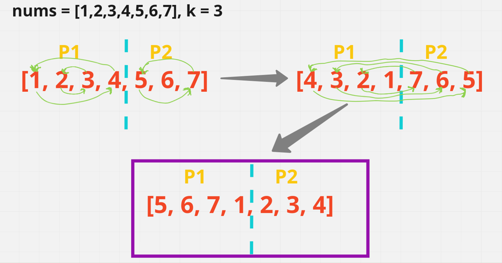

# [Java/C++/Python] A very-very well detailed explanation

**Author:** hi-malik
**Votes:** 591
**Link:** [https://leetcode.com/problems/rotate-array/solutions/1730142/](https://leetcode.com/problems/rotate-array/solutions/1730142/)

---

```
Well, to be honest with you all. This is really not a hard problem! It's an easy one
```

Alright, what the question is saying that we have **given an array & we have to rotate the array to the right by k steps, where k is non-negative.**
```
Okay so, we have one thing that k will always be > 0.
But, I will teach you, one bonus point as well what if k < 0 i.e. k is -ve then how can you rotate the array.
```
Let's undertsand this problem using an example,
**Input:** nums = [1,2,3,4,5,6,7], k = 3
**Output:** [5,6,7,1,2,3,4]

```
"K all possible rotation"

[7,1,2,3,4,5,6], k = 1
[6,7,1,2,3,4,5], k = 2
[5,6,7,1,2,3,4], k = 3
[4,5,6,7,1,2,3], k = 4
[3,4,5,6,7,1,2], k = 5
[2,3,4,5,6,7,1], k = 6
[1,2,3,4,5,6,7], k = 7
```

We have **k is 3**, so it means we have to take **3 values from the back** and **put in the front** of the array values.

So, for that what we will do is, we will break Array into 2 parts. **Part1[P1] & Part2[P2]**
* `[P1] is defined as` the array part just before the last 3 values. What I mean is something like [1,2,3,4]
* `[P2] is defined as` the array part just after remaining values which we have to rotate [5,6,7]



So, in order to rotate this Array **k times** what we will do is, we will reverse the **P1 first which become [4,3,2,1]** & then we **reverse P2 which becomes [7,6,5]**
Now finally what we have to do is we gonna **reverse the complete array** by doing that what will happen is our array become **[5,6,7,1,2,3,4]** and that's what we want in our **Output**



But, what if we have **k = 101**, then we will **not rotate it** 101 times. It simply means **till 100 times it will be [1,2,3,4,5,6,7]** & we have to **rotate only 1 time i.e. [7,1,2,3,4,5,6]**. So, now your question is how can we handle this, we simply do the **modulo of "k"** with length of array
```
Okay Bonus point what if we have k = -1, then how can we rotate the array. If k is -1 then we have to rotate the value backward not in the front.
Eg - 
Input : [1,2,3,4,5,6,7], k = -1
Output : [2,3,4,5,6,7,1]

Now how did we figure out this, if you carefully look that k = -1 is equals to k = 6.
Just look at the table which I have made for every possible k values

So, what It represent is that add the -ve value to the length of array. And you will get your answer!
```

*I hope Approach is crystal clear now!* **Let's do some dirty work**, `"code it up"`

*code each line explained :* `Similar for C++, Java, Python` **{Only Syntax Difference}** approach same
* Step - 1
```
// reversing the array values
    public static void reverse(int nums[], int i, int j){
        int li = i; // left index;
        int ri = j; // right index
        
        while(li < ri){
            int temp = nums[li];
            nums[li] = nums[ri];
            nums[ri] = temp;
            
            li++;
            ri--;
        }
    }
```
* Step - 2
```
public void rotate(int[] nums, int k) {
        k = k % nums.length; // if we have let's say 101 to rotate, then we only rotate it 1 time not 101 times
        if(k < 0){ // if we get -ve value, then -ve is just equals to it's -ve + array.length
            k += nums.length;
        }
        // part 1 reverse
        reverse(nums, 0, nums.length - k - 1);
        // part 2 reverse
        reverse(nums, nums.length - k, nums.length - 1);
        // complete reverse
        reverse(nums, 0, nums.length - 1);
    }
```

**Java**
```
class Solution {
	 public static void reverse(int nums[], int i, int j){
        int li = i;
        int ri = j;
        
        while(li < ri){
            int temp = nums[li];
            nums[li] = nums[ri];
            nums[ri] = temp;
            
            li++;
            ri--;
        }
    }
    public void rotate(int[] nums, int k) {
        k = k % nums.length; 
        if(k < 0){ 
            k += nums.length;
        }
        reverse(nums, 0, nums.length - k - 1);
        reverse(nums, nums.length - k, nums.length - 1);
        reverse(nums, 0, nums.length - 1);
    }
}
```
**C++**
```
class Solution {
    public :
    void reverse(vector<int>& nums, int i, int j){
        int li = i; // left;
        int ri = j;
        
        while(li < ri){
            int temp = nums[li];
            nums[li] = nums[ri];
            nums[ri] = temp;
            
            li++;
            ri--;
        }
    }
    void rotate(vector<int>& nums, int k) {
        k = k % nums.size();
        if(k < 0){ 
            k += nums.size();
        }
        reverse(nums, 0, nums.size() - k - 1);
        reverse(nums, nums.size() - k, nums.size() - 1);
        reverse(nums, 0, nums.size() - 1);
    }
};
```
**Python**
```
class Solution:
    def reverse (self, nums, i, j) : 
        li = i
        ri = j
        
        while li < ri:
            temp = nums[li]
            nums[li] = nums[ri]
            nums[ri] = temp
            
            li += 1
            ri -= 1
    def rotate(self, nums: List[int], k: int) -> None:
        """
        Do not return anything, modify nums in-place instead.
        """
        k = k % len(nums)
        if k < 0 : 
            k += len(nums)
        
        self.reverse(nums, 0, len(nums) - k - 1);
        self.reverse(nums, len(nums) - k, len(nums) - 1);
        self.reverse(nums, 0, len(nums) - 1);
```
ANALYSIS :-
* **Time Complexity :-** BigO(N)

* **Space Complexity :-** BigO(1)