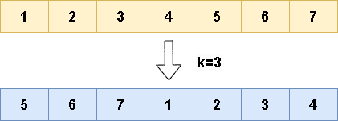

# 🔥🔥 Explicación y Resolución Del Ejercicio En Español Java | Python | PHP | C++ | JavaScript 🔥🔥

**Author:** hermescoder02
**Votes:** 7
**Link:** [https://leetcode.com/problems/rotate-array/solutions/4094830/](https://leetcode.com/problems/rotate-array/solutions/4094830/)

---

# Lectura

*Rotar arreglo (Java, Python, PHP, C++, Javascript)*

El ejercicio consiste en rotar un array hacia la derecha un n\xFAmero determinado de veces

Por ejemplo, si tenemos el array nums = [1,2,3,4,5,6,7] y queremos rotarlo k veces, como por ejemplo, 3, el nuevo array se llenar\xE1 de la siguiente manera: el elemento en la posici\xF3n 0 (valor 1) se mover\xE1 a la posici\xF3n 3, el elemento en la posici\xF3n 1 (valor 2) se mover\xE1 a la posici\xF3n 4, y as\xED sucesivamente. Una vez que se llega a la posici\xF3n 4, se sobrepasa del tama\xF1o final del array y se empieza desde el principio. Es decir, el elemento en la posici\xF3n 4 (valor 5) se mover\xE1 a la posici\xF3n  0, y as\xED sucesivamente hasta llegar al final del nuevo array [5,6,7,1,2,3,4].
        



# Explicaci\xF3n del ejercicio Paso por paso

https://youtu.be/MEZJt9-ZWpM

Si te gust\xF3 el contenido \xA1visita mi canal de youtube!: 
\u2705https://www.youtube.com/@hermescoder

Si deseas profundizar m\xE1s en este tema \xA1visita mi blog!: 
\u2705https://hermescoder.com/rotate-array-leetcode-espanol.html

# C\xF3digo 

```Java []
public class Solution {

    public static void rotate(int[] nums, int k) {
        // step #1
        int size = nums.length;
        int[] aux = new int[size];

        // step #2
        for (int i = 0; i < size; i++) {
            int position = (i + k) % size;

            // step #3
            aux[position] = nums[i];
        }

        // step #4
        System.arraycopy(aux, 0, nums, 0, size);
    }
}
```
```Python []
class Solution:
    def rotate(self, nums, k):
        #paso1
        size = len(nums)
        aux = [0] * size

        #paso2
        for i in range(size):
            position = (i + k) % size

            #paso3
            aux[position] = nums[i]

        #paso4
        nums[:] = aux
```
```PHP []
class Solution {

    /**
     * @param Integer[] $nums
     * @param Integer $k
     * @return NULL
     */
    function rotate(&$nums, $k) {
        //paso #1
        $size=count($nums);
        $aux = array_fill(0, $size, 0);
        
        for ($i = 0; $i < $size; $i++) {
            //paso #2
            $position=($i+$k)%$size;
            //paso#3
            $aux[$position]=$nums[$i];
        }

        //paso#4
        $nums=$aux;  
    }
}
```
```C++ []
class Solution {
public:
  /**
   * Rota un array de n\xFAmeros en una cantidad determinada de posiciones.

   * Args:
   *   nums: El array de n\xFAmeros a rotar.
   *   k: La cantidad de posiciones a rotar.

   * Returns:
   *   NULL.
   */
  void rotate(vector<int>& nums, int k) {
    // Paso #1
    int size = nums.size();
    vector<int> aux(size, 0);

    // Paso #2
    for (int i = 0; i < size; i++) {
      // Paso #3
      int position = (i + k) % size;
      aux[position] = nums[i];
    }

    // Paso #4
    nums = aux;
  }
};
```
```JavaScript []
/**
 * @param {number[]} nums
 * @param {number} k
 * @return {void} Do not return anything, modify nums in-place instead.
 */
var rotate = function(nums, k) {
  // Paso #1
    const size = nums.length;
    const aux = new Array(size);

    // Paso #2
    for (let i = 0; i < size; i++) {
      // Paso #3
      const position = (i + k) % size;
      aux[position] = nums[i];
    }

    // Paso #4
    for (let i = 0; i < size; i++) {
      nums[i] = aux[i];
    }
}
```


