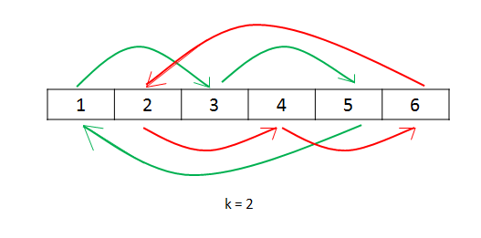

# Official Solution

**Link:** [https://leetcode.com/problems/rotate-array/solution/](https://leetcode.com/problems/rotate-array/solution/)

---

[TOC]

## Summary

We have to rotate the elements of the given array k times to the right.

## Solution

---

### Approach 1: Brute Force

The simplest approach is to rotate all the elements of the array in $$k$$ steps
by rotating the elements by 1 unit in each step.

<iframe src="https://leetcode.com/playground/2TUANkHu/shared" frameBorder="0" width="100%" height="327" name="2TUANkHu"></iframe>

**Complexity Analysis**

* Time complexity: $$\mathcal{O}(n \times k)$$. 
All the numbers are shifted by one step($$\mathcal{O}(n)$$) 
k times.

* Space complexity: $$\mathcal{O}(1)$$. No extra space is used.

<br /> 
<br />


---
### Approach 2: Using Extra Array

**Algorithm**

We use an extra array in which we place every element of the array at its correct
position i.e. the number at index $$i$$ in the original array is placed at the
index $$(i + k) \% \text{ length of array}$$. 
Then, we copy the new array to the original one.

<iframe src="https://leetcode.com/playground/TeLV3HCR/shared" frameBorder="0" width="100%" height="276" name="TeLV3HCR"></iframe>

**Complexity Analysis**

* Time complexity: $$\mathcal{O}(n)$$. 
One pass is used to put the numbers in the new array.
And another pass to copy the new array to the original one.

* Space complexity: $$\mathcal{O}(n)$$. Another array of the same size is used.

---
### Approach 3: Using Cyclic Replacements

**Algorithm**

We can directly place every number of the array at its required correct position.
But if we do that, we will destroy the original element. Thus, we need to store
the number being replaced in a $$temp$$ variable. Then, we can place the replaced
number($$\text{temp}$$) at its correct position and so on, $$n$$ times, where $$n$$ is
the length of array. We have chosen $$n$$ to be the number of replacements since we have
to shift all the elements of the array(which is $$n$$). 
But, there could be a problem with this method, if $$n \% k = 0$$
where $$k = k \% n$$ (since a value of $$k$$ larger than $$n$$ eventually 
leads to a $$k$$ equivalent to $$k \% n$$). 
In this case, while picking up numbers to be placed at the
correct position, we will eventually reach the number from 
which we originally started. Thus, in such a case, when
we hit the original number's index again, we start the same process 
with the number following it.

Now let's look at the proof of how the above method works. 
Suppose, we have $$n$$ as the number of elements in the array and
$$k$$ is the number of shifts required. Further, assume $$n \%k = 0$$. 
Now, when we start placing the elements at their correct position, 
in the first cycle all the numbers with their index $$i$$ satisfying 
$$i \%k = 0$$ get placed at their required position. 
This happens because when we jump k steps every time, 
we will only hit the numbers k steps apart. 
We start with index $$i = 0$$, having $$i \% k = 0$$. 
Thus, we hit all the numbers satisfying the above condition in the first cycle. 
When we reach back the original index, we have placed $$\frac{n}{k}$$ 
elements at their correct position, 
since we hit only that many elements in the first cycle. 
Now, we increment the index for replacing the numbers. 
This time, we place other $$\frac{n}{k}$$ elements at their correct position, 
different from the ones placed correctly in the first cycle, 
because this time we hit all the numbers satisfy the condition $$i \% k = 1$$. 
When we hit the starting number again, 
we increment the index and repeat the same process from $$i = 1$$ 
for all the indices satisfying $$i \% k == 1$$. 
This happens till we reach the number with the index $$i \% k = 0$$ 
again, which occurs for $$i=k$$. 
We will reach such a number after a total of $$k$$ cycles. 
Now, the total count of numbers exclusive numbers placed at their correct 
position will be $$k \times \frac{n}{k} = n$$. 
Thus, all the numbers will be placed at their correct position.

Look at the following example to clarify the process:
 
```
nums: [1, 2, 3, 4, 5, 6]
k: 2
```



<iframe src="https://leetcode.com/playground/FTiEskCN/shared" frameBorder="0" width="100%" height="412" name="FTiEskCN"></iframe>

**Complexity Analysis**

* Time complexity: $$\mathcal{O}(n)$$. Only one pass is used.

* Space complexity: $$\mathcal{O}(1)$$. Constant extra space is used.

---
### Approach 4: Using Reverse

**Algorithm**

This approach is based on the fact that when we rotate the array k times, $$k%n$$ elements from the back end of the array come to the front and the rest of the elements from the front shift backwards.

In this approach, we firstly reverse all the elements of the array. Then, reversing the first k elements followed by reversing the rest $$n-k$$ elements gives us the required result.

Let $$n = 7$$ and $$k = 3$$.
```
Original List                   : 1 2 3 4 5 6 7
After reversing all numbers     : 7 6 5 4 3 2 1
After reversing first k numbers : 5 6 7 4 3 2 1
After revering last n-k numbers : 5 6 7 1 2 3 4 --> Result
```

<iframe src="https://leetcode.com/playground/dw3Ce3b6/shared" frameBorder="0" width="100%" height="378" name="dw3Ce3b6"></iframe>

**Complexity Analysis**

* Time complexity: $$\mathcal{O}(n)$$. $$n$$ elements are reversed a total of three times.

* Space complexity: $$\mathcal{O}(1)$$. No extra space is used.
  
<br /> 
<br />