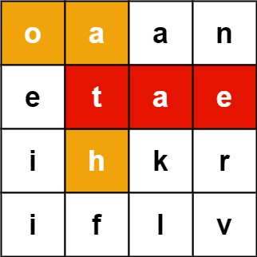
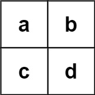

# [212. Word Search II](https://leetcode.com/problems/word-search-ii/)

| Category | Difficulty | Likes | Dislikes |
| :------: | :--------: | :---: | :------: |
| Algorithms | Hard | 10054 | 505 |

**Tags:** [`array`](https://leetcode.com/tag/array), [`string`](https://leetcode.com/tag/string), [`backtracking`](https://leetcode.com/tag/backtracking), [`trie`](https://leetcode.com/tag/trie), [`matrix`](https://leetcode.com/tag/matrix)

**Companies:** `cisco`, `amazon`, `uber`, `google`, `microsoft`, `tiktok`, `bloomberg`, `snowflake`, `two-sigma`, `doordash`, `snapchat`, `facebook`, `aurora`, `wix`, `roblox`, `paypal`, `de-shaw`, `capital-one`, `airbnb`

## Description

Given an `m x n` `board` of characters and a list of strings `words`, return *all words on the board*.

Each word must be constructed from letters of sequentially adjacent cells, where **adjacent cells** are horizontally or vertically neighboring. The same letter cell may not be used more than once in a word.

 

**Example 1:**


```

Input: board = [[&quot;o&quot;,&quot;a&quot;,&quot;a&quot;,&quot;n&quot;],[&quot;e&quot;,&quot;t&quot;,&quot;a&quot;,&quot;e&quot;],[&quot;i&quot;,&quot;h&quot;,&quot;k&quot;,&quot;r&quot;],[&quot;i&quot;,&quot;f&quot;,&quot;l&quot;,&quot;v&quot;]], words = [&quot;oath&quot;,&quot;pea&quot;,&quot;eat&quot;,&quot;rain&quot;]
Output: [&quot;eat&quot;,&quot;oath&quot;]

```

**Example 2:**


```

Input: board = [[&quot;a&quot;,&quot;b&quot;],[&quot;c&quot;,&quot;d&quot;]], words = [&quot;abcb&quot;]
Output: []

```

 

**Constraints:**

	- `m == board.length`

	- `n == board[i].length`

	- `1 <= m, n <= 12`

	- `board[i][j]` is a lowercase English letter.

	- `1 <= words.length <= 3 * 10^4`

	- `1 <= words[i].length <= 10`

	- `words[i]` consists of lowercase English letters.

	- All the strings of `words` are unique.

---

**Links:** [Submissions](https://leetcode.com/problems/word-search-ii/) | [Solutions](https://leetcode.com/problems/word-search-ii/)
