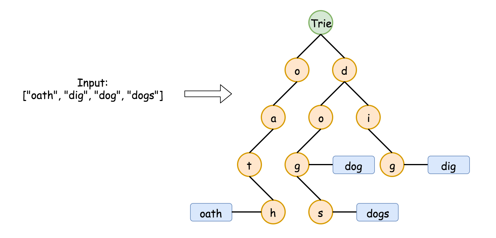
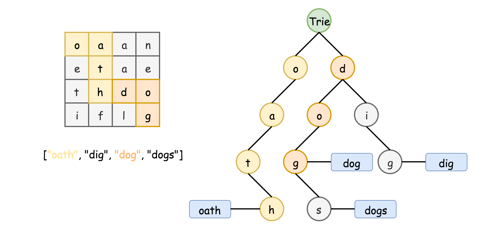
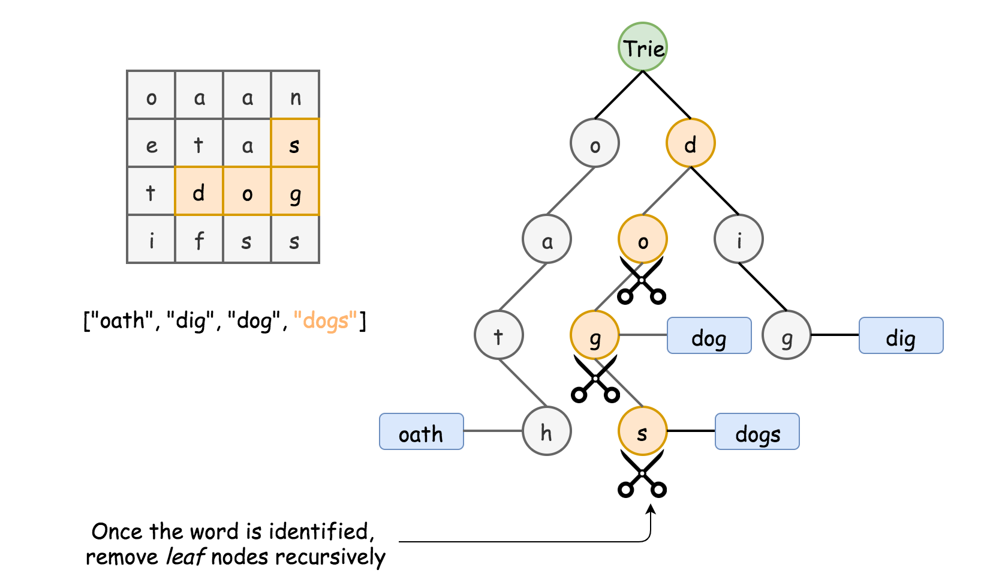
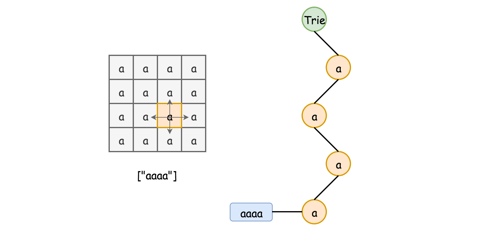

# Official Solution

**Link:** [https://leetcode.com/problems/word-search-ii/solution/](https://leetcode.com/problems/word-search-ii/solution/)

---

[TOC]

## Video Solution
---

    

        <iframe src="https://player.vimeo.com/video/814064743" width="640" height="360" frameborder="0" allow="autoplay; fullscreen" allowfullscreen></iframe>
    

&nbsp;

## Solution Article

---

### Approach 1: Backtracking with Trie

**Intuition**

The problem is actually a simplified crossword puzzle game, where the word solutions have been given on the board embedded with some noise letters. All we need to to do is to *cross* them out.

>Intuitively, in order to cross out all potential words, the overall strategy would be to iterate the cell one by one, and from each cell we walk along its neighbors in four potential directions to find matched words.
While wandering around the board, we would stop the exploration when we know it would not lead to the discovery of new words.

One might have guessed the paradigm that we would use for this problem. Yes, it is **backtracking**, which would be the backbone of the solution. It is fairly simply to construct a solution of backtracking. One could even follow a template given in our [Explore card of Recursion II](https://leetcode.com/explore/learn/card/recursion-ii/472/backtracking/2793/).

The key of the solution lies on _how we find the matches of word from the dictionary_. Intuitively, one might resort to the hashset data structure (_e.g._ `set()` in Python). This could work.

However, during the backtracking process, one would encounter more often the need to tell if there exists any word that contains certain prefix, rather than if a string exists as a word in the dictionary. Because if we know that there does not exist any match of word in the dictionary for a given prefix, then we would not need to further explore certain direction. And this, would greatly reduce the exploration space, therefore improve the performance of the backtracking algorithm.

The capability of finding matching prefix is where the data structure called [Trie](https://leetcode.com/explore/learn/card/trie/) would shine, comparing the hashset data structure. Not only can Trie tell the membership of a word, but also it can instantly find the words that share a given prefix. As it turns out, the choice of data structure (`Trie` _VS._ `hashset`), which could end with a solution that ranks either the top $$5\%$$ or the bottom $$5\%$$.

Here we show an example of Trie that is built from a list of words. As one can see from the following graph, at the node denoted `d`, we would know there are at least two words with the prefix `d` from the dictionary.

We have a problem about [implementing a Trie data structure](https://leetcode.com/problems/implement-trie-prefix-tree/). One can start with the Trie problem as warm up, and come back this problem later.

**Algorithm**

The overall workflow of the algorithm is intuitive, which consists of a loop over each cell in the board and a recursive function call starting from the cell. Here is the skeleton of the algorithm.

- We build a Trie out of the words in the dictionary, which would be used for the matching process later.

- Starting from each cell, we start the backtracking exploration (_i.e._ `backtracking(cell)`), if there exists any word in the dictionary that starts with the letter in the cell.

- During the recursive function call `backtracking(cell)`, we explore the neighbor cells (_i.e._ `neighborCell`) around the current cell for the next recursive call `backtracking(neighborCell)`. At each call, we check if the sequence of letters that we traverse so far matches any word in the dictionary, with the help of the Trie data structure that we built at the beginning.

Here is an overall impression how the algorithm works. We give some sample implementation based on the rough idea above. And later, we detail some optimization that one could further apply to the algorithm. 

<iframe src="https://leetcode.com/playground/Aoc86nwJ/shared" frameBorder="0" width="100%" height="500" name="Aoc86nwJ"></iframe>

To better understand the backtracking process, we demonstrate how we find the match of `dog` along the Trie in the following animation.

!?!../Documents/212_LIS.json:1000,474!?!

#### Optimizations

In the above implementation, we applied a few tricks to further speed up the running time, in addition to the application of the Trie data structure. In particular, the Python implementation could run faster than `98%` of the submissions. We detail the tricks as follows, ordered by their significance.

>_Backtrack along the nodes in Trie._

- One could use Trie simply as a dictionary to quickly find the match of words and prefixes, _i.e._ at _each step_ of backtracking, we start all over from the root of the Trie. This could work.
- However, a more efficient way would be to traverse the Trie together with the progress of backtracking, _i.e._ at each step of `backtracking(TrieNode)`, the depth of the `TrieNode` corresponds to the length of the prefix that we've matched so far. This measure could lift your solution out of the bottom $$5\%$$ of submissions.

>_Gradually **prune** the nodes in Trie during the backtracking._

- The idea is motivated by the fact that the time complexity of the overall algorithm sort of depends on the size of the Trie. For a leaf node in Trie, once we traverse it (_i.e._ find a matched word), we would no longer need to traverse it again. As a result, we could prune it out from the Trie.

- Gradually, those non-leaf nodes could become leaf nodes later, since we trim their children leaf nodes. In the extreme case, the Trie would become empty, once we find a match for all the words in the dictionary. This pruning measure could reduce up to $$50\%$$ of the running time for the test cases of the online judge.

> _Keep words in the Trie_.

- One might use a flag in the Trie node to indicate if the path to the current code match any word in the dictionary. It is not necessary to keep the words in the Trie.
- However, doing so could improve the performance of the algorithm a bit. One benefit is that one would not need to pass the prefix as the parameter in the `backtracking()` call. And this could speed up a bit the recursive call. Similarly, one does not need to reconstruct the matched word from the prefix, if we keep the words in Trie.

>_Remove the matched words from the Trie._

- In the problem, we are asked to return all the matched words, rather than the number of potential matches. Therefore, once we reach certain Trie node that contains a match of word, we could simply remove the match from the Trie.
- As a _side_ benefit, we do not need to check if there is any duplicate in the result set. As a result, we could simply use a list instead of set to keep the results, which could speed up the solution a bit.
 

**Complexity**

- Time complexity: $$\mathcal{O}(M(4\cdot3^{L-1}))$$, where $$M$$ is the number of cells in the board and $$L$$ is the maximum length of words.
  
    - It is tricky is calculate the exact number of steps that a backtracking algorithm would perform. We provide a upper bound of steps for the worst scenario for this problem. The algorithm loops over all the cells in the board, therefore we have $$M$$ as a factor in the complexity formula. It then boils down to the _maximum_ number of steps we would need for each starting cell (_i.e._$$4\cdot3^{L-1}$$).
  
    - Assume the maximum length of word is $$L$$, starting from a cell, initially we would have at most 4 directions to explore. Assume each direction is valid (_i.e._ worst case), during the following exploration, we have at most 3 neighbor cells (excluding the cell where we come from) to explore. As a result, we would traverse at most $$4\cdot3^{L-1}$$ cells during the backtracking exploration.

    - One might wonder what the worst case scenario looks like. Well, here is an example. Imagine, each of the cells in the board contains the letter `a`, and the word dictionary contains a single word `['aaaa']`. Voila. This is one of the worst scenarios that the algorithm would encounter.

  
    - Note that, the above time complexity is estimated under the assumption that the Trie data structure would not change once built. If we apply the optimization trick to gradually remove the nodes in Trie, we could greatly improve the time complexity, since the cost of backtracking would reduced to zero once we match all the words in the dictionary, _i.e._ the Trie becomes empty.

 

- Space Complexity: $$\mathcal{O}(N)$$, where $$N$$ is the total number of letters in the dictionary.

    - The main space consumed by the algorithm is the Trie data structure we build. In the worst case where there is no overlapping of prefixes among the words, the Trie would have as many nodes as the letters of all words. And optionally, one might keep a copy of words in the Trie as well. As a result, we might need $$2N$$ space for the Trie.