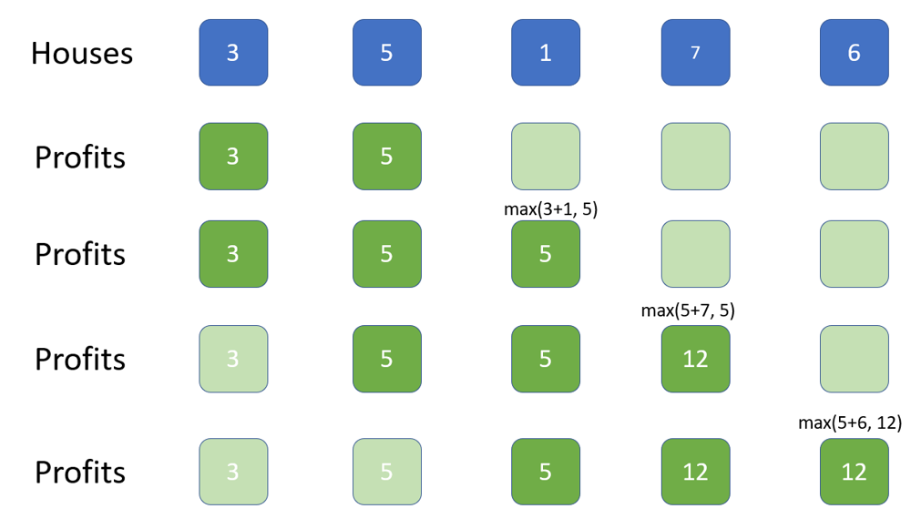

# House Robber II | Java | c++ | kotlin | O(N) time O(1) space

**Author:** cygnus
**Votes:** 16
**Link:** [https://leetcode.com/problems/house-robber-ii/solutions/893903/](https://leetcode.com/problems/house-robber-ii/solutions/893903/)

---

For a circle case, in order to make sure don't rob both the first and the last houses, we can seperate it to 2 linear cases and find the max.  Let's say there are n houses and there will two cases:

1. Rob the first house.  So can't rob the last one.  That is rob from 0 to n-2 houses
1. Don't rob the first house and can rob the last one.  That is rob from 1 to n-1 houses. 
1. The result must be one of them.  Let's get the max of 1 and 2

Next, how to rob a linear houses with size n. This is **House Robber** (leetcode 191).  Assume that we have an array profits of size n.  **profit[i]** is the the maximum amount of money you can rob from house 0 to house i.   For the i+1th house, we have 

**profit[i+1] = max( profit[i-1] + nums[i+1], profits[i])** 

So we can have a stardard dp solution. 

This solution is for the linear case and **NOT** for this question.  Have to add this since there are complains about it doesn't work.  I add this soluton so we can find and understand the optimized solution.  

```
class Solution {
    public int rob(int[] nums) {
        int n = nums.length;
        if (n == 1) return nums[0];
        int[] profit = new int[n];
        profit[0] = nums[0];
        profit[1] = Math.max(nums[0], nums[1]);
        for (int i = 2; i < n; i++)
        {
            profit[i] = Math.max(profit[i-2] + nums[i], profit[i-1]);
        }
        return profit[n-1];
    }
}
```

The space complexity for this is O(N).  Notice that each profit only depends on **the previous two values(dark green)**.  So we only need two variable for that.  Now we can have a space **O(1)** solution.  The follow solutions are Time **O(N)** Space **O(1)** solutions. 




If you like it, please upvote it. Thanks.

**java**
```
class Solution {
    public int rob(int[] nums) {
        if (nums.length ==1) return nums[0];
        return Math.max(rob(nums, 0, nums.length-2), rob(nums, 1, nums.length-1));
    }
    private int rob(int[]nums, int start, int end)
    {
        int a = 0, b = 0;
        for (int i = start; i <= end; i++)
        {
            int temp = b;
            if (nums[i] + a > b)
            {
                b = nums[i] + a;
            }
            a = temp;
        }
        return b;
    }
}
```

**c++**
```
class Solution {
public:
    int rob(vector<int>& nums) {
        if (nums.size() ==1) return nums[0];
        return max(rob(nums, 0, nums.size()-2), rob(nums, 1, nums.size()-1));
    }
private:
    int rob(vector<int>&nums, int start, int end)
    {
        int a = 0, b = 0;
        for (int i = start; i <= end; i++)
        {
            int temp = b;
            if (nums[i] + a > b)
            {
                b = nums[i] + a;
            }
            a = temp;
        }
        return b;
    }
};
```

**kotlin**
```
class Solution {
    fun rob(nums: IntArray): Int {
        if (nums.size == 1) return nums[0]
        return Math.max(rob(nums, 0, nums.size-2), rob(nums, 1, nums.size-1))
    }
    private fun rob(nums: IntArray, start: Int, end: Int): Int
    {
        var a = 0
        var b = 0
        for (i in start..end)
        {
            var temp: Int = b
            if (a + nums[i] > b)
            {
                b = a + nums[i]
            }
            a = temp
        }
        return b
    }
}
```