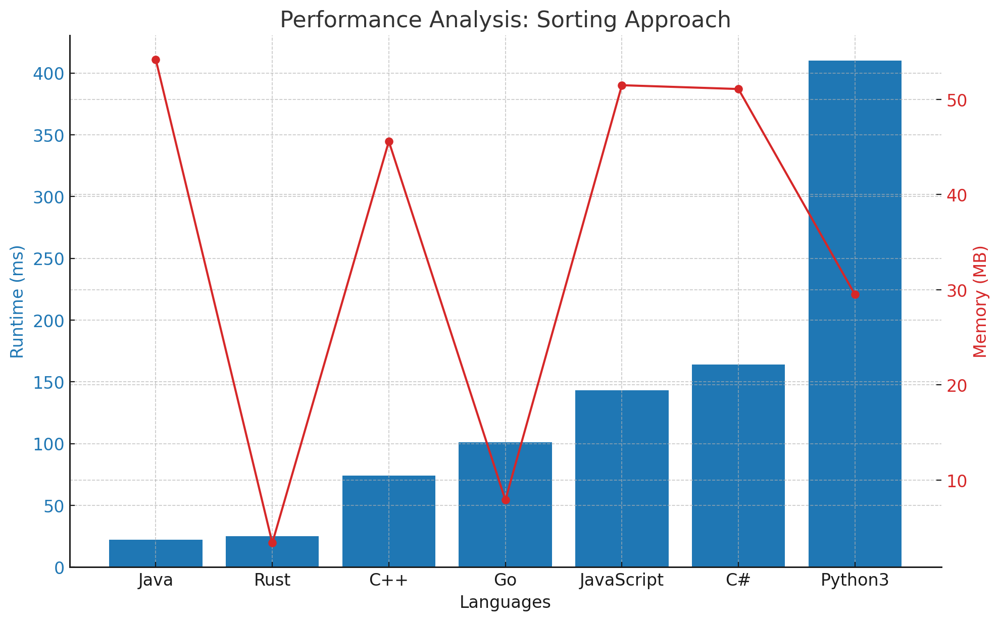
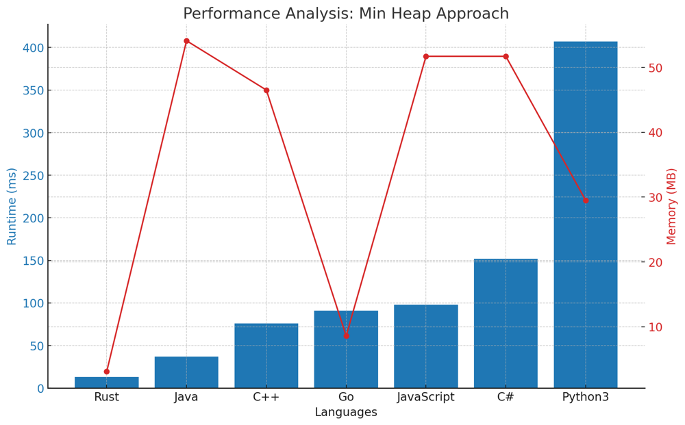
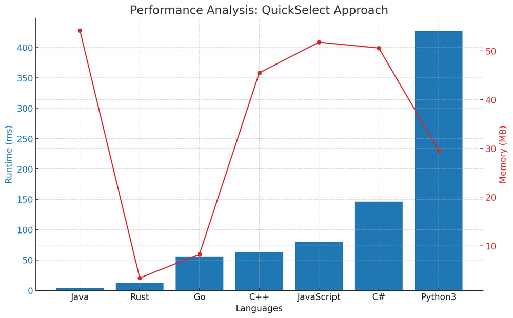
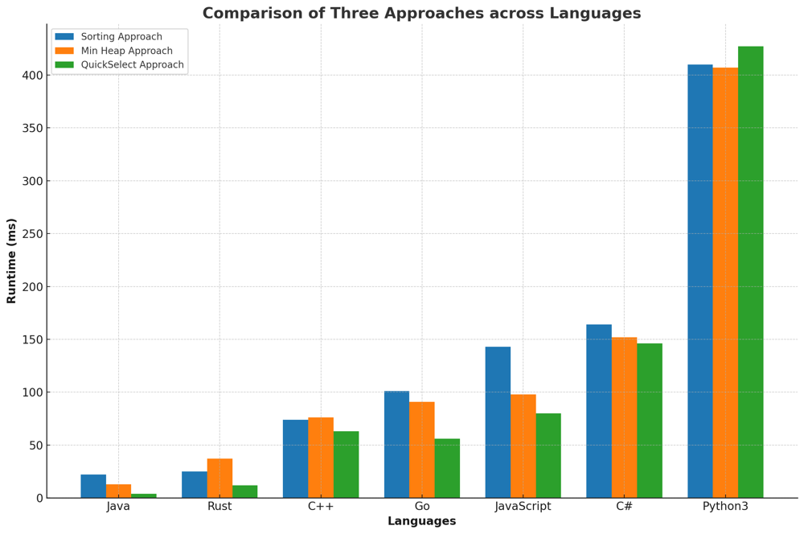

# ✅ 100% 3-Approaches [VIDEO] - Heap & QuickSelect & Sorting

**Author:** vanAmsen
**Votes:** 725
**Link:** [https://leetcode.com/problems/kth-largest-element-in-an-array/solutions/3906260/](https://leetcode.com/problems/kth-largest-element-in-an-array/solutions/3906260/)

---

# Problem Understanding

In the "Kth Largest Element in an Array" problem, we are provided with an array of integers `nums` and an integer `k`. The objective is to determine the `k`th largest element in this array.

For example, with the array `nums = [3,2,1,5,6,4]` and `k = 2`, the expected answer is `5` since `5` is the second largest element in the array.

---

# Approaches to Finding the k-th Largest Element

Finding the $$k$$-th largest element in an array is a classic problem in computer science, and over the years, multiple algorithms and techniques have been developed to tackle it efficiently. Let's explore three of these approaches:

## **Approach 1/3: Sort and Select**
The most intuitive method, this approach involves sorting the entire array in descending order and then simply picking the $$k$$-th element. Though straightforward, it may not be the most efficient for very large arrays due to the sorting step.



### Live Coding & Explenation - Sort and Select
https://youtu.be/yiUjLay-ocI

## **Approach 2/3: Min-Heap**
Rather than sorting the entire array, this method utilizes a min-heap to maintain the $$k$$-th largest elements. The heap allows us to efficiently compare each new element with the smallest of the $$k$$-th largest elements seen so far. By the end of the iteration, the top of the heap will contain our desired $$k$$-th largest element.



### Live Coding & Explenation - Min-Heap
https://youtu.be/h3GivLJBUTk

## **Approach 3/3: QuickSelect Algorithm**
Inspired by the QuickSort algorithm, QuickSelect is a divide-and-conquer technique. It partitions the array around a pivot and recursively searches for the $$k$$-th largest element in the appropriate partition. When the pivot is chosen randomly, the algorithm tends to have a linear average-case time complexity, making it faster than the sorting approach for large datasets.



### Live Coding & Explenation - QuickSelect
https://youtu.be/q6A3_mTixvE

## Comparison of Tree Approaches across Languages

The bar chart below provides a comparative analysis of the runtime performance of three different algorithms \u2013 the Sorting Approach, Min Heap Approach, and the QuickSelect Approach \u2013 across seven popular programming languages. Each language's performance is measured in milliseconds (ms) for each approach, with lower values indicating faster execution times.



---

# Approaches

Each of these approaches has its own strengths and trade-offs. Depending on the specific scenario, constraints, and size of the input, one might be more suitable than the others. It's always beneficial to have multiple tools (approaches) in your algorithmic toolbox!

# Approach 1/3: Sort and Select

This approach is quite straightforward: sort the numbers in descending order and pick the $$k$$-th element.

## Key Data Structures:
- **List/Array**: We use Python's built-in list for this approach. The list is sorted in descending order to get the $$k$$-th largest element.

## Step-by-step Breakdown:

1. **Initialization**:
   - Use built-in `sorted` function to sort the list `nums` in reverse order (i.e., in descending order).
   
2. **Selection**:
   - Select the $$k$$-th element from the sorted list (keeping in mind the zero-based indexing of lists).

3. **Result**:
   - The $$k$$-th element in the sorted list is the $$k$$-th largest element in the original list.

# Complexity:

**Time Complexity:** $$O(N \\log N)$$
- Sorting a list of $$N$$ elements requires $$O(N \\log N)$$ time.

**Space Complexity:** $$O(1)$$
- The space used is constant since we are only sorting the original list and selecting an element from it without utilizing any additional data structures.

# Performance:

This solution is simple and works effectively for smaller lists. However, for very large lists, other approaches that avoid sorting the entire list might be more efficient.

| Language   | Runtime (ms) | Runtime Beat (%) | Memory (MB) | Memory Beat (%) |
|------------|--------------|------------------|-------------|-----------------|
| **Java**       | 22           | 88.35%           | 54.2        | 79.52%          |
| **Rust**       | 25           | 21.43%           | 3.4         | 5.61%           |
| **C++**        | 74           | 96.10%           | 45.6        | 74.16%          |
| **Go**         | 101          | 51.2%            | 7.9         | 85.3%           |
| **JavaScript** | 143          | 60.17%           | 51.5        | 56.57%          |
| **C#**         | 164          | 85.88%           | 51.1        | 41.99%          |
| **Python3**    | 410          | 98.33%           | 29.5        | 72.41%          |

# Code 1/3

``` Python []
class Solution:
    def findKthLargest(self, nums, k):
        return sorted(nums, reverse=True)[k-1]
```
``` C++ []
class Solution {
public:
    int findKthLargest(std::vector<int>& nums, int k) {
        std::sort(nums.begin(), nums.end(), std::greater<int>());
        return nums[k-1];
    }
};
```
``` Java []
public class Solution {
    public int findKthLargest(int[] nums, int k) {
        Arrays.sort(nums);
        return nums[nums.length - k];
    }
}
```
``` Rust []
impl Solution {
    pub fn find_kth_largest(nums: Vec<i32>, k: i32) -> i32 {
        let mut sorted_nums = nums.clone();
        sorted_nums.sort();
        sorted_nums[(nums.len() - k as usize)]
    }
}
```
``` Go []
import "sort"

func findKthLargest(nums []int, k int) int {
    sort.Ints(nums)
    return nums[len(nums)-k]
}
```
``` JavaScript []
/**
 * @param {number[]} nums
 * @param {number} k
 * @return {number}
 */
var findKthLargest = function(nums, k) {
    nums.sort((a, b) => b - a);
    return nums[k-1];
};
```
``` C# []
public class Solution {
    public int FindKthLargest(int[] nums, int k) {
        Array.Sort(nums);
        return nums[nums.Length - k];
    }
}
```
---

# Approach 2/3: Min-Heap

The main idea of this solution is to use a min-heap with a maximum size of `k`. By doing this, we ensure that the smallest of the `k` largest elements is always on the top of the heap.

## Key Data Structures:

- **`heap`**:
  This is a min-heap containing the first `k` elements of `nums`. As we progress, we will modify this heap to ensure it contains the `k` largest elements.

### Step-by-step Breakdown:

1. **Initialization**:
   - Create a heap with the first `k` elements of `nums`.
   - Transform this list into a min-heap.

2. **Iterate through the List**:
   - For each of the remaining elements in `nums`:
     - If the element is larger than the smallest element in the heap (i.e., the top of the heap):
       - Remove the top element from the heap.
       - Insert the current element into the heap.

3. **Result**:
   - After processing all elements in `nums`, the top of the heap will contain the `k`th largest element. Return this element.

# Example:

Consider the list `nums = [3,2,1,5,6,4]` with `k = 2`.

Here's the evolution of the `heap`:

**Initial State**:
- `heap`: [3,2]

**After processing index 2 (element = 1)**:
- `heap` remains unchanged as `1` is not larger than `2`.

**After processing index 3 (element = 5)**:
- `heap`: [3,5]

**After processing index 4 (element = 6)**:
- `heap`: [5,6]

**After processing index 5 (element = 4)**:
- `heap`: [5,6]

The final state of the `heap` shows that the `k`th largest element is `5`.

# Complexity

**Time Complexity:** $$O(n \\log k)$$
Each of the `n` elements is processed once. However, heap operations take $$O(\\log k)$$ time, leading to an overall complexity of $$O(n \\log k)$$.

**Space Complexity:** $$O(k)$$
The solution uses a heap with a maximum of `k` elements.

# Performance

This solution is both time and space-efficient. By focusing only on the `k` largest elements and using the properties of a heap, it ensures optimal runtime for a wide range of inputs. The controlled space usage ensures that even for large `k`, the memory overhead remains minimal.

| Language   | Runtime (ms) | Runtime Beat (%) | Memory (MB) | Memory Beat (%) |
|------------|--------------|------------------|-------------|-----------------|
| **Rust**       | 13           | 77.55%           | 3.1         | 46.94%          |
| **Java**       | 37           | 59.27%           | 54.1        | 86.2%           |
| **C++**        | 76           | 94.84%           | 46.5        | 68.16%          |
| **Go**         | 91           | 62.6%            | 8.6         | 30.67%          |
| **JavaScript** | 98           | 87.2%            | 51.7        | 47.64%          |
| **C#**         | 152          | 95.49%           | 51.7        | 16.25%          |
| **Python3**    | 407          | 98.75%           | 29.5        | 72.41%          |

# Code
``` Python []
class Solution:
    def findKthLargest(self, nums: List[int], k: int) -> int:
        heap = nums[:k]
        heapq.heapify(heap)
        
        for num in nums[k:]:
            if num > heap[0]:
                heapq.heappop(heap)
                heapq.heappush(heap, num)
        
        return heap[0]
```
``` C++ []
class Solution {
public:
    int findKthLargest(std::vector<int>& nums, int k) {
        std::priority_queue<int, std::vector<int>, std::greater<int>> min_heap(nums.begin(), nums.begin() + k);
        
        for (int i = k; i < nums.size(); i++) {
            if (nums[i] > min_heap.top()) {
                min_heap.pop();
                min_heap.push(nums[i]);
            }
        }
        
        return min_heap.top();
    }
};
```
``` Rust []
use std::collections::BinaryHeap;
use std::cmp::Reverse;

impl Solution {
    pub fn find_kth_largest(nums: Vec<i32>, k: i32) -> i32 {
        let mut heap: BinaryHeap<Reverse<i32>> = nums.iter().take(k as usize).map(|&x| Reverse(x)).collect();
        
        for &num in nums.iter().skip(k as usize) {
            if num > heap.peek().unwrap().0 {
                heap.pop();
                heap.push(Reverse(num));
            }
        }
        
        heap.peek().unwrap().0
    }
}
```
``` Go []
import "container/heap"

func findKthLargest(nums []int, k int) int {
    h := IntHeap(nums[:k])
    heap.Init(&h)
    
    for _, num := range nums[k:] {
        if num > h[0] {
            heap.Pop(&h)
            heap.Push(&h, num)
        }
    }
    
    return h[0]
}

type IntHeap []int

func (h IntHeap) Len() int { return len(h) }
func (h IntHeap) Less(i, j int) bool { return h[i] < h[j] }
func (h IntHeap) Swap(i, j int) { h[i], h[j] = h[j], h[i] }

func (h *IntHeap) Push(x interface{}) {
    *h = append(*h, x.(int))
}

func (h *IntHeap) Pop() interface{} {
    old := *h
    n := len(old)
    x := old[n-1]
    *h = old[0 : n-1]
    return x
}
```
``` Java []
public class Solution {
    public int findKthLargest(int[] nums, int k) {
        PriorityQueue<Integer> minHeap = new PriorityQueue<>();
        for (int i = 0; i < k; i++) {
            minHeap.offer(nums[i]);
        }
        
        for (int i = k; i < nums.length; i++) {
            if (nums[i] > minHeap.peek()) {
                minHeap.poll();
                minHeap.offer(nums[i]);
            }
        }
        
        return minHeap.peek();
    }
}
```
``` JavaScript []
/**
 * @param {number[]} nums
 * @param {number} k
 * @return {number}
 */
 class MinHeap {
    constructor() {
        this.heap = [];
    }
    push(val) {
        this.heap.push(val);
        this.bubbleUp();
    }
    pop() {
        const max = this.heap[0];
        const end = this.heap.pop();
        if (this.heap.length > 0) {
            this.heap[0] = end;
            this.bubbleDown();
        }
        return max;
    }
    peek() {
        return this.heap[0];
    }
    bubbleUp() {
        let idx = this.heap.length - 1;
        const element = this.heap[idx];
        while (idx > 0) {
            let parentIdx = Math.floor((idx - 1) / 2);
            let parent = this.heap[parentIdx];
            if (element >= parent) break;
            this.heap[parentIdx] = element;
            this.heap[idx] = parent;
            idx = parentIdx;
        }
    }
    bubbleDown() {
        let idx = 0;
        const length = this.heap.length;
        const element = this.heap[0];
        while (true) {
            let leftChildIdx = 2 * idx + 1;
            let rightChildIdx = 2 * idx + 2;
            let leftChild, rightChild;
            let swap = null;
            if (leftChildIdx < length) {
                leftChild = this.heap[leftChildIdx];
                if (leftChild < element) {
                    swap = leftChildIdx;
                }
            }
            if (rightChildIdx < length) {
                rightChild = this.heap[rightChildIdx];
                if (
                    (swap === null && rightChild < element) || 
                    (swap !== null && rightChild < leftChild)
                ) {
                    swap = rightChildIdx;
                }
            }
            if (swap === null) break;
            this.heap[idx] = this.heap[swap];
            this.heap[swap] = element;
            idx = swap;
        }
    }
}
var findKthLargest = function(nums, k) {
    let heap = new MinHeap();
    for (let i = 0; i < k; i++) {
        heap.push(nums[i]);
    }
    for (let i = k; i < nums.length; i++) {
        if (nums[i] > heap.peek()) {
            heap.pop();
            heap.push(nums[i]);
        }
    }
    return heap.peek();
};
```
``` C# []
public class Solution {
    public int FindKthLargest(int[] nums, int k) {
        MinHeap minHeap = new MinHeap(k);
        for (int i = 0; i < k; i++) {
            minHeap.Insert(nums[i]);
        }
        
        for (int i = k; i < nums.Length; i++) {
            if (nums[i] > minHeap.Peek()) {
                minHeap.Pop();
                minHeap.Insert(nums[i]);
            }
        }
        
        return minHeap.Peek();
    }
}

public class MinHeap {
    private int[] heap;
    private int size;

    public MinHeap(int capacity) {
        heap = new int[capacity];
        size = 0;
    }

    public void Insert(int val) {
        heap[size] = val;
        size++;
        BubbleUp();
    }

    public int Peek() {
        return heap[0];
    }

    public int Pop() {
        int poppedValue = heap[0];
        heap[0] = heap[size - 1];
        size--;
        BubbleDown();
        return poppedValue;
    }

    private void BubbleUp() {
        int index = size - 1;
        while (index > 0 && heap[index] < heap[Parent(index)]) {
            Swap(index, Parent(index));
            index = Parent(index);
        }
    }

    private void BubbleDown() {
        int index = 0;
        while (HasLeftChild(index) && (heap[index] > LeftChild(index) || HasRightChild(index) && heap[index] > RightChild(index))) {
            int smallerChildIndex = LeftChildIndex(index);
            if (HasRightChild(index) && RightChild(index) < LeftChild(index)) {
                smallerChildIndex = RightChildIndex(index);
            }
            Swap(index, smallerChildIndex);
            index = smallerChildIndex;
        }
    }

    private int Parent(int index) { return (index - 1) / 2; }
    private int LeftChildIndex(int index) { return 2 * index + 1; }
    private int RightChildIndex(int index) { return 2 * index + 2; }

    private bool HasLeftChild(int index) { return LeftChildIndex(index) < size; }
    private bool HasRightChild(int index) { return RightChildIndex(index) < size; }

    private int LeftChild(int index) { return heap[LeftChildIndex(index)]; }
    private int RightChild(int index) { return heap[RightChildIndex(index)]; }

    private void Swap(int indexOne, int indexTwo) {
        int temp = heap[indexOne];
        heap[indexOne] = heap[indexTwo];
        heap[indexTwo] = temp;
    }
}
```

---


# Approach 3/3: QuickSelect Algorithm

The QuickSelect algorithm is an efficient method to find the $$k$$-th smallest (or largest) element in an unordered list without sorting the entire list. It works similarly to the QuickSort algorithm but only recurses into one half of the data.

## Key Data Structures:

- **List/Array**: We use Python's built-in list for this approach. The algorithm modifies the list in place.
- **Pivot**: An element chosen from the list, around which the list gets partitioned.

## Step-by-step Breakdown:

1. **Initialization**:
   - Set the `left` boundary to the beginning of the list and the `right` boundary to the end of the list.

2. **Pivot Selection**:
   - Randomly select a pivot index between the `left` and `right` boundaries.

3. **Partitioning**:
   - Move all elements smaller than the pivot to its left and all larger elements to its right.
   - Return the final position of the pivot after the partitioning.

4. **Check Pivot Position**:
   - If the position of the pivot is the desired $$k$$-th largest index, return the pivot.
   - If the pivot's position is greater than the desired index, adjust the `right` boundary and repeat.
   - If the pivot's position is lesser than the desired index, adjust the `left` boundary and repeat.

5. **Result**:
   - The function will eventually return the $$k$$-th largest element in the original list.

# Example:

Let's walk through the QuickSelect algorithm using the list `nums = [3,2,1,5,6,4]` and \\( k = 2 \\) to find the 2nd largest element.

**Initial List:** 
`[3,2,1,5,6,4]`

1. **Iteration 1:** 
   - Chosen pivot: `3` (at index 0)
   - After partitioning, the list becomes: `[2, 1, 3, 5, 6, 4]`
   - The new pivot index is 2. Since we're looking for the 2nd largest element (index 4 in 0-indexed list), and the current pivot index is less than this, we know the desired element is to the right of the current pivot.
   
2. **Iteration 2:**
   - Chosen pivot: `6` (at index 4)
   - After partitioning, the list becomes: `[2, 1, 3, 4, 5, 6]`
   - The new pivot index is 4, which matches our target index for the 2nd largest element.
   
**Result:** 
The 2nd largest element in the list is `5`.

This example demonstrates the behavior of the QuickSelect algorithm. By iteratively selecting a pivot and partitioning the list around that pivot, it efficiently narrows down the search space until it locates the kth largest element.

# Complexity:

**Time Complexity**: 
- Best and Average Case: $$O(N)$$
- Worst Case: $$O(N^2)$$
  
  The average performance is linear. However, in the worst case (very rare, especially with randomized pivot), the algorithm can degrade to $$O(N^2)$$.

**Space Complexity**: $$O(1)$$
- The space used is constant. The algorithm modifies the original list in place and doesn't utilize any significant additional data structures. The recursive stack calls (in the worst case) are also bounded by the depth of the list, making it $$O(\\log N)$$, but this is typically considered as $$O(1)$$ space complexity in QuickSelect.

# Performance:

This solution is efficient for larger lists, especially when the pivot is chosen randomly, which greatly reduces the chance of the worst-case scenario. The QuickSelect algorithm allows for finding the desired element without sorting the entire list, making it faster than the sorting approach for large datasets.

| Language   | Runtime (ms) | Runtime Beat (%) | Memory (MB) | Memory Beat (%) |
|------------|--------------|------------------|-------------|-----------------|
| **Java**       | 4            | 97.78%           | 54.2        | 79.52%          |
| **Rust**       | 12           | 83.16%           | 3.4         | 5.61%           |
| **Go**         | 56           | 100%             | 8.3         | 46.37%          |
| **C++**        | 63           | 98.85%           | 45.5        | 86.52%          |
| **JavaScript** | 80           | 94.94%           | 51.8        | 38.99%          |
| **C#**         | 146          | 98.46%           | 50.6        | 90.98%          |
| **Python3**    | 427          | 94.80%           | 29.6        | 55.40%          |

# Code 3/3
``` Python []
class Solution:
    def findKthLargest(self, nums, k):
        left, right = 0, len(nums) - 1
        while True:
            pivot_index = random.randint(left, right)
            new_pivot_index = self.partition(nums, left, right, pivot_index)
            if new_pivot_index == len(nums) - k:
                return nums[new_pivot_index]
            elif new_pivot_index > len(nums) - k:
                right = new_pivot_index - 1
            else:
                left = new_pivot_index + 1

    def partition(self, nums, left, right, pivot_index):
        pivot = nums[pivot_index]
        nums[pivot_index], nums[right] = nums[right], nums[pivot_index]
        stored_index = left
        for i in range(left, right):
            if nums[i] < pivot:
                nums[i], nums[stored_index] = nums[stored_index], nums[i]
                stored_index += 1
        nums[right], nums[stored_index] = nums[stored_index], nums[right]
        return stored_index
```
``` C++ []
class Solution {
public:
    int findKthLargest(std::vector<int>& nums, int k) {
        int left = 0, right = nums.size() - 1;
        while (true) {
            int pivot_index = rand() % (right - left + 1) + left;
            int new_pivot_index = partition(nums, left, right, pivot_index);
            if (new_pivot_index == nums.size() - k) {
                return nums[new_pivot_index];
            } else if (new_pivot_index > nums.size() - k) {
                right = new_pivot_index - 1;
            } else {
                left = new_pivot_index + 1;
            }
        }
    }

private:
    int partition(std::vector<int>& nums, int left, int right, int pivot_index) {
        int pivot = nums[pivot_index];
        std::swap(nums[pivot_index], nums[right]);
        int stored_index = left;
        for (int i = left; i < right; i++) {
            if (nums[i] < pivot) {
                std::swap(nums[i], nums[stored_index]);
                stored_index++;
            }
        }
        std::swap(nums[right], nums[stored_index]);
        return stored_index;
    }
};
```
``` Rust []
use rand::Rng;

impl Solution {
    pub fn find_kth_largest(nums: Vec<i32>, k: i32) -> i32 {
        let mut nums = nums;
        let mut left = 0;
        let mut right = nums.len() - 1;
        let mut rng = rand::thread_rng();
        loop {
            let pivot_index = rng.gen_range(left, right + 1);
            let new_pivot_index = Self::partition(&mut nums, left, right, pivot_index);
            if new_pivot_index == nums.len() - k as usize {
                return nums[new_pivot_index];
            } else if new_pivot_index > nums.len() - k as usize {
                right = new_pivot_index - 1;
            } else {
                left = new_pivot_index + 1;
            }
        }
    }

    fn partition(nums: &mut Vec<i32>, left: usize, right: usize, pivot_index: usize) -> usize {
        let pivot = nums[pivot_index];
        nums.swap(pivot_index, right);
        let mut stored_index = left;
        for i in left..right {
            if nums[i] < pivot {
                nums.swap(i, stored_index);
                stored_index += 1;
            }
        }
        nums.swap(right, stored_index);
        stored_index
    }
}
```
``` Go []
import (
	"math/rand"
)

func findKthLargest(nums []int, k int) int {
	left, right := 0, len(nums)-1
	for {
		pivotIndex := left + rand.Intn(right-left+1)
		newPivotIndex := partition(nums, left, right, pivotIndex)
		if newPivotIndex == len(nums)-k {
			return nums[newPivotIndex]
		} else if newPivotIndex > len(nums)-k {
			right = newPivotIndex - 1
		} else {
			left = newPivotIndex + 1
		}
	}
}

func partition(nums []int, left int, right int, pivotIndex int) int {
	pivot := nums[pivotIndex]
	nums[pivotIndex], nums[right] = nums[right], nums[pivotIndex]
	storedIndex := left
	for i := left; i < right; i++ {
		if nums[i] < pivot {
			nums[i], nums[storedIndex] = nums[storedIndex], nums[i]
			storedIndex++
		}
	}
	nums[right], nums[storedIndex] = nums[storedIndex], nums[right]
	return storedIndex
}
```
``` Java []
public class Solution {
    public int findKthLargest(int[] nums, int k) {
        int left = 0, right = nums.length - 1;
        Random rand = new Random();
        while (true) {
            int pivot_index = left + rand.nextInt(right - left + 1);
            int new_pivot_index = partition(nums, left, right, pivot_index);
            if (new_pivot_index == nums.length - k) {
                return nums[new_pivot_index];
            } else if (new_pivot_index > nums.length - k) {
                right = new_pivot_index - 1;
            } else {
                left = new_pivot_index + 1;
            }
        }
    }

    private int partition(int[] nums, int left, int right, int pivot_index) {
        int pivot = nums[pivot_index];
        swap(nums, pivot_index, right);
        int stored_index = left;
        for (int i = left; i < right; i++) {
            if (nums[i] < pivot) {
                swap(nums, i, stored_index);
                stored_index++;
            }
        }
        swap(nums, right, stored_index);
        return stored_index;
    }

    private void swap(int[] nums, int i, int j) {
        int temp = nums[i];
        nums[i] = nums[j];
        nums[j] = temp;
    }
}
```
``` JavaScript []
/**
 * @param {number[]} nums
 * @param {number} k
 * @return {number}
 */
var findKthLargest = function(nums, k) {
    const partition = (left, right, pivotIndex) => {
        const pivot = nums[pivotIndex];
        [nums[pivotIndex], nums[right]] = [nums[right], nums[pivotIndex]];
        let storedIndex = left;
        for (let i = left; i < right; i++) {
            if (nums[i] < pivot) {
                [nums[storedIndex], nums[i]] = [nums[i], nums[storedIndex]];
                storedIndex++;
            }
        }
        [nums[right], nums[storedIndex]] = [nums[storedIndex], nums[right]];
        return storedIndex;
    };
    
    let left = 0, right = nums.length - 1;
    while (true) {
        const pivotIndex = left + Math.floor(Math.random() * (right - left + 1));
        const newPivotIndex = partition(left, right, pivotIndex);
        if (newPivotIndex === nums.length - k) {
            return nums[newPivotIndex];
        } else if (newPivotIndex > nums.length - k) {
            right = newPivotIndex - 1;
        } else {
            left = newPivotIndex + 1;
        }
    }
};
```
``` C# []
public class Solution {
    public int FindKthLargest(int[] nums, int k) {
        int left = 0, right = nums.Length - 1;
        Random rand = new Random();
        while (true) {
            int pivot_index = left + rand.Next(right - left + 1);
            int new_pivot_index = Partition(nums, left, right, pivot_index);
            if (new_pivot_index == nums.Length - k) {
                return nums[new_pivot_index];
            } else if (new_pivot_index > nums.Length - k) {
                right = new_pivot_index - 1;
            } else {
                left = new_pivot_index + 1;
            }
        }
    }

    private int Partition(int[] nums, int left, int right, int pivot_index) {
        int pivot = nums[pivot_index];
        Swap(nums, pivot_index, right);
        int stored_index = left;
        for (int i = left; i < right; i++) {
            if (nums[i] < pivot) {
                Swap(nums, i, stored_index);
                stored_index++;
            }
        }
        Swap(nums, right, stored_index);
        return stored_index;
    }

    private void Swap(int[] nums, int i, int j) {
        int temp = nums[i];
        nums[i] = nums[j];
        nums[j] = temp;
    }
}
```

In the dynamic world of algorithms, there's no 'one-size-fits-all'. Each solution we've explored offers unique strengths and comes with its own set of trade-offs. Some shine brightest with smaller inputs, while others stand resilient in the face of massive datasets. The beauty lies in understanding and judiciously applying them based on the constraints and requirements at hand.

Remember, every challenge you face is an opportunity to apply and expand your understanding. By mastering multiple approaches, you not only diversify your algorithmic toolbox but also enhance your adaptability in solving real-world problems. Keep pushing the boundaries, keep exploring, and most importantly, keep coding! The journey of algorithms is vast and rewarding, and every problem you solve is a stepping stone towards becoming a more skilled and confident coder. Embrace the learning, and let the world of algorithms inspire and empower you!