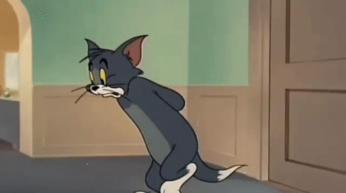

# All Possible Easy Solution with single line code || c++

**Author:** vishal_k78
**Votes:** 2101
**Link:** [https://leetcode.com/problems/contains-duplicate/solutions/2728722/](https://leetcode.com/problems/contains-duplicate/solutions/2728722/)

---

# Try to code by yourself by listing Approach \uD83E\uDD7A.

**Brute Force** : Idea behind code
* Make nested loop , generate all possible pair 
* Put a condition if both of the number generate in a pair are same
In this approach only the unique pair will be formed becouse outerloop is running from 0 to n - 1, and inner loop will start from one value extra from previous loop value ( which make it to run n*(n+1)/2 ) . if we are matching each and every pair of vector , then possibly we can compare if any of them have same value then return true. else at end of nested form loop return false.
```
// Brute Force
class Solution {
public:
    bool containsDuplicate(vector<int>& nums) {
        bool flag = false;
        for(int i =0;i<nums.size();i++){
            for(int j=i+1;j<nums.size();j++){
                if(nums[i] == nums[j]) return true;
            }
        }
        return flag;
    }
};
```
###### Complexity
- Time complexity: $$O((n*(n+1))/2)$$ \u2248 $$O(n^2)$$
- Space complexity: $$O(1)$$
<br/>

**Shorted Approach** : Idea behind code
* sort the array.
* linearly traverse , find if there is any of the number and its greater one are equal or not

```
// Shorted Approach
class Solution {
public:
    bool containsDuplicate(vector<int>& nums) {
        sort(nums.begin(),nums.end());
        bool flag = false;
        for(int i =0;i<nums.size()-1;i++){
            if(nums[i] == nums[i+1]) return true;
        }
        return flag;
    }
};
```
###### Complexity
- Time complexity: $$O(n*log(n))$$
- Space complexity: $$O(1)$$
<br/>

**Set Approach** : Idea behind code
* Set only don't contain duplicate elment .
* If the size of set if less than  the original vector then it contain duplicate element.

* For your set approach, time complexity can be reduced from O(nlogn) to O(n) using an unordered_set. Regular set uses trees with O(logn) insert, but unordered_sets use hashing for O(1). :)
```
// Set Approach
class Solution {
public:
    bool containsDuplicate(vector<int>& nums) {
        return nums.size() > set<int>(nums.begin(),nums.end()).size();
    }
};
```
###### Complexity
- Time complexity: $$O(n*log(n))$$
- Space complexity: $$O(n)$$
<br/>

**Map** : Idea behind code
* traverse vector and count frequency using any data structure.
* Iterate through data structure to find if the frequency is beyond 1.

```
// Contains Duplicate
  class Solution {
  public:
      bool containsDuplicate(vector<int>& nums) {
          map<int,int> mp;
          for(auto i : nums) mp[i]++;
          bool flag = false;
          for(auto i : mp){
              if(i.second >= 2) return true;
          }
          return flag;
      }
  };
```
###### Complexity
- Time complexity: $$O(n*log(n))$$
- Space complexity: $$O(n)$$

**Hashmap** : Idea behind code
* traverse vector and count frequency using any data structure.
* Iterate through data structure to find if the frequency is beyond 1.
* same as above but difference is that it will be in `O(n)`

```
// Contains Duplicate
  class Solution {
  public:
      bool containsDuplicate(vector<int>& nums) {
          unordered_map<int,int> mp;
          for(auto i : nums) mp[i]++;
          bool flag = false;
          for(auto i : mp){
              if(i.second >= 2) return true;
          }
          return flag;
      }
  };
```
###### Complexity
- Time complexity: $$O(n)$$
- Space complexity: $$O(n)$$

**My Opinion**
It depend on situation which Complexity is best for you.

Happy coding, Please do upvote this post.


