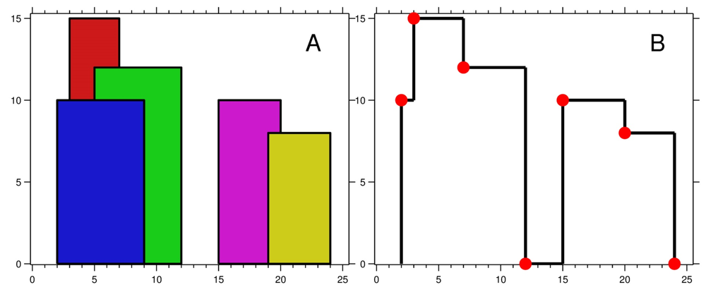

# [C++] Easiest Explanation Ever Guaranteed - Beginner Friendly - Detailed - O(nlogn)

**Author:** t0them00n
**Votes:** 412
**Link:** [https://leetcode.com/problems/the-skyline-problem/solutions/2094329/](https://leetcode.com/problems/the-skyline-problem/solutions/2094329/)

---

This one really broke my back.
Okay, so the question is a bit complicated but fret not, we're gonna take things slowly.


**Input: [ [2,9,10], [3,7,15], [5,12,12], [15,20,10], [19,24,8]]**
**Output: [[2,10], [3,15], [7,12], [12,0], [15,10], [20,8], [24,0]]**

**LET'S GO THROUGH ALL THE POINTS**
1. We're at 0 firstly, our ongoing height is 0 for obvious reasons. 
2. So at 2, the height is 10, great! Height at 2 is greater than our ongoing height 0. We change ongoing height to 10 (and also add 10 to our fallback heights list, I'll explain what it is). 
3. At 3, we get another point with height 15. Now we choose between the ongoing height that was 10 and the new height that's 15. We choose the new height obviously (our ongoing height changed again, we'll add it to fallback list). Now the ongoing height is 15.
4. we arrive at 5 where the height is 12. Ongoing height 15 is still greater than the new point's height 12. So we keep the height as is for now (but 12 is still a height to consider, so add it to fallback list). 
5. Then we arrive at 7, which is the end point for height 15, which means we need a fallback. Our ongoing height will no longer be 15. The fallback is chosen from other heights that we have right now. So we currently have 12 and 10, from green and blue buildings. 12 is the greatest, so 12 becomes our fallback ongoing height. 
6. Then we arrive at 9, end point for height 10 from blue building. So, we cannot consider 10 as our fallback from now, since it just ended, so we'll remove it from our fallback height's list. The ongoing height is still 12. 
7. Now we arrive at 12, this is our end point for the height 12, so we need a fallback height. Welp, there's none since height 10 and 15 ended already. So, take the fallback as 0 and our ongoing height now becomes 0.

**CONCLUSION:**
1. So what did we get? How many times did we change our ongoing height? For 2 height was 10. For 3 height was 15. For 5, we didn't change the height, so 15. For 7 height was 12. For 9, we didn't change the height, so 12. For 12 we changed the height to 0.
2. All the times we changed the height, that was our output: [2, 10], [3, 15], [7, 12], [12, 0]

Getting it now? Yeah? Awesome! No? Read it again ;)

**HOW DOES THE CODE WORK?**
So, since we need to consider all the points, let's create an array named points that will contain all the points and their heights, yeah? What we do here is we pair the starting point and the height but we change height to -ve sign so that the negative sign can help us determine whether the point is starting or ending one.
We'll insert the ending point with positive height in the points array.

Now our array is ready. Let's sort it so that we go through all the points sequentially, just like we did earlier but before that, we know our ongoing height will always start with 0.

Let's go through all the points in points array.
So first check if the height at the current point is negative or positive:
1. If it's negative, we know it's a starting point which means we can add this to our fallback height list in case the ongoing height ends and we have to find another height to fallback on.
2. If it's positive, we know that this height at current point will no longer be a part of our fallback height list, as this point just ended (positive height sign). So we can remove this from our fallback height list.

>**What's this fallback list going to be like?** Glad you asked :D 
>
> Notice how we only pick the maximum height available from our fallback list? 
> 
> Wouldn't priority queue be great for creating such a list where we can access the maximum element easily? Hey, that's not a bad idea. 
>
> But what about when we need to remove a height from our fallback list? Hmm, C++ provides no way to do it easily without increasing the time complexity. That's a problem. 
> So what do we do? The answer is set, multiset specifically. Why multiset? Because in C++, multiset stores elements in increasing order, the last element is always the greatest and also, set in C++ lets us erase elements easily. So we can use multiset like a priority queue, yay! 
> 
> Why multiset and not set though? Simply because there can be multiple buildings with the same height, so we need to consider duplicate heights in our fallback list as ending one height does not mean another same height is not available for fallback. Got it? Great!

Now notice that according to the sign of the current point, we either added it to our fallback list or removed it from our fallback list 'pq'. Which might mean that at the current point, either the height could increase or decrease to fallback but that's only possible when the ongoing height is not the same as the maximum height in fallback list. As ongoing height is the maximum height, it will exist in the fallback list at the same time.

So if after inserting the height at current point in our fallback list, if the fallback list's maximum height has increased in case of height at current point being greater than ongoing height or decreased due to height at current point being the end of ongoing height so fallback is needed, what's gonna happen is we're going to change our ongoing height.
As I said before, whenever ongoing height changes, our answer gets a new entry.
So we do both:
1. Set the ongoing height as the maximum height from the 'pq' multiset. Basically the maximum fallback height available.
2. In the ans array, push currentPoint and the newly updated ongoing height (the new fallback height).

That's it! We're done! Writing this took me a lot of time, so I hope you guys like this :)

Anyway, here's the code:
```cpp
class Solution {
public:
    vector<vector<int>> getSkyline(vector<vector<int>>& buildings) {
        vector<vector<int>> ans;
        multiset<int> pq{0};
        
        vector<pair<int, int>> points;
        
        for(auto b: buildings){
            points.push_back({b[0], -b[2]});
            points.push_back({b[1], b[2]});
        }
        
        sort(points.begin(), points.end());
        
        int ongoingHeight = 0;
        
        // points.first = x coordinate, points.second = height
        for(int i = 0; i < points.size(); i++){
            int currentPoint = points[i].first;
            int heightAtCurrentPoint = points[i].second;
            
            if(heightAtCurrentPoint < 0){
                pq.insert(-heightAtCurrentPoint);
            } else {
                pq.erase(pq.find(heightAtCurrentPoint));
            }
            
            // after inserting/removing heightAtI, if there's a change
            auto pqTop = *pq.rbegin();
            if(ongoingHeight != pqTop){
                ongoingHeight = pqTop;
                ans.push_back({currentPoint, ongoingHeight});
            }
        }
        
        return ans;
    }
};
```