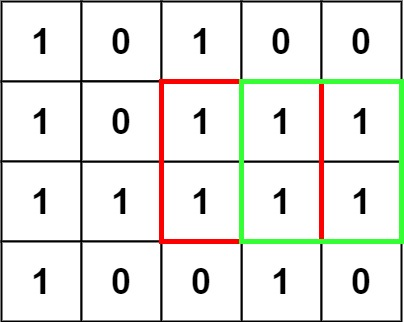
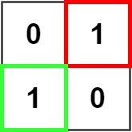

# [221. Maximal Square](https://leetcode.com/problems/maximal-square/)

| Category | Difficulty | Likes | Dislikes |
| :------: | :--------: | :---: | :------: |
| Algorithms | Medium | 10880 | 258 |

**Tags:** [`array`](https://leetcode.com/tag/array), [`dynamic-programming`](https://leetcode.com/tag/dynamic-programming), [`matrix`](https://leetcode.com/tag/matrix)

**Companies:** `google`, `amazon`, `microsoft`, `bloomberg`, `flipkart`, `paypal`, `karat`, `facebook`, `tiktok`, `bytedance`, `salesforce`, `de-shaw`, `phonepe`, `apple`, `oracle`, `citadel`, `adobe`, `bookingcom`, `goldman-sachs`, `nvidia`, `myntra`, `airbnb`

## Description

Given an `m x n` binary `matrix` filled with `0`'s and `1`'s, *find the largest square containing only* `1`'s *and return its area*.

 

**Example 1:**


```

Input: matrix = [[&quot;1&quot;,&quot;0&quot;,&quot;1&quot;,&quot;0&quot;,&quot;0&quot;],[&quot;1&quot;,&quot;0&quot;,&quot;1&quot;,&quot;1&quot;,&quot;1&quot;],[&quot;1&quot;,&quot;1&quot;,&quot;1&quot;,&quot;1&quot;,&quot;1&quot;],[&quot;1&quot;,&quot;0&quot;,&quot;0&quot;,&quot;1&quot;,&quot;0&quot;]]
Output: 4

```

**Example 2:**


```

Input: matrix = [[&quot;0&quot;,&quot;1&quot;],[&quot;1&quot;,&quot;0&quot;]]
Output: 1

```

**Example 3:**

```

Input: matrix = [[&quot;0&quot;]]
Output: 0

```

 

**Constraints:**

	- `m == matrix.length`

	- `n == matrix[i].length`

	- `1 <= m, n <= 300`

	- `matrix[i][j]` is `'0'` or `'1'`.

---

**Links:** [Submissions](https://leetcode.com/problems/maximal-square/) | [Solutions](https://leetcode.com/problems/maximal-square/)
