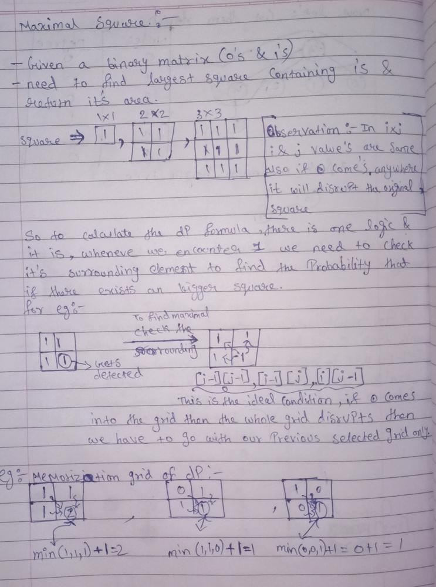

# [C++/JAVA/PYTHON] EASY TO SOLVE || Detailed Explanation of DP with Visualization and dry run

**Author:** Cosmic_Phantom
**Votes:** 92
**Link:** [https://leetcode.com/problems/maximal-square/solutions/1632145/](https://leetcode.com/problems/maximal-square/solutions/1632145/)

---

# **Dynamic Programming || Memoization || Dynamic Doge Memoization**

**Intuition:-**
After reading the question we understood that, we need to find largest square of 1's and return it's area( that will be maxSqr * maxSqr ). Also given that matrix is a binary matrix.
**There are two ways to solve this problem :-**
*  **Our Classical Recursion**
*  **DP**

In this type of questions we believe in supremacy of DP. Since in recursion the TLE error will hunt us. Ok, now let's hunt the hunter .

**Algorithm:-**
1. Let's consider the base case that the size of matrix is 0 . So `return 0`.
2. Let's declare some variables, I always try to declare self-explanatory variables like `maxSqr`[maximal area of square] , `rows`, `column` 
3. Now the dp memorization matrix that we will be making needs to have `1 extra row and column` for the purpose of computing dp of first row and column .
4. Now we need to iterate the whole matrix and once we find a `1` we need to check the surrounding i.e left, uppper and upper left neighbours -> `(dp[i-1][j-1], dp[i-1][j], dp[i][j-1])`
5. After we get the minimum value from neighbours we will be adding 1. You say why , I say we need `"+ 1"` for two reasons:
* If the surrounding 1's are becoming part of our maximal square then we need to increase the maximal size by 1.
* If not then atleast we have our original 1x1 square matrix .
6. Now just find the max from our dp matrix and KABOOM we are done.

**Let's have our Doge run:-**




**Code:-**
**C++:**
```
//Upvote & Comment

class Solution {
public:
    int maximalSquare(vector<vector<char>>& matrix) {
        //base case
        if(matrix.size()==0) return 0;
        //initializing our sentinal variables
        int maxSqr = 0, rows = matrix.size() , column = matrix[0].size();
        //dp matrix that we will be making 
        vector<vector<int>> dp(rows+1,vector<int>(column+1,0));
        
        //Iterate over the matrix
        for(int i=1;i<=rows;++i){
            for(int j=1;j<=column;++j){
                //we found the 1 in our binary matrix 
                if(matrix[i-1][j-1]=='1'){
                    dp[i][j] = min({dp[i-1][j-1], dp[i-1][j], dp[i][j-1]})+ 1;
                    maxSqr=max(maxSqr,dp[i][j]);
                }
            }
        }
        return maxSqr*maxSqr;
    }
};
```

**JAVA:**
*All the logic and variables are same :)*
```
//Upvote & Comment

class Solution {
    public int maximalSquare(char[][] matrix) {
        //initializing sentinal varibles
        int maxSqr=0 , rows=matrix.length , column=matrix[0].length;
        //base case
        if(rows==0) return 0;
        //dp matrix that we will be making
        int[][] dp=new int[rows+1][column+1];
		
        //Iterate over the matrix
        for(int i=1;i<=rows;i++)
            for(int j=1;j<=column;j++) {
                ///we found the 1 in our binary matrix 
                if(matrix[i-1][j-1]=='0') continue;
                dp[i][j]=Math.min(dp[i-1][j],Math.min(dp[i-1][j-1],dp[i][j-1])) + 1;
                maxSqr=Math.max(maxSqr,dp[i][j]);
            }
        return maxSqr*maxSqr;
    }
}
```


**Python:**
*All the logic and variables are same :)*
```
//Upvote & Comment

class Solution:
    def maximalSquare(self, matrix: List[List[str]]) -> int:
        #base case
        if matrix is None or len(matrix) < 1:
            return 0
        #initializing our sentinal variables
        rows = len(matrix)
        cols = len(matrix[0])
        maxSqr = 0
        #dp matrix that we will be making 
        dp = [[0]*(cols+1) for _ in range(rows+1)]
        
        #Iterate over the matrix
        for i in range(rows):
            for j in range(cols):
                #we found the 1 in our binary matrix 
                if matrix[i][j] == '1':
                    dp[i+1][j+1] = min(dp[i][j], dp[i+1][j], dp[i][j+1]) + 1 
                    maxSqr = max(maxSqr, dp[i+1][j+1])
                
        return maxSqr * maxSqr
```


**Time complexity : O(mn). [Single pass i.e rows x column]
Space complexity : O(mn). [Additional space for dp grid].**

