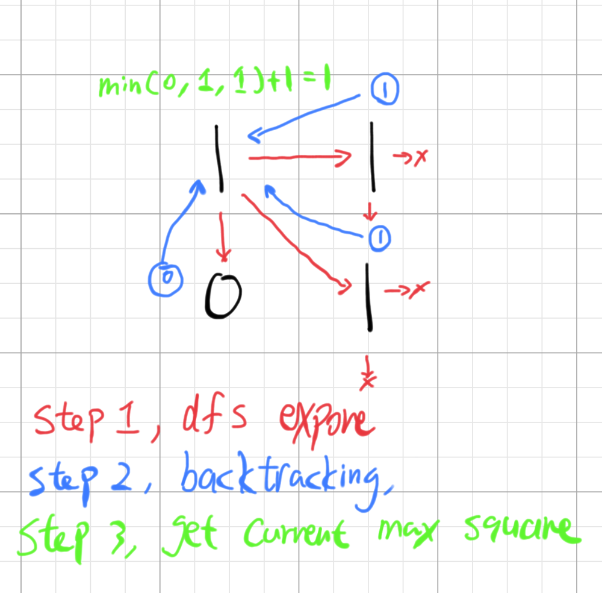
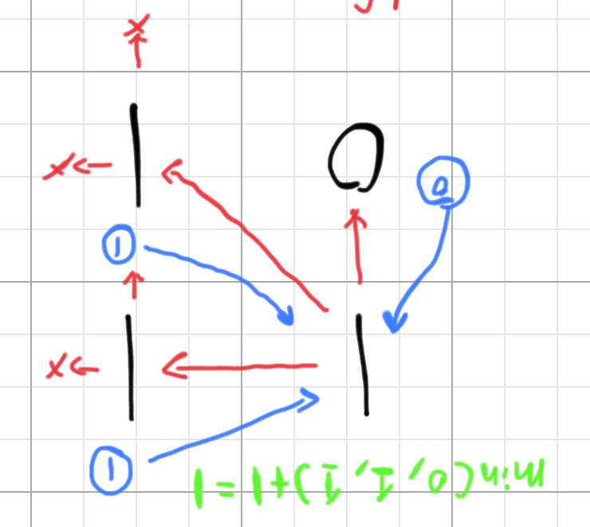

# 💡JavaScript Solution | Some thoughts on breaking down DP problems

**Author:** AminiCK
**Votes:** 28
**Link:** [https://leetcode.com/problems/maximal-square/solutions/458717/](https://leetcode.com/problems/maximal-square/solutions/458717/)

---

### The idea
We have seen many problems that are solved using the magic "dp matrix", but most of the explanations don't quite explain what's the intuition behind it all. After all, Dynamic programming is mostly a tool that serves to optimize recursions for better time complexity, and it is oftern called the bottom-up approach where recursion is called the top-down approach. But what does it mean by "bottom-up" and "top-down"? I will share my intuition on breaking down this particular dp problem, but I think the methodology can be shared with almost all dp problems.
1. Lets think of the recursive(top-down) apporach of this problem, the first thing comes to my mind is a dfs seach that explores from one number to the others. We can define `dfs(r, c)` and it should return the maximum square for a given row and column. Below is a very simple sample where we start the dfs from (0,0).

We see that the at (0,0), the result is 1, and it's mainly because of the 0 gives it a constraint. We can do this for every number and find the maximum square.

2. If you can understand the recursion apporach, you should automatically understand the dp because you already kind of did it. If I rotate the graph by 180 degree:

Everything is exactly the same, except here, the original dfs(red), now becomes a simple up, left, diagonal check.
The original backtracking(blue), now becomes the value for the cell. And the calculation is still the same. We are literally doing "bottom-up" work. We are building the result from the ground up.

*please let me know if any of  these doesn't make sense or possibly wrong! this is purely my own intuition.

### Solution here
``` javascript
var maximalSquare = function(matrix) {
    if (!matrix.length) return 0;
    let dp = new Array(matrix.length+1).fill(0).map(()=>new Array(matrix[0].length+1).fill(0));
    let max = 0;
    for (let r=1;r<dp.length;r++) { 
        for (let c=1;c<dp[0].length;c++) {
            if (matrix[r-1][c-1]!=0) {
                dp[r][c] = Math.min(dp[r][c-1], dp[r-1][c], dp[r-1][c-1])+1;
                max = Math.max(dp[r][c], max);
            }
        }
    }
    return max**2;
};
```