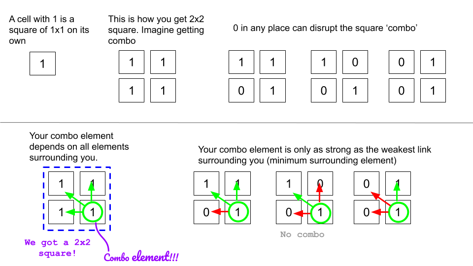
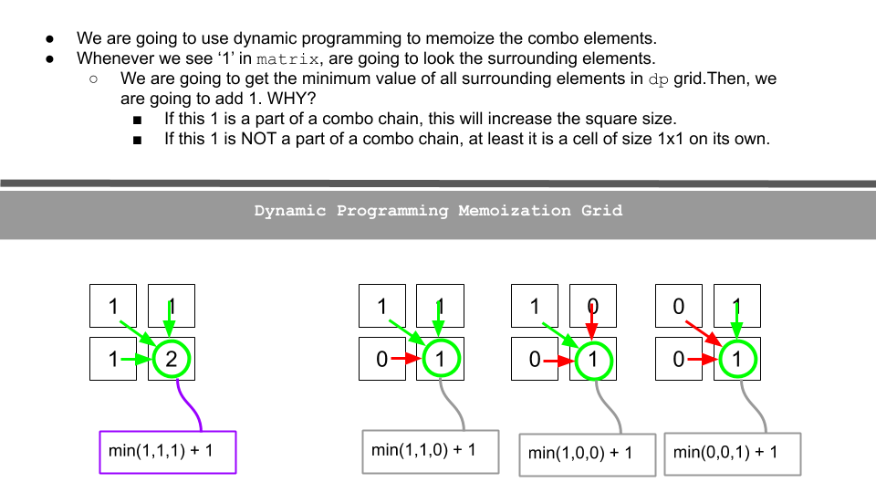
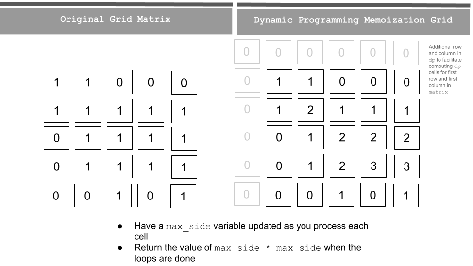

# [Python] Thinking Process Diagrams - DP Approach

**Author:** arkaung
**Votes:** 1880
**Link:** [https://leetcode.com/problems/maximal-square/solutions/600149/](https://leetcode.com/problems/maximal-square/solutions/600149/)

---

**Understanding basics**


* Here I want to mention that we are drawing squares from top left corner to bottom right corner. Therefore, when I mention, "surrounding elements", I am saying cells above the corner cell and the cells on the left of the corner cell.

**Building DP grid to memoize**
* We are going to create a `dp` grid with initial values of 0.
* We are going to update `dp` as described in the following figure. 



**Bigger Example**
* Let's try to see a bigger example.
* We go over one cell at a time row by row in the `matrix` and then update our `dp` grid accordingly. 
* Update `max_side` with the maximum `dp` cell value as you update.




In the code, I create a `dp` grid which has one additional column and one additional row. The reason is to facilitate the index dp[r-1][c] dp[r][c-1] and dp[r-1][c-1] for cells in first row and first column in `matrix`.

``` python
class Solution:
    def maximalSquare(self, matrix: List[List[str]]) -> int:
        if matrix is None or len(matrix) < 1:
            return 0
        
        rows = len(matrix)
        cols = len(matrix[0])
        
        dp = [[0]*(cols+1) for _ in range(rows+1)]
        max_side = 0
        
        for r in range(rows):
            for c in range(cols):
                if matrix[r][c] == '1':
                    dp[r+1][c+1] = min(dp[r][c], dp[r+1][c], dp[r][c+1]) + 1 # Be careful of the indexing since dp grid has additional row and column
                    max_side = max(max_side, dp[r+1][c+1])
                
        return max_side * max_side
                
```

**Complexity Analysis**

Time complexity : `O(mn)`. Single pass - `row x col (m=row; n=col)`
Space complexity : `O(mn)`. Additional space for `dp` grid (don't need to worry about additional 1 row and col).

**Follow up**
Space can be optimized as we don't need to keep the whole `dp` grid as we progress down the rows in `matrix`.

Aren't Dynamic Programming problems much like this joke? :D


