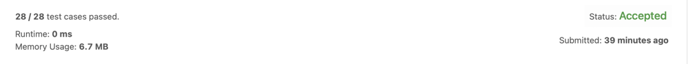

# [C++]| Detailed Explanation w/ DRY RUN | Faster than 100%| Basic Concept Used

**Author:** aryanttripathi
**Votes:** 291
**Link:** [https://leetcode.com/problems/summary-ranges/solutions/1805583/](https://leetcode.com/problems/summary-ranges/solutions/1805583/)

---

***Brief note about Question-***
* We have to *return the smallest sorted list of ranges that cover all the numbers in the array exactly.*
```
Let's take an example not given in question -
Suppose array given to us is like, arr[]: [0,1,2,3,4,6,7,8,10,11,12,14]

Array given to us is arr[]:  [0, 1, 2, 3, 4, 6, 7, 8, 10, 11, 12, 14]
Ideally it should look like: [0, 1, 2, 3, 4, 5, 6, 7, 8, 9, 10, 11, 12, 13, 14]

If we see then in our given array 5, 9, and 13 is not present.
So this breaks our continuation
so our answer should be ["0->4","6->8","10->12","14"]

First from      "0->4", 5 is not their so it breaks our range 
then again from "6->8", 9 is not their so it breaks our range
then again from "10->12", 13 is not their so it breaks our range
and lastly left "14", as it remain alone so we include it, like me, sad life :)
```
____________
***Solution - I (Using Normal Maths, Accepted)-***
* If we observe our question, then what is the first basic thing we can do.
* We simply say, we run a loop in the array and when it differs from our expected number we break the loop and store it in answer as the main advanatage given to us is *array is in already sorted form*.
* After that we shift to our next element and again start doing that.
* Let's see some in more detailed way.
```
Suppose array given to us is like, arr[]: [0,1,2,3,4,6,7,8,10,11,12,14]

arr[]: [0, 1, 2, 3, 4, 6, 7, 8, 10, 11, 12, 14]
        \u2191  (intially we stand on our zeroth element)
		Now, what we want to be our next element, we say it should be 1
		so we will check our next element, and yes it is 1,
		so we move ahead without breaking our current range 
		
arr[]: [0, 1, 2, 3, 4, 6, 7, 8, 10, 11, 12, 14]
           \u2191  (now, we stand on our first element)
		Now, what we want to be our next element, we say it should be 2
		so we will check our next element, and yes it is 2,
		so we move ahead without breaking our current range 
		
arr[]: [0, 1, 2, 3, 4, 6, 7, 8, 10, 11, 12, 14]
              \u2191  (now, we stand on our second element)
		Now, what we want to be our next element, we say it should be 3
		so we will check our next element, and yes it is 3,
		so we move ahead without breaking our current range
		
arr[]: [0, 1, 2, 3, 4, 6, 7, 8, 10, 11, 12, 14]
                 \u2191  (now, we stand on our third element)
		Now, what we want to be our next element, we say it should be 4
		so we will check our next element, and yes it is 4,
		so we move ahead without breaking our current range
		
arr[]: [0, 1, 2, 3, 4, 6, 7, 8, 10, 11, 12, 14]
                    \u2191  (now, we stand on our fourth element)
		Now, what we want to be our next element, we say it should be 5
		But here our next element is not 5, it is 6
		so, our current range breaks here and 
		we store this particular range into our answer i.e "0->4" and move head
		
arr[]: [0, 1, 2, 3, 4, 6, 7, 8, 10, 11, 12, 14]
                       \u2191  (now, we stand on our fifth element and will do a fresh start from here)
		Now, what we want to be our next element, we say it should be 7
		so we will check our next element, and yes it is 7,
		so we move ahead without breaking our current range
		
arr[]: [0, 1, 2, 3, 4, 6, 7, 8, 10, 11, 12, 14]
                          \u2191  (now, we stand on our sixth element)
		Now, what we want to be our next element, we say it should be 8
		so we will check our next element, and yes it is 8,
		so we move ahead without breaking our current range
		
arr[]: [0, 1, 2, 3, 4, 6, 7, 8, 10, 11, 12, 14]
                             \u2191  (now, we stand on our seventh element)
		Now, what we want to be our next element, we say it should be 9
		But here our next element is 10, it is not 9
		so, our current range breaks here and 
		we store this particular range into our answer i.e "6->8" and move head
		
arr[]: [0, 1, 2, 3, 4, 6, 7, 8, 10, 11, 12, 14]
                                 \u2191 (now, we stand on our eighth element and will do a fresh start from here)
		Now, what we want to be our next element, we say it should be 11
		so we will check our next element, and yes it is 11,
		so we move ahead without breaking our current range
		
arr[]: [0, 1, 2, 3, 4, 6, 7, 8, 10, 11, 12, 14]
                                     \u2191 (now, we stand on our ninth element )
		Now, what we want to be our next element, we say it should be 12
		so we will check our next element, and yes it is 12,
		so we move ahead without breaking our current range
		
arr[]: [0, 1, 2, 3, 4, 6, 7, 8, 10, 11, 12, 14]
                                         \u2191 (now, we stand on our tenth element)
		Now, what we want to be our next element, we say it should be 13
		But here our next element is 14, it is not 13
		so, our current range breaks here and 
		we store this particular range into our answer i.e "10->12" and move head
		
arr[]: [0, 1, 2, 3, 4, 6, 7, 8, 10, 11, 12, 14]
                                             \u2191
											 And lastly only one element is left
											 so simply we push it into our answer i.e "14"
											 
So, Our final answer array looks like ["0->4","6->8","10->12","14"]
```
______________
```
Time Complexity --> O(n) // where n is the length of the array 
Space Complexity --> O(1) // we are not using anything extra from our side
//also, we are not considering answer array, as we have to return that, we only push our answers to that

It paases [ 28 / 28 ] in built test cases
```
_________________

_______________
**Code (C++)**
```
class Solution {
public:
    vector<string> summaryRanges(vector<int>& arr) {
        int n = arr.size(); // extracting size of the array
        vector<string> ans; // declaring answer array to store our answer
        
        string temp = ""; // temproray string that stores all possible answer
        
        for(int i = 0; i < n; i++) // start traversing from the array
        {
            int j = i; // declare anthor pointer that will move
            
            // run that pointer until our range is not break
            while(j + 1 < n && arr[j + 1] == arr[j] + 1)
            {
                j++;
            }
            
            // if j > i, that means we got our range more than one element
            if(j > i)
            {
                temp += to_string(arr[i]); // first store starting point
                temp += "->"; // then store arrow, as question wants it
                temp += to_string(arr[j]); // and lastly store the end point
            }
            else // we got only one element as range
            {
                temp += to_string(arr[i]); // then store that element in temp
            }
            
            ans.push_back(temp); // push one possible answer string to our answer
            temp = ""; // again reintiliaze temp for new possible answers
            i = j; // and move i to j for a fresh start
        }
        
        return ans; // and at last finally return the answer array
    }
};
```
***`If u find this useful , please consider to give a upvote!!`***