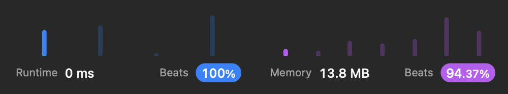

# ✅ O(n) Beats 100% Runtime | 94% Memory | Clean Solution

**Author:** eleev
**Votes:** 3
**Link:** [https://leetcode.com/problems/summary-ranges/solutions/3627193/](https://leetcode.com/problems/summary-ranges/solutions/3627193/)

---

[]()


# Approach
The `summaryRanges(_:) `function is designed to process a sorted integer array, and produce an array of strings that succinctly describe contiguous ranges of numbers present in the input array. The method works by iterating over the input array, maintaining a current range, and extending it if the next number is consecutive to the current one.

A nested helper function `resolve()` is employed, which generates a string representation of the current range and appends it to the result. This string is a single number if the range represents a single value, otherwise it's in the `start->end` format.

During iteration, for each number, if it's a consecutive increment of the previous one, the current range is extended to include it. If it's not consecutive, the current range is finalized by invoking `resolve()`, then a new range starting with this number is initiated.

Once all numbers have been processed, `resolve()` is called once more to ensure the final range is included in the output. Therefore, if the input array is ***[0, 1, 2, 4, 5, 7]***, the function will output ***["0->2", "4->5", "7"]***.

This approach offers an efficient and clean solution to the problem of summarizing numerical ranges in a sorted array. It leverages **Swift's** powerful language features such as `structs`, `custom string descriptions`, and `function inlining` to optimize performance.

# Time Complexity
**O(n)**
The function iterates through the input array exactly once, so the time complexity is linear with respect to the size of the input array, where n is the number of elements in the input array.

# Space complexity
**O(n)**
The function uses an auxiliary array ranges to store the output strings. In the worst-case scenario where no consecutive numbers exist in the array, every number would become a single range, resulting in the size of ranges being the same as the input array. Hence, the space complexity is also linear with respect to the size of the input array.

# Solution
```swift
final class Solution {
    /// This structure holds the range of numbers, with left and right representing the start and end of the range respectively. It also includes helper computed properties to convert left and right to strings, and to format the string representation of the range. The assign(_:) function is used to reset the left and right values to a new number.
    struct NumRange: CustomStringConvertible {
        var left: Int
        var right: Int

        var sleft: String { "\\(left)" }
        var sright: String { "\\(right)" }
        var description: String { sleft + "->" + sright }

        mutating func assign(_ val: Int) {
            left = val
            right = val
        }
    }

    @inline(__always)
    func summaryRanges(_ nums: [Int]) -> [String] {
        guard !nums.isEmpty else { return [] }
        var ranges = [String]()
        // Keep track of the current range 
        var range = NumRange(left: nums[0], right: nums[0])

        // This function is used to generate the string representation of the current range and add it to the ranges array. If left and right of the range are the same, it simply adds the string representation of left, otherwise it adds the range in the left->right format.
        @inline(__always)
        func resolve() {
            ranges += [range.left == range.right ? range.sleft : range.description]
        }

        // Iterate over the input array from the second element onwards
        for num in nums[1...] {
            // For each number, it check if it's a consecutive number of the previous number by comparing it with right + 1 of the range. If it's consecutive, it extends the current range by setting right to this number. If it's not consecutive, it means the current range has ended, so it calls resolve() to add the current range to ranges and resets range to the new number.
            if range.right + 1 == num {
                range.right = num
            } else {
                resolve()
                range.assign(num)
            }
        }
        // Call resolve() one more time to ensure the last range is added to ranges.
        resolve()

        return ranges
    }
}
```