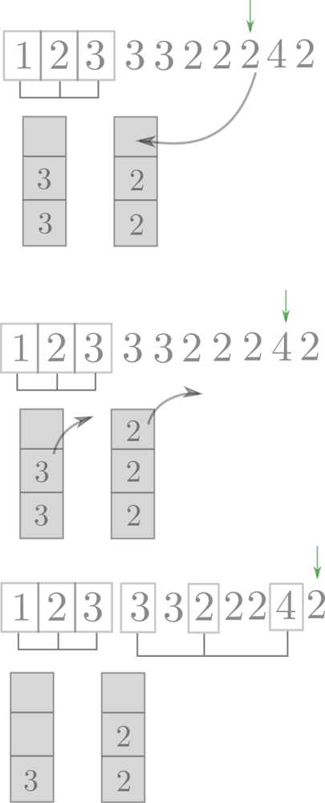
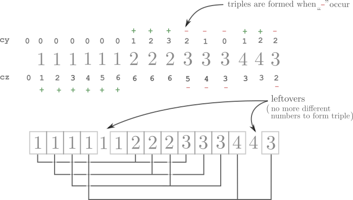

# 🚩 Boyer–Moore majority vote algorithm EXPLAINED ^^

**Author:** andrii_khlevniuk
**Votes:** 720
**Link:** [https://leetcode.com/problems/majority-element-ii/solutions/543672/](https://leetcode.com/problems/majority-element-ii/solutions/543672/)

---

**Solution: Boyer\u2013Moore majority vote algorithm `O(N), O(1)`**

I've read a few explanations of this algorithm, but I feel a need for a more detailed talk. Here's my take on this algorithm, hope it will help somebody.
```
class Solution {
public:
  vector<int> majorityElement(vector<int> &a) 
  {
	  int y(-1), z(-1), cy(0), cz(0);
    
	  for (const auto & x: a) 
	  {
		  if (x == y) cy++;
		  else if (x == z) cz++;
		  else if (! cy) y = x, cy = 1;
		  else if (! cz) z = x, cz = 1;
		  else cy--, cz--;
     }
      
     cy = cz = 0;
     for (const auto & x: a)
		 if (x == y) cy++;
			 else if (x == z) cz++;
  
	  vector<int> r;
	  if (cy > size(a)/3) r.push_back(y);
	  if (cz > size(a)/3) r.push_back(z);
	  return r;
  }
};
```
This is a two-pass algorithm: the first pass chooses two candidates, the second pass either confirms or rejects each of them.

## Explanation: Forming triples

\u261D Before we start you may want to get a feeling of Boyer\u2013Moore `\u230A n/2 \u230B` majority vote algorithm (explanation [here](https://leetcode.com/problems/majority-element/discuss/543431/Majority-vote-algorithm-EXPLAINED-(with-pictures))).

The main point of this algorithm is to form triples of **different** numbers like these `(1,2,3)`, `(1,3,4)`: the leftovers after this triple-forming procedure will be our majority candidates. Two different triples may coinside (e.g. `(1,2,3)`, `(1,2,3)`). These triples are formed under the hood and never articulated, so it's a bit hard to see them at first. These triples are produced when the two counters are decreased (in the ultimate `else` section where `--` occur). Let me elaborate on how this is done exactly and then I'll explain what do we need those triples for.

##### How to form triples of different elements

If our vector consisted of different elements triples production would be easy: we would traverse the array and form triples out of 3 consecutive elements.


When we have duplicates we have an excess of some elements and we can't use them unless we encounter some fresh elements.
In order to remember what elements we had an excess of we can use a stack (two stacks in fact.). I hope these two pictures will clarify the process.




Note that we should put into stack the elements of only one kind. The triple is formed when we simultaniously pop two different elements from our staches and take current element from the array. If current element equals elements in one of the stacks we can't form a proper triple and push current element into the respective stack.

The next observation is that we don't need all these stacks as they contain identical elements and we can substitute them with two variables `y` and `z` and their counters `cy ` and `cz`.
Let's take a look how triples are formed in this process


Here the following triples are formed: `(1, 2, 3), (1, 2, 3), (1, 2, 3), (1, 4, 3) `.  Note that "`-`"'s occur simultanuosly for the two counters but "`+`"'s occur to only one of them. Also every step leads to either "`+`" or "`-`". "`+`" means that we were unable to form a triple because we didn't have enough different elements at our disposal when the current element matched with one of the two types of stashed elements and we need to stash this element as well for the future.

##### Why do we need triples ?
Why do we partition the elements into triples with different elements in each triple? It's because the leftovers after this procedure are the candidates for the majority elements. There will be elements of only two types in the leftovers (otherwise we could make a triple of them). Note that triples contain only different elements and there could be no more than   `\u230A n/3 \u230B` of them. So even if majority element would appear in every one of `\u230A n/3 \u230B` triples there will be leftover of it. That's why majority elements (if present) are guaranted to be among the leftovers.

UPD. Thanks for all the nice words in the comments :)
