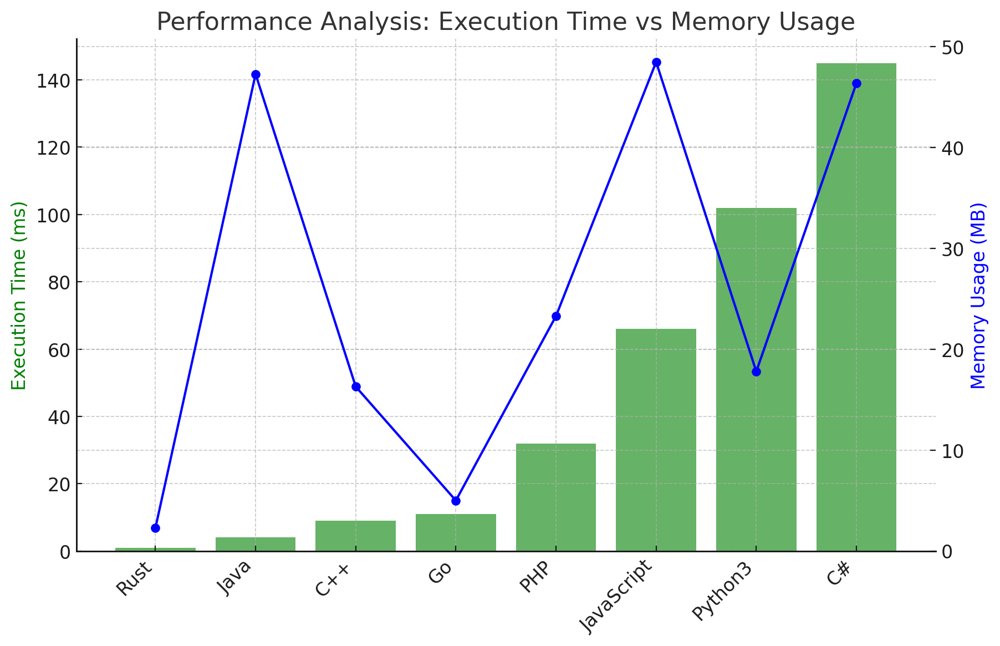

# ✅ 92.99% Boyer-Moore Voting Algorithm

**Author:** vanAmsen
**Votes:** 53
**Link:** [https://leetcode.com/problems/majority-element-ii/solutions/4131138/](https://leetcode.com/problems/majority-element-ii/solutions/4131138/)

---

# Intuition
When faced with the problem of finding elements that appear more than $$ \\left\\lfloor \\frac{n}{3} \\right\\rfloor $$ times, our initial thought may lean towards using a hash map to count the occurrences of each element. However, the problem challenges us to think beyond this obvious solution, specifically hinting at a linear time and O(1) space complexity solution.

The Boyer-Moore Voting Algorithm, which efficiently finds a majority element in an array, can be extended to this problem. At most, only two numbers can appear more than $$ \\left\\lfloor \\frac{n}{3} \\right\\rfloor $$ times. Keeping this fact in mind can guide our approach.

## Live Coding & Explain
https://youtu.be/j30EwQrrnUk?si=j9kDquWuj_UOd5Ay

# Approach
1. **Initialization**: We initiate two candidate variables and their respective counters. These candidates will represent potential elements that could appear more than $$ \\left\\lfloor \\frac{n}{3} \\right\\rfloor $$ times.
   
2. **Voting Mechanism**: As we traverse through the array:
   - If we find a number equal to either of our candidates, we increment the respective counter.
   - If one of the counters is zero, we replace the respective candidate with the current number and reset the counter.
   - If the current number doesn't match either candidate, both counters are decremented.
   
3. **Verification**: The two candidates selected might not actually be numbers that appear more than $$ \\left\\lfloor \\frac{n}{3} \\right\\rfloor $$ times. So, we need to traverse the array again to count and verify their occurrences.

# Why It Works?
The Boyer-Moore Voting Algorithm leverages the fact that any number that appears more than $$ \\left\\lfloor \\frac{n}{k} \\right\\rfloor $$ times will have at most $$ k-1 $$ such numbers. By generalizing the algorithm to maintain two candidates and counters, we can handle the $$ k=3 $$ case for this problem. The decrementing of counters ensures that if a number truly appears more than $$ \\left\\lfloor \\frac{n}{3} \\right\\rfloor $$ times, it will survive till the end.

# What We Have Learned?
This problem teaches us the power of algorithm generalization and thinking beyond straightforward hash map solutions. The Boyer-Moore Voting Algorithm's extension showcases the importance of understanding underlying principles and insights of algorithms, enabling us to apply them in varied scenarios.

# Complexity
- **Time complexity**: $$O(n)$$. We go through the list thrice: once for voting and twice for counting.
- **Space complexity**: $$O(1)$$. Only a constant amount of extra space is used, irrespective of the input size.


# Code
``` Python []
class Solution:
    def majorityElement(self, nums: List[int]) -> List[int]:
        if not nums:
            return []
        
        candidate1, candidate2, count1, count2 = 0, 1, 0, 0
        
        for num in nums:
            if num == candidate1:
                count1 += 1
            elif num == candidate2:
                count2 += 1
            elif count1 == 0:
                candidate1, count1 = num, 1
            elif count2 == 0:
                candidate2, count2 = num, 1
            else:
                count1 -= 1
                count2 -= 1
        
        return [num for num in (candidate1, candidate2) if nums.count(num) > len(nums) // 3]

```
``` Go []
func majorityElement(nums []int) []int {
    var candidate1, candidate2, count1, count2 int = 0, 1, 0, 0
    
    for _, num := range nums {
        if num == candidate1 {
            count1++
        } else if num == candidate2 {
            count2++
        } else if count1 == 0 {
            candidate1 = num
            count1 = 1
        } else if count2 == 0 {
            candidate2 = num
            count2 = 1
        } else {
            count1--
            count2--
        }
    }

    count1, count2 = 0, 0
    for _, num := range nums {
        if num == candidate1 {
            count1++
        } else if num == candidate2 {
            count2++
        }
    }

    var result []int
    if count1 > len(nums)/3 {
        result = append(result, candidate1)
    }
    if count2 > len(nums)/3 {
        result = append(result, candidate2)
    }
    return result
}
```
``` Rust []
impl Solution {
    pub fn majority_element(nums: Vec<i32>) -> Vec<i32> {
        let (mut candidate1, mut candidate2, mut count1, mut count2) = (0, 1, 0, 0);
        for &num in &nums {
            if num == candidate1 {
                count1 += 1;
            } else if num == candidate2 {
                count2 += 1;
            } else if count1 == 0 {
                candidate1 = num;
                count1 = 1;
            } else if count2 == 0 {
                candidate2 = num;
                count2 = 1;
            } else {
                count1 -= 1;
                count2 -= 1;
            }
        }

        let mut result = Vec::new();
        if nums.iter().filter(|&&x| x == candidate1).count() > nums.len() / 3 {
            result.push(candidate1);
        }
        if nums.iter().filter(|&&x| x == candidate2).count() > nums.len() / 3 {
            result.push(candidate2);
        }
        result
    }
}
```
``` C++ []
class Solution {
public:
    std::vector<int> majorityElement(std::vector<int>& nums) {
        int candidate1 = 0, candidate2 = 1, count1 = 0, count2 = 0;
        for (int num : nums) {
            if (num == candidate1) {
                count1++;
            } else if (num == candidate2) {
                count2++;
            } else if (count1 == 0) {
                candidate1 = num;
                count1 = 1;
            } else if (count2 == 0) {
                candidate2 = num;
                count2 = 1;
            } else {
                count1--;
                count2--;
            }
        }
        
        std::vector<int> result;
        if (std::count(nums.begin(), nums.end(), candidate1) > nums.size() / 3) result.push_back(candidate1);
        if (std::count(nums.begin(), nums.end(), candidate2) > nums.size() / 3) result.push_back(candidate2);
        return result;
    }
};
```
``` Java []
import java.util.*;

public class Solution {
    public List<Integer> majorityElement(int[] nums) {
        Integer candidate1 = null, candidate2 = null;
        int count1 = 0, count2 = 0;
        for (int num : nums) {
            if (candidate1 != null && num == candidate1.intValue()) {
                count1++;
            } else if (candidate2 != null && num == candidate2.intValue()) {
                count2++;
            } else if (count1 == 0) {
                candidate1 = num;
                count1 = 1;
            } else if (count2 == 0) {
                candidate2 = num;
                count2 = 1;
            } else {
                count1--;
                count2--;
            }
        }

        count1 = 0;
        count2 = 0;
        for (int num : nums) {
            if (candidate1 != null && num == candidate1.intValue()) {
                count1++;
            } 
            if (candidate2 != null && num == candidate2.intValue()) {
                count2++;
            }
        }

        List<Integer> result = new ArrayList<>();
        if (count1 > nums.length / 3) result.add(candidate1);
        if (count2 > nums.length / 3) result.add(candidate2);
        return result;
    }
}
```
``` JavaScript []
var majorityElement = function(nums) {
    let candidate1 = 0, candidate2 = 1, count1 = 0, count2 = 0;

    for (let num of nums) {
        if (num === candidate1) {
            count1++;
        } else if (num === candidate2) {
            count2++;
        } else if (count1 === 0) {
            candidate1 = num;
            count1 = 1;
        } else if (count2 === 0) {
            candidate2 = num;
            count2 = 1;
        } else {
            count1--;
            count2--;
        }
    }

    let result = [];
    if (nums.filter(n => n === candidate1).length > nums.length / 3) result.push(candidate1);
    if (nums.filter(n => n === candidate2).length > nums.length / 3) result.push(candidate2);
    return result;
};
```
``` PHP []
class Solution {

    function majorityElement($nums) {
        $candidate1 = 0;
        $candidate2 = 1;
        $count1 = 0;
        $count2 = 0;

        foreach ($nums as $num) {
            if ($num == $candidate1) {
                $count1++;
            } elseif ($num == $candidate2) {
                $count2++;
            } elseif ($count1 == 0) {
                $candidate1 = $num;
                $count1 = 1;
            } elseif ($count2 == 0) {
                $candidate2 = $num;
                $count2 = 1;
            } else {
                $count1--;
                $count2--;
            }
        }

        $result = [];
        if (count(array_filter($nums, function($n) use ($candidate1) { return $n == $candidate1; })) > count($nums) / 3) {
            $result[] = $candidate1;
        }
        if (count(array_filter($nums, function($n) use ($candidate2) { return $n == $candidate2; })) > count($nums) / 3) {
            $result[] = $candidate2;
        }
        return $result;
    }
}
```
``` C# []
public class Solution {
    public IList<int> MajorityElement(int[] nums) {
        int? candidate1 = null, candidate2 = null, count1 = 0, count2 = 0;
        foreach (int num in nums) {
            if (candidate1.HasValue && num == candidate1) {
                count1++;
            } else if (candidate2.HasValue && num == candidate2) {
                count2++;
            } else if (count1 == 0) {
                candidate1 = num;
                count1 = 1;
            } else if (count2 == 0) {
                candidate2 = num;
                count2 = 1;
            } else {
                count1--;
                count2--;
            }
        }
        
        var result = new List<int>();
        if (nums.Count(n => n == candidate1) > nums.Length / 3) result.Add(candidate1.Value);
        if (nums.Count(n => n == candidate2) > nums.Length / 3) result.Add(candidate2.Value);
        return result;
    }
}
```

## Performance
| Language   | Execution Time (ms) | Memory Usage   |
|------------|---------------------|----------------|
| Rust       | 1                   | 2.3 MB         |
| Java       | 4                   | 47.3 MB        |
| C++        | 9                   | 16.3 MB        |
| Go         | 11                  | 5 MB           |
| PHP        | 32                  | 23.3 MB        |
| JavaScript | 66                  | 48.5 MB        |
| Python3    | 102                 | 17.8 MB        |
| C#         | 145                 | 46.4 MB        |



