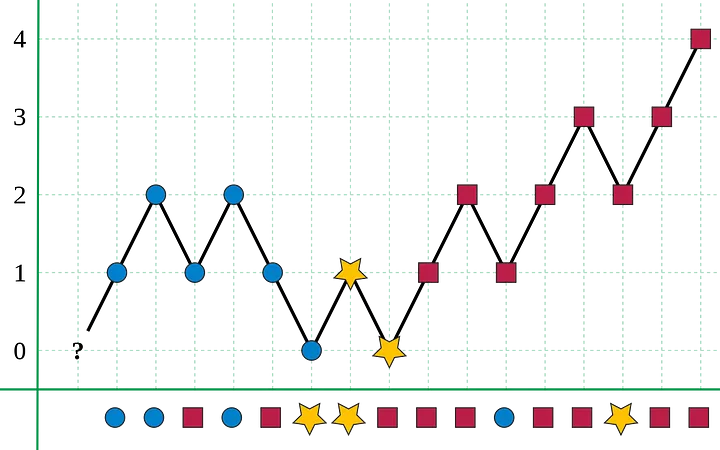

# 🚀 99.7% || HashMap & Boyer-Moore Majority Voting || Explained Intuition 🚀

**Author:** MohamedMamdouh20
**Votes:** 484
**Link:** [https://leetcode.com/problems/majority-element-ii/solutions/4131226/](https://leetcode.com/problems/majority-element-ii/solutions/4131226/)

---

# Problem Description
The problem is to **identify** elements in an integer array, `nums`, of size `n`, that appear more than `\u230An/3\u230B` times and **return** them as an output.

- **Constraints:**
    - `1 <= nums.length <= 5 * 10e4`
    - `-10e9 <= nums[i] <= 10e9`

Seems Easy! \uD83D\uDE03

---


# Intuition

Hi there everyone \uD83D\uDE03,

Let's see our today interesting problem, We are required to return the number that has appeared **more** than `\u230An/3\u230B` times in our array.\uD83E\uDD14
Seems Interesting.\uD83E\uDD29

We know that we need something here, **count** the number of **occurencies** and **store** them somewhere and then return the required elements.\uD83D\uDE03

It's a job for **HASHMAPS** !!\uD83E\uDDB8\u200D\u2642\uFE0F\uD83E\uDDB8\u200D\u2642\uFE0F
Our hero today is the `HashMap` since, we can **store** the number of occurencies for each unique element and then return the elements that have appeared more than `\u230An/3\u230B` times.\uD83D\uDE80\uD83D\uDE80

It is an easy solution. Can we do better ?\uD83E\uDD14
Actually, We can \uD83E\uDD2F\uD83E\uDD2F
There is an interesting observation we want to look at.\uD83D\uDC40

```
EX1 : Array = [1, 2, 2, 4, 4, 4]
Answer  = [4]
```
```
EX2 : Array = [1, 2, 2, 2, 4, 4, 4]
Answer  = [2, 4]
```
```
EX3 : Array = [1, 1, 2, 2, 2, 4, 4, 4]
Answer  = [2, 4]
```
```
EX4 : Array = [1, 1, 1, 2, 2, 2, 4, 4, 4]
Answer  = []
```

I think we have something here.\uD83E\uDD14
Since we are required to return elements that appeared more than `\u230An/3\u230B` times then we have atmost **two elements** that we can return.\uD83D\uDCAA

But how two elements ???\uD83E\uDD2F\uD83E\uDD2F\uD83E\uDD2F\uD83E\uDD2F
Since we want to return elements that appeared more than `\u230An/3\u230B` times then atleast it must have appeared `\u230An/3\u230B + 1` times.
`\u230An/3\u230B + 1` is greater than the **third** of the array so 
```
`\u230An/3\u230B + 1` * 3 > array size
```
So, it is impossible to return more than two elements.\uD83D\uDE14

How can we **utilize** a great observation like this?\uD83E\uDD14
Instead of **storing** the occurencies of all elements, We can only **track** the **two highest elements** that have appeared in our array and return them!\uD83E\uDD29
And there is algorithm for that. It is called **Boyer-Moore Majority Voting Algorithm**.

This algorithm can be used to return the highest `K` elements that appeared in the array more than `array_size/(K+1)` times. In our case, `K = 2`.

- The major **Intuition** behind this algorithm is that **maintaining** voting variable for the **candidates**:
    - **Increase** the variable if you faced the candidate in your iteration.
    - **Decrease** the variable if you faced another element.
    - If the variable reaches `0`, look for **another** promising candidate.

Why this work?\uD83E\uDD14
Assume we are searching for the element that appeared **more** than `array_size / 2` times, then we are sure that the voting variable can has value `array_size / 2 + 1` and if we **decreased** it for all other elements in the array it will also stay **positive** enough to tell us the **desired** candidate.

This is small image illustrating the algorithm for `K=1` and the major element is the red square.




And this is the solution for our today problem I hope that you understood it\uD83D\uDE80\uD83D\uDE80


---


# Proposed Approaches
## 1. HashMap Solution
1. **Create** an `HashMap` to store the **count** of each element.
2. **Iterate** through the input array and **increment** the **count** for each element in the `HashMap`.
3. **Create** a vector to store the result and **Calculate** the `threshold` count (1/3 of the array size).
5. **Iterate** through the `HashMap` and for each element:
    - Check if the **element count** is **greater** than the `threshold`.
    - If **yes**, **add** the element to the result vector.
6. **Return** the **vector** containing the identified majority elements.


## Complexity
- **Time complexity:** $$O(N)$$
Since we are **iterating** over the array then it's a **linear** complexity and we are **iterating** over the `HashMap` that also can be **linear** complexity, then the total complexity is `2 * N` which is `O(N)`
- **Space complexity:** $$O(N)$$
Since we are storing the **count** of occurencies for each **unique** element in the nums array and the array's elements can **all** be unique then it is **linear** complexity which is `O(N)`.

---

## 1. Boyer-Moore Majority Voting Solution
1. Create **variables** to **track** counts and candidates for potential majority elements.
2. **First Pass** - Find **Potential** Majority Elements:
    - **Iterate** through the input array and **identify** potential majority element candidates.
    - **Update** the candidates based on **specific** conditions.
    - **Maintain** counts for each candidate.
3. **Second Pass** - **Count** Occurrences:
    - Iterate through the input array again to **count** the occurrences of the **potential** majority elements.
4. **Compare** the counts with a threshold to **determine** the majority elements.
5. **Return** Majority Elements.


## Complexity
- **Time complexity:** $$O(N)$$
Since we are iterating over the array in **two** passes then the complexity is `2 * N` which is `O(N)`.
- **Space complexity:** $$O(1)$$
Since we are only storing **constant** variables then the complexity is `O(1)`.


---


# Code
## HashMap Solution
```C++ []
class Solution {
public:
    vector<int> majorityElement(vector<int>& nums) {
        // Create a frequency map to store the count of each element
        unordered_map<int, int> elementCountMap;
        
        // Iterate through the input array to count element occurrences
        for(int i = 0; i < nums.size(); i++) {
            elementCountMap[nums[i]]++;
        }
        
        vector<int> majorityElements;
        int threshold = nums.size() / 3;
        
        // Iterate through the frequency map to identify majority elements
        for(auto elementCountPair : elementCountMap) {
            int element = elementCountPair.first;
            int count = elementCountPair.second;
            
            // Check if the element count is greater than the threshold
            if(count > threshold) {
                majorityElements.push_back(element);
            }
        }
        
        return majorityElements; 
    }
};
```
```Java []
class Solution {
    public List<Integer> majorityElement(int[] nums) {
        // Create a frequency map to store the count of each element
        Map<Integer, Integer> elementCountMap = new HashMap<>();
        
        // Iterate through the input array to count element occurrences
        for (int i = 0; i < nums.length; i++) {
            elementCountMap.put(nums[i], elementCountMap.getOrDefault(nums[i], 0) + 1);
        }
        
        List<Integer> majorityElements = new ArrayList<>();
        int threshold = nums.length / 3;
        
        // Iterate through the frequency map to identify majority elements
        for (Map.Entry<Integer, Integer> entry : elementCountMap.entrySet()) {
            int element = entry.getKey();
            int count = entry.getValue();
            
            // Check if the element count is greater than the threshold
            if (count > threshold) {
                majorityElements.add(element);
            }
        }
        
        return majorityElements;
    }
}
```
```Python []
class Solution:
    def majorityElement(self, nums: list[int]) -> list[int]:
        # Create a Counter to store the count of each element
        element_count = Counter(nums)
        
        majority_elements = []
        threshold = len(nums) // 3
        
        # Iterate through the element count to identify majority elements
        for element, count in element_count.items():
            # Check if the element count is greater than the threshold
            if count > threshold:
                majority_elements.append(element)
        
        return majority_elements
```


---

## Boyer-Moore Majority Voting Solution

```C++ []
class Solution {
public:
    vector<int> majorityElement(vector<int>& nums) {
        int count1 = 0, count2 = 0; // Counters for the potential majority elements
        int candidate1 = 0, candidate2 = 0; // Potential majority element candidates

        // First pass to find potential majority elements.
        for (int i = 0; i < nums.size(); i++) {
            // If count1 is 0 and the current number is not equal to candidate2, update candidate1.
            if (count1 == 0 && nums[i] != candidate2) {
                count1 = 1;
                candidate1 = nums[i];
            } 
            // If count2 is 0 and the current number is not equal to candidate1, update candidate2.
            else if (count2 == 0 && nums[i] != candidate1) {
                count2 = 1;
                candidate2 = nums[i];
            } 
            // Update counts for candidate1 and candidate2.
            else if (candidate1 == nums[i]) {
                count1++;
            } else if (candidate2 == nums[i]) {
                count2++;
            } 
            // If the current number is different from both candidates, decrement their counts.
            else {
                count1--;
                count2--;
            }
        }

        vector<int> result;
        int threshold = nums.size() / 3; // Threshold for majority element

        // Second pass to count occurrences of the potential majority elements.
        count1 = 0, count2 = 0;
        for (int i = 0; i < nums.size(); i++) {
            if (candidate1 == nums[i]) {
                count1++;
            } else if (candidate2 == nums[i]) {
                count2++;
            }
        }

        // Check if the counts of potential majority elements are greater than n/3 and add them to the result.
        if (count1 > threshold) {
            result.push_back(candidate1);
        }
        if (count2 > threshold) {
            result.push_back(candidate2);
        }

        return result;
    }
};
```
```Java []
class Solution {
    public List<Integer> majorityElement(int[] nums) {
        int count1 = 0, count2 = 0; // Counters for the potential majority elements
        int candidate1 = 0, candidate2 = 0; // Potential majority element candidates

        // First pass to find potential majority elements.
        for (int i = 0; i < nums.length; i++) {
            // If count1 is 0 and the current number is not equal to candidate2, update candidate1.
            if (count1 == 0 && nums[i] != candidate2) {
                count1 = 1;
                candidate1 = nums[i];
            } 
            // If count2 is 0 and the current number is not equal to candidate1, update candidate2.
            else if (count2 == 0 && nums[i] != candidate1) {
                count2 = 1;
                candidate2 = nums[i];
            } 
            // Update counts for candidate1 and candidate2.
            else if (candidate1 == nums[i]) {
                count1++;
            } else if (candidate2 == nums[i]) {
                count2++;
            } 
            // If the current number is different from both candidates, decrement their counts.
            else {
                count1--;
                count2--;
            }
        }

        List<Integer> result = new ArrayList<>();
        int threshold = nums.length / 3; // Threshold for majority element

        // Second pass to count occurrences of the potential majority elements.
        count1 = 0;
        count2 = 0;
        for (int i = 0; i < nums.length; i++) {
            if (candidate1 == nums[i]) {
                count1++;
            } else if (candidate2 == nums[i]) {
                count2++;
            }
        }

        // Check if the counts of potential majority elements are greater than n/3 and add them to the result.
        if (count1 > threshold) {
            result.add(candidate1);
        }
        if (count2 > threshold) {
            result.add(candidate2);
        }

        return result;
    }
}
```
```Python []
class Solution:
    def majorityElement(self, nums: list[int]) -> list[int]:
        # Counters for the potential majority elements
        count1 = count2 = 0     
        # Potential majority element candidates
        candidate1 = candidate2 = 0

        # First pass to find potential majority elements.
        for num in nums:
            # If count1 is 0 and the current number is not equal to candidate2, update candidate1.
            if count1 == 0 and num != candidate2:
                count1 = 1
                candidate1 = num

            # If count2 is 0 and the current number is not equal to candidate1, update candidate2.
            elif count2 == 0 and num != candidate1:
                count2 = 1
                candidate2 = num
            
            # Update counts for candidate1 and candidate2.
            elif candidate1 == num:
                count1 += 1
            elif candidate2 == num:
                count2 += 1

            # If the current number is different from both candidates, decrement their counts.
            else:
                count1 -= 1
                count2 -= 1

        result = []
        threshold = len(nums) // 3  # Threshold for majority element

        # Second pass to count occurrences of the potential majority elements.
        count1 = count2 = 0
        for num in nums:
            if candidate1 == num:
                count1 += 1
            elif candidate2 == num:
                count2 += 1

        # Check if the counts of potential majority elements are greater than n/3 and add them to the result.
        if count1 > threshold:
            result.append(candidate1)
        if count2 > threshold:
            result.append(candidate2)

        return result

```


