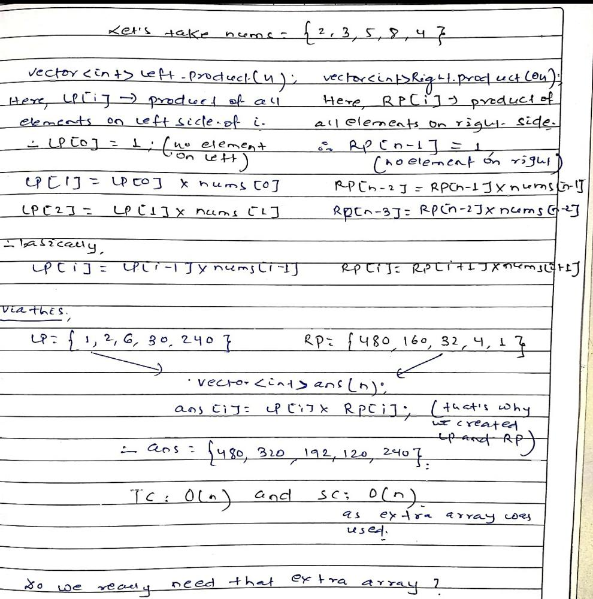
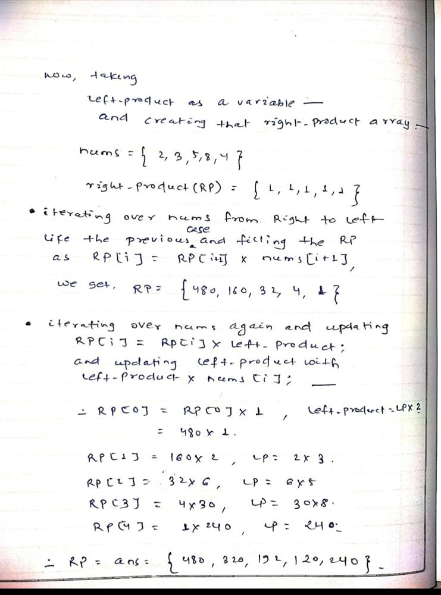

# c++ | discussing all solutions | explaining in detail with image |

**Author:** priyam_vd
**Votes:** 262
**Link:** [https://leetcode.com/problems/product-of-array-except-self/solutions/1597959/](https://leetcode.com/problems/product-of-array-except-self/solutions/1597959/)

---

There can be multiple solutions to this problem but we have to reach the required condition mentioned in the question that **TC :: O(n)** and **SC :: O(1)**

1.  **Naive solution using nested loop** 

 For every element in the array , running the loop and calculating the product except itself -->>>
```
class Solution {
public:
    vector<int> productExceptSelf(vector<int>& nums) {
        
        int n = nums.size();
        vector<int> ans(n, 1);
        
        for(int i = 0; i < n; i++){
            for(int j = 0; j < n; j++){
                if(i == j) continue;
                ans[i] = ans[i] * nums[j]; 
            }
        }

        return ans;
    }
};
```
**TC ::  O(n\xB2)** and **SC :: O(1)** 
obviously did not meet the required condition as TC is very bad !!

    
	  
  	  
2. **Maintaining a left_product and a right_product array**

This is the way towards reaching the desired solution ... To calculate the product of all the elements except itself for an element at the index i, what do we need ?  Product of all the elements on the left side of it and the product of all the elements on the right side of it and if we multiply them both we get the answer !!
keeping this in mind, let's look at an example --->>

```
class Solution {
public:
    vector<int> productExceptSelf(vector<int>& nums) {
        int n = nums.size();
        vector<int> ans(n);
        vector<int> left_Product(n);
        vector<int> right_Product(n);
        
        left_Product[0] = 1;
        for(int i = 1; i < nums.size(); i++){
            left_Product[i] = left_Product[i - 1] * nums[i - 1];
        }
        
        right_Product[n - 1] = 1;
        for (int j = n - 2; j >= 0; j--) {
            right_Product[j] = right_Product[j + 1] * nums[j + 1];
        }
        
        for (int k = 0; k < n; k++) {
            ans[k]= left_Product[k] * right_Product[k];
        }
        
        return ans;
    }
};
```
**TC :: O(n)** and **SC :: O(n)**


3. **Left_product taken as variable and using Right_product array as ans**

We have optimized the TC, we just don't need to use any extra space ... In the previous solution do we really need any extra space ? After maintaining the Right_prod array , can't we just take left_prod as a variable and then we keep updating it with left_product into nums[i] while iterating from left to right ... look at the example again



```
class Solution {
public:
    vector<int> productExceptSelf(vector<int>& nums) {
        int n = nums.size();
        
        vector<int> ans(n);
        
        ans[n - 1] = 1; // ans array used as right product array
        
        for(int i = n - 2; i >= 0; i--){
            ans[i] = nums[i + 1] * ans[i + 1];
        }
        
        int leftProd = 1;
        for(int i = 0; i < n; i++){
            ans[i] = leftProd * ans[i];
            leftProd = leftProd * nums[i];
        }
        
        return ans;
    }
};
```
**TC :: O(n) and SC :: O(1)**

we have achieved the desired solution .. if you have come this far then thanks for coping up with my handwriting ::))