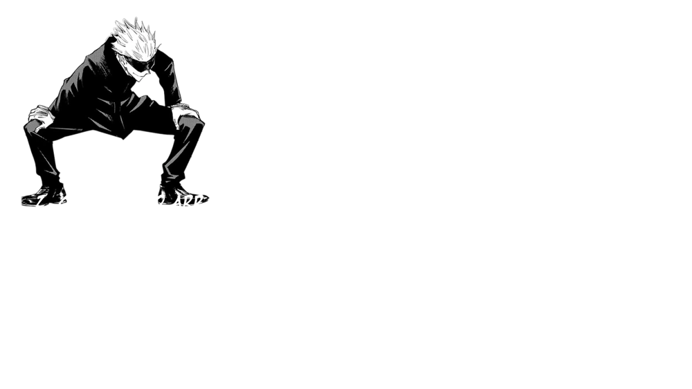
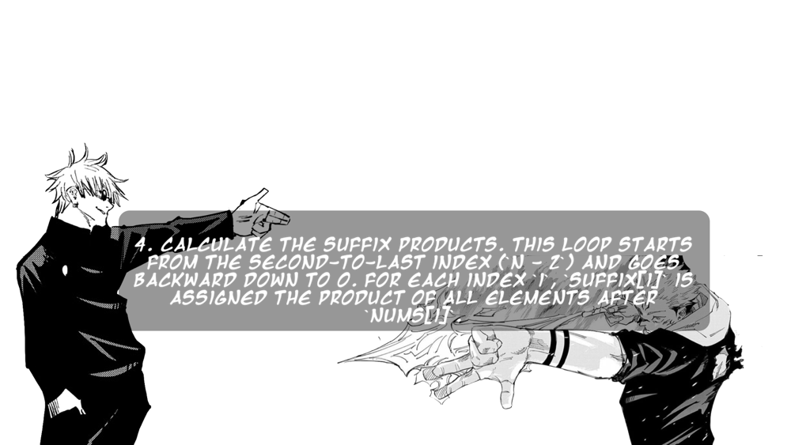
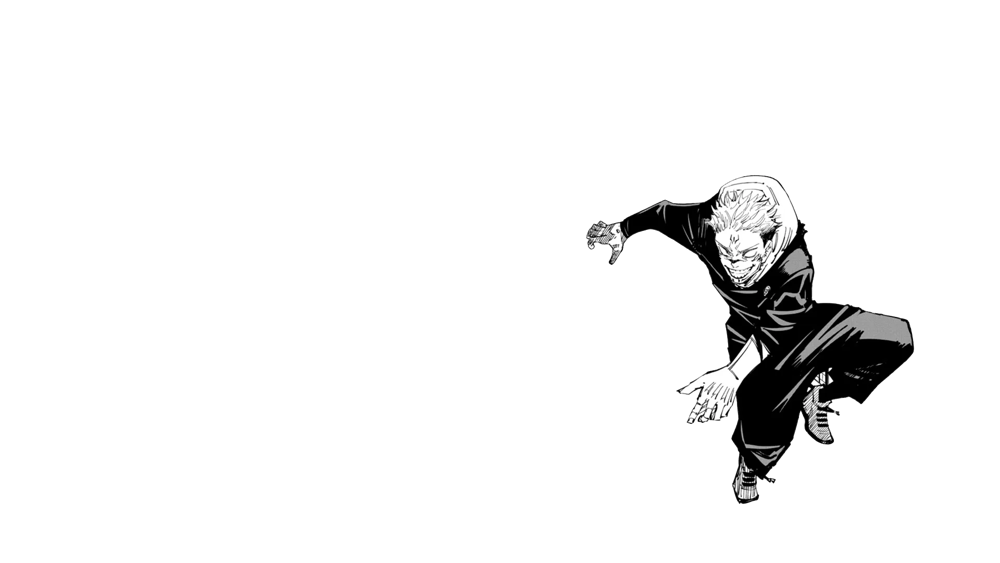

# 🔥✅✅ Beat 80.80% | ✅ Full explanation with pictures ✅✅🔥

**Author:** DevOgabek
**Votes:** 180
**Link:** [https://leetcode.com/problems/product-of-array-except-self/solutions/4876797/](https://leetcode.com/problems/product-of-array-except-self/solutions/4876797/)

---


[
](https://leetcode.com/problems/product-of-array-except-self/submissions/1203934237?envType=daily-question&envId=2024-03-15)








For TTS

1. Initialize the length of the input array `nums` to `n`.

2. Create two arrays, `prefix` and `suffix`, both initialized with ones and having the same length as `nums`. These arrays will hold the products of elements before and after each index in the `nums` array.
3. Calculate the prefix products. This loop starts from index 1 and goes up to `n - 1`. For each index `i`, `prefix[i]` is assigned the product of all elements before `nums[i]`.
4. Calculate the suffix products. This loop starts from the second-to-last index (`n - 2`) and goes backward down to 0. For each index `i`, `suffix[i]` is assigned the product of all elements after `nums[i]`.
5. Multiply the corresponding prefix and suffix products for each index to get the final result. This is done by iterating over each index `i` and calculating `prefix[i] * suffix[i]`.
6. Return the `answer`, which is the list containing the products of all elements except the element at each index.

```python []
# Here I have used division operation

class Solution(object):
    def productExceptSelf(self, nums):
        total_product = 1
        zero_count = 0
        
        for num in nums:
            if num != 0:
                total_product *= num
            else:
                zero_count += 1
                
        result = []
        
        if zero_count > 1:
            return [0] * len(nums)
        
        for num in nums:
            if num != 0:
                if zero_count == 1:
                    result.append(0)
                else:
                    result.append(total_product // num)
            else:
                result.append(total_product)
        
        return result
```
```python []
class Solution(object):
    def productExceptSelf(self, nums):
        n = len(nums)
        
        prefix = [1] * n
        suffix = [1] * n
        
        for i in range(1, n):
            prefix[i] = prefix[i - 1] * nums[i - 1]
        
        for i in range(n - 2, -1, -1):
            suffix[i] = suffix[i + 1] * nums[i + 1]
        
        answer = [prefix[i] * suffix[i] for i in range(n)]
        
        return answer
```
```python3 []
class Solution:
    def productExceptSelf(self, nums: List[int]) -> List[int]:
        n = len(nums)
        
        prefix = [1] * n
        suffix = [1] * n
        
        for i in range(1, n):
            prefix[i] = prefix[i - 1] * nums[i - 1]
        
        for i in range(n - 2, -1, -1):
            suffix[i] = suffix[i + 1] * nums[i + 1]
        
        answer = [prefix[i] * suffix[i] for i in range(n)]
        
        return answer
```
```C++ []
class Solution {
public:
    vector<int> productExceptSelf(vector<int>& nums) {
        int n = nums.size();
        
        std::vector<int> prefix(n, 1);
        std::vector<int> suffix(n, 1);
        
        for (int i = 1; i < n; ++i) {
            prefix[i] = prefix[i - 1] * nums[i - 1];
        }
        
        for (int i = n - 2; i >= 0; --i) {
            suffix[i] = suffix[i + 1] * nums[i + 1];
        }
        
        std::vector<int> answer(n);
        for (int i = 0; i < n; ++i) {
            answer[i] = prefix[i] * suffix[i];
        }
        
        return answer;
    }
};
```
```javascript []
var productExceptSelf = function(nums) {
    const n = nums.length;
    
    const prefix = new Array(n).fill(1);
    const suffix = new Array(n).fill(1);
    
    for (let i = 1; i < n; i++) {
        prefix[i] = prefix[i - 1] * nums[i - 1];
    }
    
    for (let i = n - 2; i >= 0; i--) {
        suffix[i] = suffix[i + 1] * nums[i + 1];
    }
    
    const answer = [];
    for (let i = 0; i < n; i++) {
        answer[i] = prefix[i] * suffix[i];
    }
    
    return answer;
};
```


## **My solutions**

\uD83D\uDFE2 - $$easy$$  
\uD83D\uDFE1 - $$medium$$ 
\uD83D\uDD34 - $$hard$$


\uD83D\uDFE1 [104. Maximum Depth of Binary Tree](https://leetcode.com/problems/maximum-depth-of-binary-tree/solutions/4876170/beat-100-full-explanation-with-pictures)

\uD83D\uDFE1 [46. Permutations](https://leetcode.com/problems/permutations/solutions/4853218/beat-98-64-full-explanation-with-pictures)
\uD83D\uDFE1 [17. Letter Combinations of a Phone Number](https://leetcode.com/problems/letter-combinations-of-a-phone-number/solutions/4845532/there-is-an-80-chance-of-being-in-the-interview-full-problem-explanation)
\uD83D\uDFE1 [22. Generate Parentheses](https://leetcode.com/problems/generate-parentheses/solutions/4845742/simple-explanation-with-pictures)
\uD83D\uDFE1 [39. Combination Sum](https://leetcode.com/problems/combination-sum/solutions/4847482/beat-8292-full-explanation-with-pictures)
\uD83D\uDFE2 [2540. Minimum Common Value](https://leetcode.com/problems/minimum-common-value/solutions/4845076/beat-9759-full-explanation-with-pictures)
\uD83D\uDFE2 [3005. Count Elements With Maximum Frequency](https://leetcode.com/problems/count-elements-with-maximum-frequency/solutions/4839796/beat-8369-full-explanation-with-pictures)
\uD83D\uDFE2 [3028. Ant on the Boundary](https://leetcode.com/problems/ant-on-the-boundary/solutions/4837433/full-explanation-with-pictures)
\uD83D\uDFE2 [876. Middle of the Linked List](https://leetcode.com/problems/middle-of-the-linked-list/solutions/4834682/beat-10000-full-explanation-with-pictures)
\uD83D\uDFE1 [1750. Minimum Length of String After Deleting Similar Ends](https://leetcode.com/problems/minimum-length-of-string-after-deleting-similar-ends/solutions/4824224/beat-10000-full-explanation-with-pictures)
\uD83D\uDFE1 [948. Bag of Tokens](https://leetcode.com/problems/bag-of-tokens/solutions/4818912/beat-10000-full-explanation-with-pictures)
\uD83D\uDFE1 [19. Remove Nth Node From End of List](https://leetcode.com/problems/remove-nth-node-from-end-of-list/solutions/4813340/beat-10000-full-explanation-with-pictures)
\uD83D\uDFE2 [977. Squares of a Sorted Array](https://leetcode.com/problems/squares-of-a-sorted-array/solutions/4807704/square-sorter-python-python3-javascript-c)
\uD83D\uDFE2 [2864. Maximum Odd Binary Number](https://leetcode.com/problems/maximum-odd-binary-number/solutions/4802402/visual-max-odd-binary-solver-python-python3-javascript-c)
\uD83D\uDFE1 [1609. Even Odd Tree](https://leetcode.com/problems/even-odd-tree/solutions/4797529/even-odd-tree-validator-python-python3-javascript-c)
\uD83D\uDFE2 [9. Palindrome Number](https://leetcode.com/problems/palindrome-number/solutions/4795373/why-not-1-line-of-code-python-python3-c-everyone-can-understand)
\uD83D\uDFE1 [513. Find Bottom Left Tree Value](https://leetcode.com/problems/find-bottom-left-tree-value/solutions/4792022/binary-tree-explorer-mastered-javascript-python-python3-c-10000-efficiency-seeker)
\uD83D\uDFE2 [1. Two Sum](https://leetcode.com/problems/two-sum/solutions/4791305/5-methods-python-c-python3-from-easy-to-difficult)
\uD83D\uDFE2 [543. Diameter of Binary Tree](https://leetcode.com/problems/diameter-of-binary-tree/solutions/4787634/surpassing-9793-memory-magician-excelling-at-9723)
\uD83D\uDFE2 [101. Symmetric Tree](https://leetcode.com/problems/symmetric-tree/solutions/4848126/beat-100-full-explanation-with-pictures)
\uD83D\uDFE2 [136. Single Number](https://leetcode.com/problems/single-number/solutions/4862807/master-the-xor-trick-beat-97-20-with-full-explanation)
\uD83D\uDFE2 [283. Move Zeroes](https://leetcode.com/problems/move-zeroes/solutions/4864068/mastering-efficiency-beat-98-71)
\uD83D\uDFE2 [108. Convert Sorted Array to Binary Search Tree](https://leetcode.com/problems/convert-sorted-array-to-binary-search-tree/solutions/4864578/beat-89-74-full-explanation-with-pictures)

[More...](https://leetcode.com/DevOgabek/)