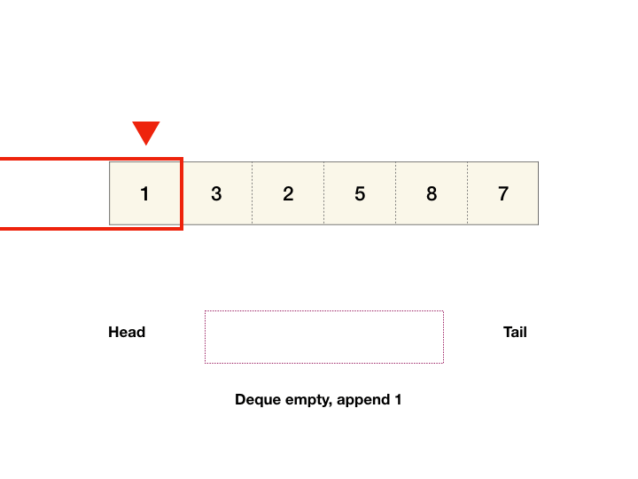

# Clear thinking process with PICTURE, brute force to mono deque, python/java/javascript

**Author:** wanga2659
**Votes:** 612
**Link:** [https://leetcode.com/problems/sliding-window-maximum/solutions/871317/](https://leetcode.com/problems/sliding-window-maximum/solutions/871317/)

---

EDIT: See full step-by-step animation of monotonic stack in action in [this post](https://bit.ly/33d5kb1)
    
  # Brute force
  We can write a nested loop, the outer loop goes through each window and the inner loop finds the max within the window. This is `O(N^2)` time complexity.

  To optimize on brute force, we can either reduce outer or inner loop complexity. Since we have to examine each element at least once (there's no way to find the maximum if we don't know what the values are..), there is not much we can do for outer loop. So we have to work on the inner loop. 

  ## Preserving inner elements maximum
  Currently, to get the max of the sliding window, we look at each element in the window and compare them. Analogous to sliding window sum problem (given an array and a window size, return the sum of each window), when a window slides, only two elements change - the leftmost gets removed and a new element gets added to the right. Everything in the middle (let's call them "inner elements") is unchanged, and the maximum element among these inner elements are unchanged as well. The key to reducing inner loop complexity is to persist the maximum of the inner elements as we slide the window. Ideally, we want to be able to access the maximum element in less than `O(N)` time and updating it in less than `O(N)` time.

  ## Balanced binary search tree
  One way to achieve this goal is to save the window elements in a [self-balancing binary search tree](https://en.wikipedia.org/wiki/Self-balancing_binary_search_tree). Because it's self-balancing, the depth of the tree is guaranteed to be `O(log(N))` so lookup, getting max, insert and delete are all `O(log(N))` operations. Every time we slide the window, we remove the node that's out of the window and add the one that comes into the window to the tree. Overall, this gives us `O(N log(k))` since the number of tree nodes is `k` and we slide max `N` times.

  This is pretty good already, but can we do better?

  ## Larger elements entering window invalidates smaller elements
  A question we can ask ourselves is "do we need to keep all the window elements in our state?".
  An important observation is for two elements `arr[left]` and `arr[right]`, where `left < right`, `arr[left]` leaves the window earlier as we slide. If `arr[right]` is larger than `arr[left]`, then there is no point keeping `arr[left]` in our state since `arr[right]` is always gonna be larger during the time `arr[left]` is in the window. Therefore, `arr[left]` can never be the maximum.

  # Monotonic deque
  Here we introduce an interesting data structure. It's a deque with an interesting property - the elements in the deque from head to tail are in decreasing order (hence the name monotonic).

  To achieve this property, we modify the push operation so that 

  **Before we push an element into the deque, we first pop everything smaller than it out of the deque**.

  This enforces the decreasing order.
  



  The time complexity is `O(N)`. This is because each element in the original array can only be pushed into and popped out of the deque only *once*.

  The key why monotonic deque works is it stores both magnitude and position information. From head to tail, the elements get smaller and further to the right of the array.

  ## Implementation
  In the actual implementation, we store indices instead of actual elements in the deque. This is because we need the index to know if an element is out of the window or not and we can always get the value using the index from the array.
  
### python

```
class Solution:
    def maxSlidingWindow(self, nums: List[int], k: int) -> List[int]:
        from collections import deque
        q = deque() # stores *indices*
        res = []
        for i, cur in enumerate(nums):
            while q and nums[q[-1]] <= cur:
                q.pop()
            q.append(i)
            # remove first element if it's outside the window
            if q[0] == i - k:
                q.popleft()
            # if window has k elements add to results (first k-1 windows have < k elements because we start from empty window and add 1 element each iteration)
            if i >= k - 1:
                res.append(nums[q[0]])
        return res
```		

### java
```
class Solution {
    public int[] maxSlidingWindow(int[] nums, int k) {
        Deque<Integer> q = new ArrayDeque<>();  // stores *indices*
        List<Integer> res = new ArrayList<>();
        for (int i = 0; i < nums.length; i++) {
            while (!q.isEmpty() && nums[q.getLast()] <= nums[i]) {
                q.removeLast();
            }
            q.addLast(i);
            // remove first element if it's outside the window
            if (q.getFirst() == i - k) {
                q.removeFirst();
            }
            // if window has k elements add to results (first k-1 windows have < k elements because we start from empty window and add 1 element each iteration)
            if (i >= k - 1) {
                res.add(nums[q.peek()]);
            }
        }
        return res.stream().mapToInt(i->i).toArray();            
    }
}

```

### javascript
```
var maxSlidingWindow = function(nums, k) {
    const q = [];  // stores *indices*
    const res = [];
    for (let i = 0; i < nums.length; i++) {
        while (q && nums[q[q.length - 1]] <= nums[i]) {
            q.pop();
        }
        q.push(i);
        // remove first element if it's outside the window
        if (q[0] === i - k) {
            q.shift();
        }
        // if window has k elements add to results (first k-1 windows have < k elements because we start from empty window and add 1 element each iteration)
        if (i >= k - 1) {
            res.push(nums[q[0]]);
        }
    }
    return res;    
};
```

Still not clear? See full animations of monotonic stack in action in [this post](https://bit.ly/33d5kb1)

## Please upvote if you found it useful!
