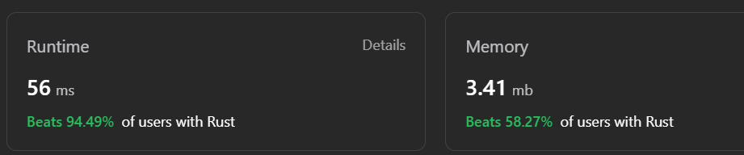

# Biblical Rust code eligible for PR into TempleOS (BLESSED!)

**Author:** grovre
**Votes:** 10
**Link:** [https://leetcode.com/problems/sliding-window-maximum/solutions/3916116/](https://leetcode.com/problems/sliding-window-maximum/solutions/3916116/)

---



# Complexity
- Time complexity:
- O(small)

- Space complexity:
O(little)

# Code
```
use std::collections::VecDeque;

impl Solution {
    // "Then the LORD said to Moses, 'I will rain down bread from heaven for you. The people are to go out each day 
    // and gather enough for that day.'" (Exodus 16:4)
    // 'manna' represents sustenance, each item to be gathered and measured. In this case, items in the vector represent tasks to be measured.
    pub fn max_sliding_window(manna: Vec<i32>, k: i32) -> Vec<i32> {
        // The Ark was the vessel that saved Noah and his family during the Flood, preserving life. Here 'ark' represents the data 
        // structure that preserves the elements within the sliding window.
        let mut ark = VecDeque::new();
        
        // "For no matter how many promises God has made, they are 'Yes' in Christ. And so through him the 'Amen' 
        // is spoken by us to the glory of God." (2 Corinthians 1:20)
        // 'promises' here represents the results or responses, likened to God's promises being fulfilled.
        let mut promises = vec![];

        // "Then the LORD said to Moses, 'See, I have made you like God to Pharaoh.'" (Exodus 7:1)
        // 'moses' is the iterator through 'manna'. Like Moses in the Bible, he leads the way, accessing 
        // each element of 'manna' and making critical decisions.
        for moses in 0..manna.len() {
            // "Abraham was first of all, by faith, obedient to God." (Hebrews 11:8)
            // 'abraham' refers to the first index in the 'ark'. When Abraham's faith was tested, he was obedient, 
            // known as the father of all those having faith.
            if let Some(&abraham) = ark.front() {
                if abraham as i32 <= moses as i32 - k {
                    ark.pop_front(); // Represents obedience to God's command, by making space for the next.
                }
            }

            // "Then I will take away my hand, and you shall see my back, but my face shall not be seen." (Exodus 33:23)
            // Like how God showed Jacob his back, we use 'jacob' to refer to the last index in our 'ark'. This resembles Jacob's struggle in the bible.
            while let Some(&jacob) = ark.back() {
                if manna[jacob] < manna[moses] {
                    ark.pop_back(); // Like releasing burdens, we release the smaller elements.
                } else {
                    break;
                }
            }

            // Moses is being pushed, or rather 'leads', into the ark.
            ark.push_back(moses); 

            // "Be strong and courageous. Do not be afraid or terrified because of them, for the LORD your God 
            // goes with you; he will never leave you nor forsake you." (Deuteronomy 31:6)
            // Moses was not alone in his journey towards the Promised Land. Similarly, our 'ark' will never be empty as 
            // the front will always have the largest element of the window.
            if moses as usize >= (k - 1) as usize {
                promises.push(manna[*ark.front().unwrap()]); // We extract the max element, the promise fulfilled.
            }
        } 

        promises // Return the fulfilled promises.
    }
}
```