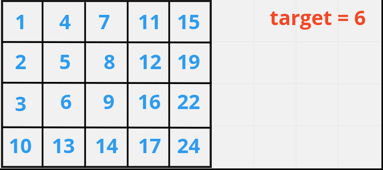
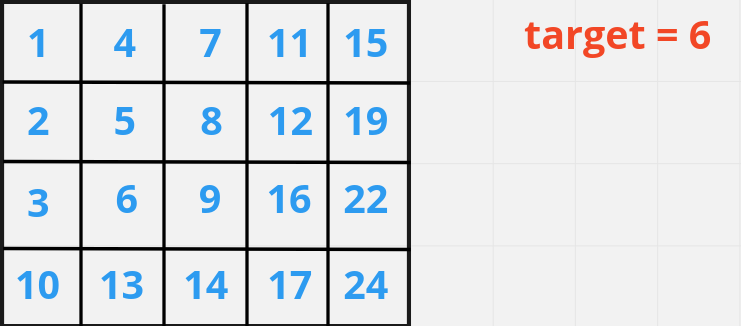
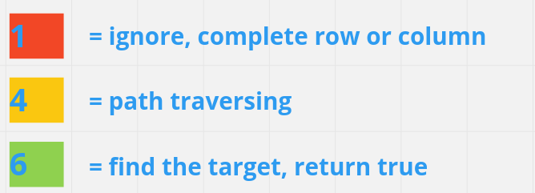
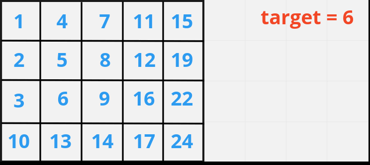

# [Java/C++] FULL VISUALL explanation

**Author:** hi-malik
**Votes:** 91
**Link:** [https://leetcode.com/problems/search-a-2d-matrix-ii/solutions/2324616/](https://leetcode.com/problems/search-a-2d-matrix-ii/solutions/2324616/)

---

Hello, **Ladies-N-Gentlemen** today we are going to solve a another easy-peasy question.

I hope so, that questions is clear what it is all are talking about. Because, question statement is very clear!!

```
# Brute Force Approach
```
So, let's talk about what will be **`Brute Force approach` to solve this problem.**

The very brute-force approach is, we will traverse it's every row & column of the matrix.

**Let's understand it visually,**




**JAVA**
```
class Solution {
    public boolean searchMatrix(int[][] matrix, int target) {
        for(int i = 0; i < matrix.length; i++){
            for(int j = 0; j < matrix[0].length; j++){
                if(matrix[i][j] == target) return true;
            }
        }
        return false;
    }
}
```
**C++**
```
class Solution {
public:
    bool searchMatrix(vector<vector<int>>& matrix, int target) {
        for(int i = 0; i < matrix.size(); i++){
            for(int j = 0; j < matrix[0].size(); j++){
                if(matrix[i][j] == target) return true;
            }
        }
        return false;
    }
};
```
ANALYSIS :-
As, you are seeing we are traversing it's all row and column therefore the **Time Complexity** will be **`O(N^2)`** And the **Space Complexity** will be **`O(1)`**

```
# Better Approach
```
Let's take an example to understand this approach,



So, what we gonna do is we will start traversing from **`top-right corner`** or you can even start from **`bottom-left corner`**. Now you'll ask why not from **top-left OR bottom-right?** Well, there's a reason why not from there, we'll come to this point later on.

**`Now, let's start traversing and understand it's visaully`**

**`Note :-`** 






So, what we are doing you got the idea,
* If value is **`>`** then target, then move to **left i.e. j--**


* If value is **`<`** then target, then move **down i.e. i++** 
* If value is **`==`** to target, **return true**
* Else **return false**

Now, let's code it up:-
**Java**
```
class Solution {
    public boolean searchMatrix(int[][] matrix, int target) {
        int i = 0;
        int j = matrix[0].length - 1;
        
        while(i >= 0 && i < matrix.length && j >= 0 && j < matrix[0].length){
            if(matrix[i][j] == target) return true;
            else if(matrix[i][j] > target) j--;
            else if(matrix[i][j] < target) i++;
        }
        return false;
    }
}
```
**C++**
```
class Solution {
public:
    bool searchMatrix(vector<vector<int>>& matrix, int target) {
        int i = 0;
        int j = matrix[0].size() - 1;
        
        while(i >= 0 && i < matrix.size() && j >= 0 && j < matrix[0].size()){
            if(matrix[i][j] == target) return true;
            else if(matrix[i][j] > target) j--;
            else if(matrix[i][j] < target) i++;
        }
        return false;
    }
};
```
ANALYSIS :-
* **Time Complexity :-** It will be **`O(row + column)`** because we are traversing every row & column only once

* **Space Complexity :-** It will be **`O(1)`** as we are not using any extra memory OR space