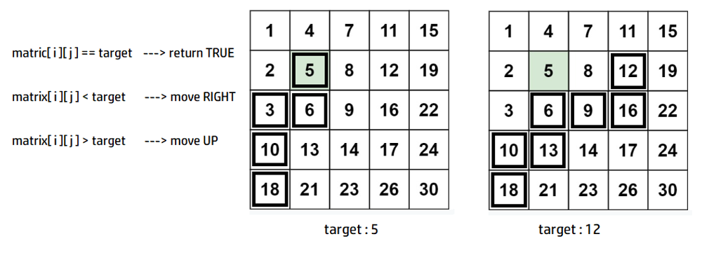

# ✔️ PYTHON ||  EXPLAINED  ||  ; ]

**Author:** karan_8082
**Votes:** 117
**Link:** [https://leetcode.com/problems/search-a-2d-matrix-ii/solutions/2324351/](https://leetcode.com/problems/search-a-2d-matrix-ii/solutions/2324351/)

---

**UPVOTE IF HELPFuuL**

**EFFICIENT APPROACH -> O ( M + N )**

As the rows are sorted **->** ```matrix[i][j] < matrix[i][j+1]```
As the columns are sorted **->** ```matrix[i][j] >matrix[i-1][j]```

Hence it can be said that :
* any element right to ```matrix[i][j]``` will be greater than it.
* any element to the top of ```matrix[i][j]``` will be less than it.

So we start searching from **BOTTOM_LEFT**:
* if element found -> return **TRUE**
* if ```matrix[i][j] > target``` -> move **UP**.
* if ```matrix[i][j] < target``` -> move **RIGHT**.



**UPVOTE IF HELPFuuL**

```
class Solution:
    def searchMatrix(self, mat: List[List[int]], target: int) -> bool:
        
        m=len(mat)
        n=len(mat[0])
        
        i=m-1
        j=0
        
        while i>=0 and j<n:
            if mat[i][j]==target:
                return True
            elif mat[i][j]<target:
                j+=1
            else:
                i-=1
                
        return False
```

**EFFICIENT APPROACH -> O ( M LOG N )**
As all the rows are sorted , an element can be clearly searched using *BINARY-SEARCH* for each row.

For each row -> O ( M )
Binary search -> O ( LOG N )

**UPVOTE IF HELPFuuL**

**BINARY SEARCH SOLUTION**
```
class Solution:
    def searchMatrix(self, mat: List[List[int]], target: int) -> bool:
        
        m=len(mat)
        n=len(mat[0])
        
        for i in range(m):
            if mat[i][0]<=target and mat[i][-1]>=target:
                lo=0
                hi=n
                while (lo<hi):
                    mid=(lo+hi)//2
                    
                    if mat[i][mid]==target:
                        return True
                    elif mat[i][mid]<target:
                        lo = mid + 1
                    else:
                        hi = mid
                        
        return False
```

