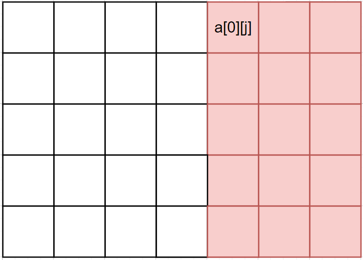
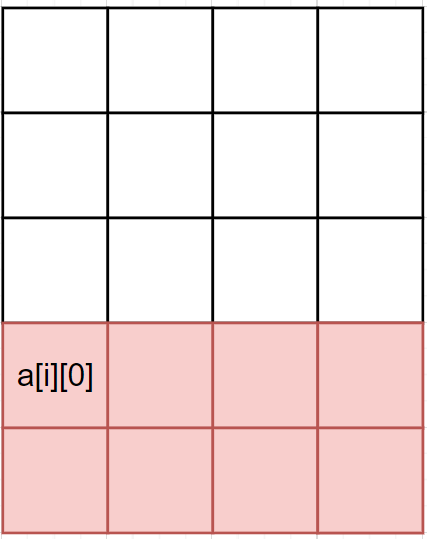
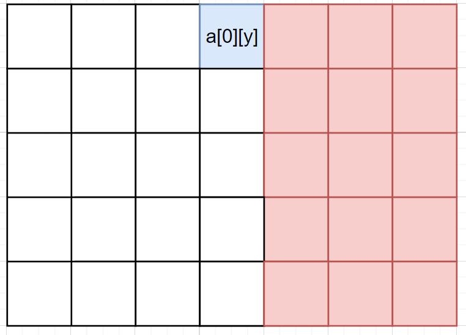

# Binary Search | O(logN*logN + logM*logM)

**Author:** xiyu0612
**Votes:** 2
**Link:** [https://leetcode.com/problems/search-a-2d-matrix-ii/solutions/3228127/](https://leetcode.com/problems/search-a-2d-matrix-ii/solutions/3228127/)

---

# Intuition
<!-- Describe your first thoughts on how to solve this problem. -->
Brief keypoint: **Search on first row, then search on first column**.

- Take a look at a number `a[0][j]` in the first row. If `target < a[0][j]`, then all numbers to its bottom-right can be dropped(marked as red) since those numbers are not smaller than `a[0][j]`, thus none of them could be equal to `target`. **See? The search has been cut off**.



- Take a look at a number `a[i][0]` in the first column. If `target < a[i][0]`, then all numbers to its bottom-right can also be dropped(marked as red) since those numbers are not smaller than `a[i][0]`.



# Approach
<!-- Describe your approach to solving the problem. -->
Let matrix be denoted by: `([top_left_x, top_left_y], [bottom_right_x, bottom_right_y])`.

e.g `([0,0], [m-1][n-1])` represents the given matrix.

**step 1.** Apply binary search on first row of index `top_left_x`
search space: `[top_left_y, bottom_right_y]`
find a *largest* number that is *smaller* than `target`, let it be `firstRow[y]`, where `y \u2208 [top_left_y - 1, bottom_right_y]`.



Then the matrix to its right-down part will all be greater than `target`, so this part can be dropped.

Now we have our matrix denoted as `([tl_x, tl_y], [br_x, y])`.

**step 2.** Apply binary search on the first column of index `top_left_y`
search space: `[top_left_x, bottom_right_x]`)
Same as above, we have `firstColumn[x] < target` stand, where `x` is the largest row index.

The matrix to its right-down part will all be greater again than `target`, so this part can also be dropped.

Now the matrix may have been deduced into 1/4 size of its origin by 2 binary searches, and can be denoted as `([tl_x, tl_y], [x, y])`.

We do this until the matrix left is invalid.

# Complexity
- Time complexity: $$ O((logN) ^ 2 + (logM) ^ 2) $$
<!-- Add your time complexity here, e.g. $$O(n)$$ -->

In average, we can divide the rows or columns into 2 halves with almost same length at each step.

For columns, there would be $$ logN $$ binary searches and each time costs up to $$ logN $$ to find that `y`. So it is $$ (logN)^2 $$ for columns to be deduced into only 1 column, same is for the rows.

Cost of deducing $$ N $$ columns into only `1` column:

$$ 
Cost = logN +    logN/2   +    logN/4 + ... + log2 
$$
$$
= logN + (logN-log2) + (logN-log4) + ... 
$$
$$
= (logN)^2 - (log1 + log2 + log4 + ... + logN)
$$
$$
= (logN)^2 - (0 + 1 + 2 + 3 + ... + logN)
$$
$$
= (logN)^2 - (1+logN) * logN / 2
$$
$$
= (logN)^2 - [(logN)^2 / 2] - (logN / 2)
$$
$$
= 1/2 * (logN)^2 - 1/2logN
$$
$$
= 1/2 * [(logN)^2 - logN]
$$
$$
= (logN)^2
$$

Same with the rows: $$ (logM)^2 $$

So the total TC would be $$ O((logN) ^ 2 + (logM) ^ 2) $$ 


- Space complexity: $$ O(1) $$
<!-- Add your space complexity here, e.g. $$O(n)$$ -->

# Code
```
function searchMatrix(matrix: number[][], target: number): boolean {
  const m = matrix.length;
  const n = matrix[0].length;

  let top_left_x = 0;
  let top_left_y = 0;
  let bottom_right_x = m - 1;
  let bottom_right_y = n - 1;

  while (top_left_x < m && top_left_y < n && (top_left_x < bottom_right_x || top_left_y < bottom_right_y)) {
    // columns still >=2, we need to deduce it by searching the first row `matrix[top_left_x]` to find some position `y`
    if (top_left_y < bottom_right_y) {
      let l = top_left_y, r = bottom_right_y;
      while (l < r) {
        const mid = Math.ceil((l + r) / 2);
        if (matrix[top_left_x][mid] === target) {
          return true;
        }
        if (matrix[top_left_x][mid] > target) {
          r = mid - 1;
        } else {
          l = mid;
        }
      }
      if (target === matrix[top_left_x][l]) {
        return true;
      }
      if (target < matrix[top_left_x][l]) {
        return false;
      }
      bottom_right_y = l;
      //we move onto next row because we didn't find target in current row
      top_left_x++;
    }

    if (top_left_x < bottom_right_x) {
      let l = top_left_x, r = bottom_right_x;
      while (l < r) {
        const mid = Math.ceil((l + r) / 2);
        if (matrix[mid][top_left_y] === target) {
          return true;
        }
        if (matrix[mid][top_left_y] > target) {
          r = mid - 1;
        } else {
          l = mid;
        }
      }
      if (target === matrix[l][top_left_y]) {
        return true;
      }
      if (target < matrix[l][top_left_y]) {
        return false;
      }
      bottom_right_x = l;
      top_left_y++;
    }
  }

  if (top_left_x === m || top_left_y === n) {
    return false;
  }

  // only 1 element left, just compare it with target is fine
  return target === matrix[top_left_x][top_left_y];
};