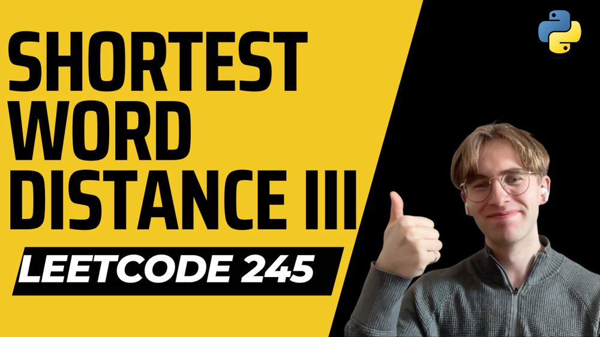

# Python O(N) TIME O(1) SPACE [Solution Blog]

**Author:** CarterMacLennan
**Votes:** 4
**Link:** [https://leetcode.com/problems/shortest-word-distance-iii/solutions/3391313/](https://leetcode.com/problems/shortest-word-distance-iii/solutions/3391313/)

---

# Welcome to my Solution Blog! 

# Intuition
<!-- Describe your first thoughts on how to solve this problem. -->
I just iterate through the list and keep track of the last time we saw word1 and word2. If they are the same word we only make use of `index1`. It's a greedy approach where you greedily use the most recent index location of each word with every iteration!

# Complexity
- Time complexity: O(N)
<!-- Add your time complexity here, e.g. $$O(n)$$ -->

- Space complexity: O(1)
<!-- Add your space complexity here, e.g. $$O(n)$$ -->

# Code
```
class Solution:
    def shortestWordDistance(self, wordsDict: List[str], word1: str, word2: str) -> int:
        index1 = index2 = -1
        min_dist = float('inf')

        for i, word in enumerate(wordsDict):
            if word == word1 == word2:
                if index1 != -1:
                    min_dist = min(min_dist, i - index1)
                index1 = i
            elif word == word1:
                if index2 != -1:
                    min_dist = min(min_dist, i - index2)
                index1 = i
            elif word == word2:
                if index1 != -1:
                    min_dist = min(min_dist, i - index1)
                index2 = i

        return min_dist
```