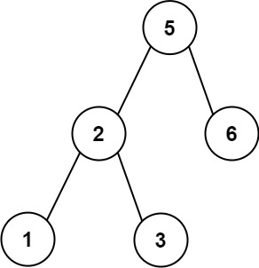

# [255. Verify Preorder Sequence in Binary Search Tree](https://leetcode.com/problems/verify-preorder-sequence-in-binary-search-tree/)

| Category | Difficulty | Likes | Dislikes |
| :------: | :--------: | :---: | :------: |
| Algorithms | Medium | 1259 | 90 |

**Tags:** [`array`](https://leetcode.com/tag/array), [`stack`](https://leetcode.com/tag/stack), [`tree`](https://leetcode.com/tag/tree), [`binary-search-tree`](https://leetcode.com/tag/binary-search-tree), [`recursion`](https://leetcode.com/tag/recursion), [`monotonic-stack`](https://leetcode.com/tag/monotonic-stack), [`binary-tree`](https://leetcode.com/tag/binary-tree)

**Companies:** `expedia`, `nvidia`, `tiktok`, `salesforce`, `zenefits`

## Description

Given an array of **unique** integers `preorder`, return `true` *if it is the correct preorder traversal sequence of a binary search tree*.

 

**Example 1:**


```

Input: preorder = [5,2,1,3,6]
Output: true

```

**Example 2:**

```

Input: preorder = [5,2,6,1,3]
Output: false

```

 

**Constraints:**

	- `1 <= preorder.length <= 10^4`

	- `1 <= preorder[i] <= 10^4`

	- All the elements of `preorder` are **unique**.

 

**Follow up:** Could you do it using only constant space complexity?

---

**Links:** [Submissions](https://leetcode.com/problems/verify-preorder-sequence-in-binary-search-tree/) | [Solutions](https://leetcode.com/problems/verify-preorder-sequence-in-binary-search-tree/)
