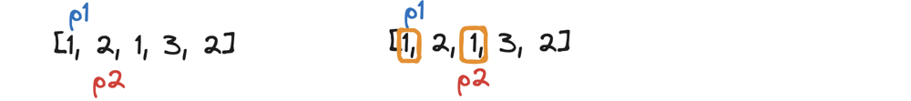
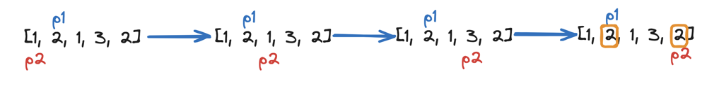
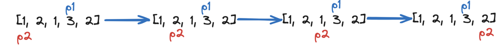
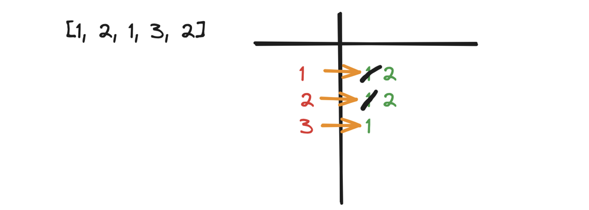
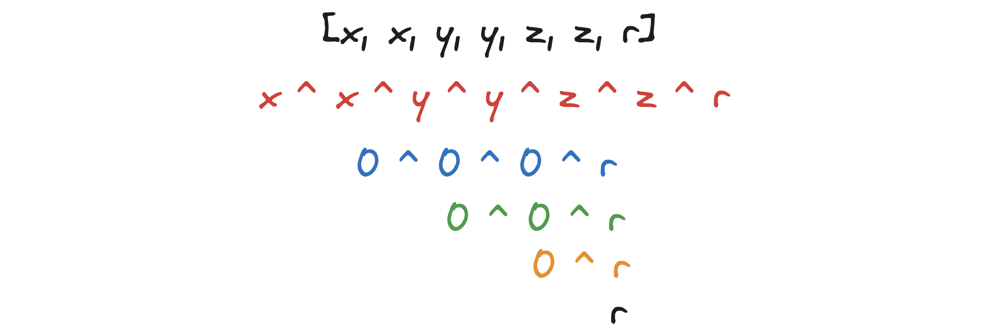
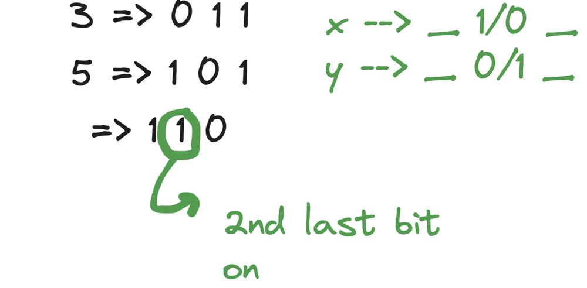
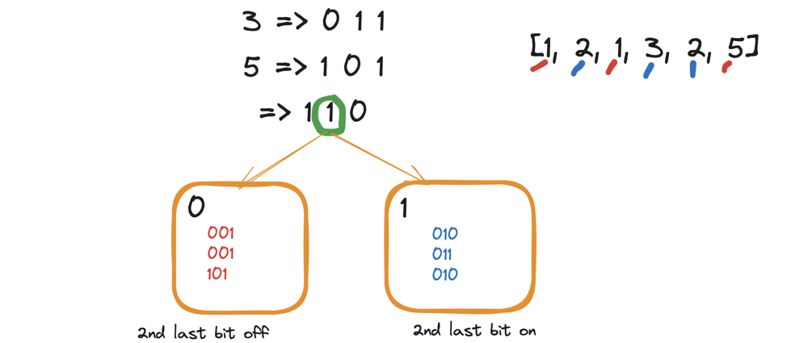
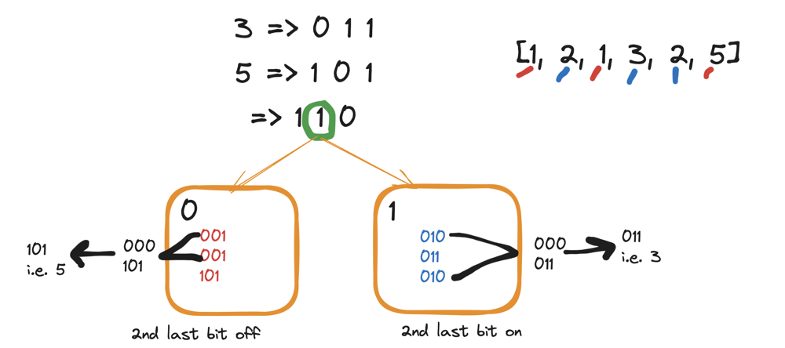

# 🔥🔥 DEMON Level Explanation || 3 Approaches 😨😱🤯

**Author:** hi-malik
**Votes:** 224
**Link:** [https://leetcode.com/problems/single-number-iii/solutions/5233206/](https://leetcode.com/problems/single-number-iii/solutions/5233206/)

---

So, a **single number 3**. In this problem, we have given an array. And we have to tell those 2 numbers, those are not in the pair.
Example :
```
Input: nums = [1,2,1,3,2,5]
Output: [3,5]
```


Before, solving this problem, let's dicuss an problem called, **Single Number I**

So, what is given in **Single Number I** is, we have given an array and all the numbers are in pair!, except one element. Let's look at one example :
```
nums = [1,2,1,3,2]
```


So, we have **return 3**. So, how we going to return this is, 
> the first approach comes in my mind is. We going to have **2 pointers**

* **pointer 1** will start from index **0**
* **pointer 2** will start from index **1**
* We will increment **pointer 2** and see if the element at **index 0** i.e. **`1`** exists or not. **And we see it exists!**
* Thus **`1`** is not a **single number**


Now, I will put back my **pointer 2** at **index 0** & I'll increment the **pointer 1** and also I'll not consider the value at which **pointer 1** is present and iterate over all the values. To check the **pointer 1** pair is present or not!
* We see that **`2`** exists
* Thus **`2`** is not a **single number**


Now, I will put back my **pointer 2** at **index 0** & I'll increment the **pointer 1** and also I'll not consider the value at which **pointer 1** is present and iterate over all the values. To check the **pointer 1** pair is present or not!
* We see that **`1`** exists
* Thus **`1`** is not a **single number**


Now, I will put back my **pointer 2** at **index 0** & I'll increment the **pointer 1** and also I'll not consider the value at which **pointer 1** is present and iterate over all the values. To check the **pointer 1** pair is present or not!
* We see that **`3`** doesn't exists
* Thus **`3`** is a **single number**
* We going to **return 3**


But, in this approach you are seeing that, fixing pointer at every-single element, we are moving on the whole array. 
We are doing **n** times an array and **(n - 1)** times, not cosidering that single value, we are iterating.

So, what will be the **Time Complexity :-** BigO(n^2)

> Can we Optimise our Approach?

Yes, we can. Let's create a **frequency map** having a key, value pair!
Let's create that!


Now, we going to iterate over this, **frequency map!** And once we find the **frequency** one, of an element. That is our **Single Number**

So, what will be the **Time Complexity :-** 
* Creating a **frequency map**, will takes **O(n)**
* Iterating over the **frequency map**, will also takes **O(n)**
Thus, **TC** is **O(n)**

But, what problem, we are facing is! We are consuming **extra space!** and it's **Space Complexity** is also **O(n)**.

> Can we more, Optimise our Approach? 
> > In **O(n)** `TC` and **O(1)** `SC`!!

So, yes we can do that! Using **Bit Manipulation**!
Let's make the **binary** representation of every element from our array, i.e.


Let's see the magic of **XOR**. So, what our XOR do is
```
x y  x ^ y
0 0    0
0 1    1
1 0    1
1 1    0
```
So, we all know this right.

What we are looking for is, we solve this problem in **O(n)** times and **O(1)** space
And also, the **XOR** of
```
x ^ x will always be 0
```
Let's take one small example
```
[2, 2, 1]
```
Let;s first take **XOR** of **2, 2** which will be


Now we will take **XOR** of the previous **0 0 0** with the **1** i.e. **0 0 1**


So, what we have learn from this is. We took the **XOR** of all the values and in the end we did the **XOR** with the one, what we have actually did is **XOR** of `0` with `x` always be `x`
**`0 ^ x => x`**

> I know, still now! We are understanding, **single number 1**, but it's very important to first understand **single number 1**, before moving to **single number 3**

What we have done is, let's say our array is
```
[x, x, y, y, z, z, r]
```
When we going to **XOR** `x ^ x`, `y ^ y`, `z ^ z`, when we **XOR** these, our single number will be `r`


In total, if we take **XOR** of all these elements, we will get, single element in the end. Because the pair elements **XOR** will be **0**. And the **XOR** of **0** with that single element will be single element.

So, this is the all story, we don't going to use any extra space. And we will solve it in **O(1)** space.
___

> I don't want to code this **Single Number I** right now, but if you look at the code of **Single Number III**, you yourself will understand!

___

Now, let's see! How we going to solve **Single Number III** problem
Example :
```
Input: nums = [1,2,1,3,2,5]
Output: [3,5]
```

**Approach - 1**
So, the first approach will be the same as we discuss above, using 2 pointers, which was taking **O(n^2)** time complexity!

Let's code this up, you know the tutorial above for this approach!

**Here's an explanation of the code:**

1. We initialize an array `result` of size 2 to store the two unique elements.
2. We use an outer loop to iterate through each element of the array.
3. For each element `nums[i]`, we use an inner loop to check if there is any other element `nums[j]` (where `i != j`) that is equal to `nums[i]`.
4. If we find a match (i.e., the element appears twice), we set `found` to true and break out of the inner loop.
5. If no match is found after the inner loop, it means `nums[i]` is one of the unique elements. We store it in the `result` array.
6. We increment the index and break out of the loop once we have found both unique elements.

**C++**
```
class Solution {
public:
    vector<int> singleNumber(vector<int>& nums) {
        int n = nums.size();
        vector<int> result(2);
        int index = 0;

        for (int i = 0; i < n; ++i) {
            bool found = false;
            for (int j = 0; j < n; ++j) {
                if (i != j && nums[i] == nums[j]) {
                    found = true;
                    break;
                }
            }
            if (!found) {
                result[index++] = nums[i];
                if (index == 2) {
                    break;
                }
            }
        }

        return result;
    }
};
```
**JAVA**
```
class Solution {
    public int[] singleNumber(int[] nums) {
        int n = nums.length;
        int[] result = new int[2];
        int index = 0;

        for (int i = 0; i < n; i++) {
            boolean found = false;
            for (int j = 0; j < n; j++) {
                if (i != j && nums[i] == nums[j]) {
                    found = true;
                    break;
                }
            }
            if (!found) {
                result[index++] = nums[i];
                if (index == 2) {
                    break;
                }
            }
        }

        return result;
    }
}
```
**PYTHON**
```
class Solution:
    def singleNumber(self, nums: List[int]) -> List[int]:
        n = len(nums)
        result = [0, 0]
        index = 0

        for i in range(n):
            found = False
            for j in range(n):
                if i != j and nums[i] == nums[j]:
                    found = True
                    break
            if not found:
                result[index] = nums[i]
                index += 1
                if index == 2:
                    break

        return result
```

___
Complexity Analysis
___
* **Time Complexity :-** BigO(N^2)
* **Space Complexity :-** BigO(1)

**Approach - 2**
So, the second approach will be the same as we discuss above using frequency map, which was taking **O(n)** time complexity, but it's taking **O(n)** space complexity too!

Let's code this up, you know the tutorial above for this approach!

**Here's an explanation of the code:**

1. **Frequency Map Construction**:
   - We iterate over the array and build a frequency map (or hash map) where the keys are the numbers from the array and the values are the counts of those numbers.

2. **Finding Unique Numbers**:
   - We then iterate over the entries of the frequency map to find the numbers that appear exactly once and add them to the result array.

3. **Return Result**:
   - The result array, which contains the two numbers that appear only once, is returned.

**C++**
```
class Solution {
public:
    vector<int> singleNumber(vector<int>& nums) {
        unordered_map<int, int> frequencyMap;
        
        // Build the frequency map
        for (int num : nums) {
            frequencyMap[num]++;
        }
        
        // Find the elements that appear only once
        vector<int> result;
        for (const auto& entry : frequencyMap) {
            if (entry.second == 1) {
                result.push_back(entry.first);
            }
        }
        
        return result;
    }
};
```
**JAVA**
```
class Solution {
    public int[] singleNumber(int[] nums) {
        Map<Integer, Integer> frequencyMap = new HashMap<>();
        
        // Build the frequency map
        for (int num : nums) {
            frequencyMap.put(num, frequencyMap.getOrDefault(num, 0) + 1);
        }
        
        // Find the elements that appear only once
        int[] result = new int[2];
        int index = 0;
        for (Map.Entry<Integer, Integer> entry : frequencyMap.entrySet()) {
            if (entry.getValue() == 1) {
                result[index++] = entry.getKey();
            }
        }
        
        return result;
    }
}
```
**PYTHON**
```
class Solution:
    def singleNumber(self, nums: List[int]) -> List[int]:
        frequency_map = {}
        
        # Build the frequency map
        for num in nums:
            frequency_map[num] = frequency_map.get(num, 0) + 1
        
        # Find the elements that appear only once
        result = [num for num, count in frequency_map.items() if count == 1]
        
        return result
```

___
Complexity Analysis
___
* **Time Complexity :-** BigO(N)
* **Space Complexity :-** BigO(N)

**Approach - 3**
Let's understand this one, we have to solve in **O(N)** times and **O(1)** space

We, going to use the same logic above i.e. **Bit Manipulation**, but it will be little tricky! 

Till now, you know the **Single Number 1** method, let's look for this :
```
nums = [1,2,1,3,2,5]
```
In this what situation we are having, we got **two singal numbers**, rest all of them are in pair!


It doesn't matter both have to be adjacent! It could be place anywhere!

So, if we take the **XOR** of all this, what we will get is!

Eventually we will get is **p ^ r**

We are finding, both these numbers and we will **XOR** of it.
From `p ^ r` what we can do is. We going to do a grouping of these two. We going to put **p** and **r** in a different group!

So, how we going to do is!
Using the above example, the **1 ^ 1** and **2 ^ 2** will make there **XOR's** i.e. **0**
But we are getting **XOR** of **3** and **5** and we will have there **XOR** too, which will be
```
3 => 0 1 1
5 => 1 0 1
  => 1 1 0
```
* So, from this **XOR** last bit i.e. **0** we can see that it is same, that means it could be **0 ^ 0** or **1 ^ 1**. 
* there 2nd last bit is **1**, which means either first value could be **1** and another could be **0** or vice versa
* We can calculate this thing. By doing what will happen is, we will group them


What we can say is, our **x** no and **y** no. These both are different. Their 2nd last bit could be **1/0**

Let's create 2 Group, one will be **0** and one will be **1**



Now, if we take **XOR** inside group **0** and **1**, it will left with one value



So, in the single iteration we got these 2 numbers **3 and 5**, so without using any extra space we have got this!

Let's code it up, now!!

**Here's an explanation of the code:**

1. **XOR of All Numbers**:
   - `xor2no` is the XOR of all numbers in the array. This XOR result is the XOR of the two unique numbers since all other numbers cancel out.

2. **Find a Bit That Differentiates the Two Unique Numbers**:
   - `lowestBit = xor2no & (-xor2no)` finds the rightmost set bit in `xor2no`. This bit is different between the two unique numbers.

3. **Separate Numbers Based on the Differentiating Bit**:
   - Iterate through the array again and use the `lowestBit` to divide the numbers into two groups. XORing all numbers in each group will result in the two unique numbers.

**C++**
```
class Solution {
public:
    vector<int> singleNumber(vector<int>& nums) {
        int xor2no = 0;
        for (int num : nums) {
            xor2no ^= num;
        }

        // Cast xor2no to unsigned to avoid undefined behavior with -INT_MIN
        unsigned int lowestBit = xor2no & -(unsigned int)xor2no;

        vector<int> result(2, 0);
        for (int num : nums) {
            if ((lowestBit & num) == 0) {
                result[0] ^= num;
            } else {
                result[1] ^= num;
            }
        }

        return result;
    }
};
```
**JAVA**
```
class Solution {
    public int[] singleNumber(int[] nums) {
        int xor2no = 0;
        for (int num : nums) {
            xor2no ^= num;
        }

        int lowestBit = xor2no & (-xor2no);

        int[] result = new int[2];
        for (int num : nums) {
            if ((lowestBit & num) == 0) {
                result[0] ^= num;
            } else {
                result[1] ^= num;
            }
        }

        return result;
    }
}
```
**PYTHON**
```
class Solution:
    def singleNumber(self, nums: List[int]) -> List[int]:
        xor2no = 0
        for num in nums:
            xor2no ^= num

        lowestBit = xor2no & -xor2no

        result = [0, 0]
        for num in nums:
            if (lowestBit & num) == 0:
                result[0] ^= num
            else:
                result[1] ^= num

        return result
```

___
Complexity Analysis
___
* **Time Complexity :-** BigO(N)
* **Space Complexity :-** BigO(1)