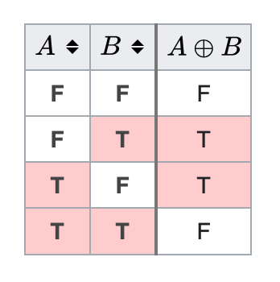

# ✅ O(n) and O(1) space. bitmagic explained

**Author:** codeninja8
**Votes:** 1
**Link:** [https://leetcode.com/problems/single-number-iii/solutions/5237424/](https://leetcode.com/problems/single-number-iii/solutions/5237424/)

---

# Intuition
To solve this problem we need next cosidirations:
1. x ^ x = 0
2. 101 ^ 011 = 110

# Approach

Let's say we have an array ```[a, a, c, b, b, d]```
If we take `xor` of all values in the array. ```a ^ a ^ c ^ b ^ b ^ d``` The result is ``` c ^ d ```
```c``` and ```d``` are what we are looking for.

How do we find them if we know only their xor sum?

Check the truth table


The ```xor``` operation give us a binary digit where all bits are distict. In other word, ```c ^ d``` results in a number that has bits set only where ```c``` and ```d``` differ.

To find ```c``` of ```d``` we need one of these bits. Let's say ```mask``` contains one of these bits, specifically the rightmost bit.

Than we can split the array into two groups.
1. Group 1 has the bit ```x & mask == mask```
2. Group 2 doesn't have the bit ```x && mask == 0```

For example we get two arrays
```[b, b, d]```
```[a, a, c]```

Now we can find ```c``` and ```d``` easily using ```xor``` operation (x^x = 0 do you remember?)

```b ^ b ^ d = d```
```a ^ a ^ c = c```

How do we get the ```mask```?

We can shift until we find the first set bit:
``` java
int mask = 1;
for (int i = 0; i < 32; i++) {
    if ((mask & xor) != 0) break;
    mask <<= 1;
}
```

But I have a better trick for you:
``` java
mask &= -xor;
``` 

Check out the code below:

# Complexity
- Time complexity:
$$O(n)$$

- Space complexity:
$$O(1)$$

# Code
``` java []
class Solution {
    public int[] singleNumber(int[] nums) {
        int mask = 0;
        for (int val : nums) {
            mask ^= val;
        }

        mask &= -mask;

        int xor1 = 0;
        int xor2 = 0;
        for (int val : nums) {
            if ((val & mask) == 0) {
                xor1 ^= val;
            } else {
                xor2 ^= val;
            }
        }

        return new int[] {xor1, xor2};
    }
}
```
``` python []
class Solution(object):
    def singleNumber(self, nums):
        mask = 0
        for val in nums:
            mask ^= val
        mask &= -mask
        
        val1 = 0
        val2 = 0
        for val in nums:
            if val & mask == 0:
                val1 ^= val
            else:
                val2 ^= val
        
        return [val1, val2]
```
``` c []
int* singleNumber(int* nums, int numsSize, int* returnSize) {
    long mask = 0;
    for (int i = 0; i < numsSize; i++) {
        mask ^= nums[i];
    }
    mask &= -mask;

    int val1 = 0;
    int val2 = 0;
    for (int i = 0; i < numsSize; i++) {
        if ((nums[i] & mask) == 0) {
            val1 ^= nums[i];
        } else {
            val2 ^= nums[i];
        }
    }

    int* res = malloc(2*sizeof(int));
    res[0] = val1;
    res[1] = val2;
    *returnSize = 2;

    return res;
}
```
``` cpp []
class Solution {
public:
    vector<int> singleNumber(vector<int>& nums) {
        long mask = 0;
        for (auto val : nums) {
            mask ^= val;
        }

        mask &= (-mask);

        int val1 = 0;
        int val2 = 0;
        for (auto val : nums) {
            if ((val & mask) == 0) {
                val1 ^= val;
            } else {
                val2 ^= val;
            }
        }

        return {val1, val2};
    }
};
```
``` javascript []
var singleNumber = function(nums) {
    var mask = 0;
    for (var i = 0; i < nums.length; i++) {
        mask ^= nums[i];
    }

    mask &= - mask;

    var val1 = 0;
    var val2 = 0;
    for (var i = 0; i < nums.length; i++) {
        if ((nums[i] & mask) == 0) {
            val1 ^= nums[i];
        } else {
            val2 ^= nums[i];
        }
    }

    return [val1, val2];
};
```
``` php []
class Solution {
    function singleNumber($nums) {
        $mask = 0;
        foreach($nums as $val) {
            $mask ^= $val;
        }
        $mask &= -$mask;

        $val1 = 0;
        $val2 = 0;
        foreach($nums as $val) {
            if (($val & $mask) == 0) {
                $val1 ^= $val;
            } else {
                $val2 ^= $val;
            }
        }

        return [$val1, $val2];
    }
}
```
``` golang []
func singleNumber(nums []int) []int {
    mask := 0
    for _, val := range nums {
        mask ^= val
    }

    mask &= -mask

    val1 := 0
    val2 := 0
    for _, val := range nums {
        if val & mask == 0 {
            val1 ^= val
        } else {
            val2 ^= val
        }
    }

    return []int {val1, val2}
}
```
``` ruby []
def single_number(nums)
    mask = nums.reduce(0) { |acc, x| acc ^ x }
    mask &= -mask
    val1 = 0
    val2 = 0
    nums.each do |x|
        if (x & mask) == 0
            val1 ^= x
        else
            val2 ^= x
        end
    end

    return [val1, val2]
end
```
``` rust []
impl Solution {
    pub fn single_number(nums: Vec<i32>) -> Vec<i32> {
        let mut mask = 0;

        for &val in &nums {
            mask ^= val;
        }

        mask &= -mask;

        let mut val1 = 0;
        let mut val2 = 0;

        for &val in &nums {
            if val & mask == 0 {
                val1 ^= val;
            } else {
                val2 ^= val;
            }
        }

        return vec![val1, val2];
    }
}
```
``` kotlin []
class Solution {
    fun singleNumber(nums: IntArray): IntArray {
        var mask = 0;
        for (item in nums) {
            mask = mask xor item
        }

        mask = mask and (-mask)

        var val1 = 0
        var val2 = 0

        for (item in nums) {
            if (mask and item == 0) {
                val1 = val1 xor item
            } else {
                val2 = val2 xor item
            }
        }

        return intArrayOf(val1, val2)
    }
}
```
``` racket []
(define (single-number nums)
    (let* ([xor (foldl bitwise-xor 0 nums)]
           [mask (bitwise-and xor (* xor -1))])
        (list (foldl bitwise-xor 0 (filter (lambda (x) (zero? (bitwise-and x mask))) nums))
              (foldl bitwise-xor 0 (filter (lambda (x) (not (zero? (bitwise-and x mask)))) nums)))))