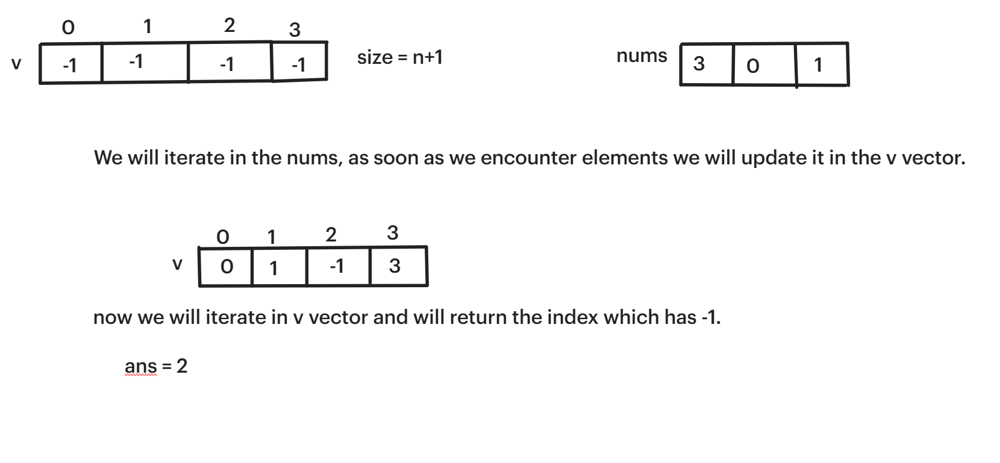
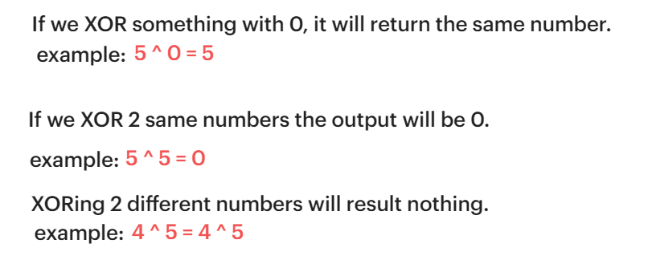
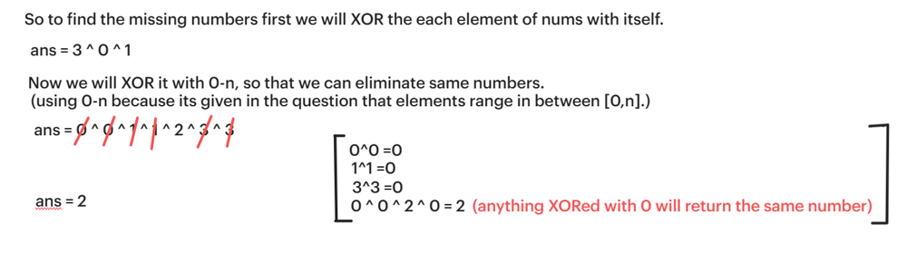
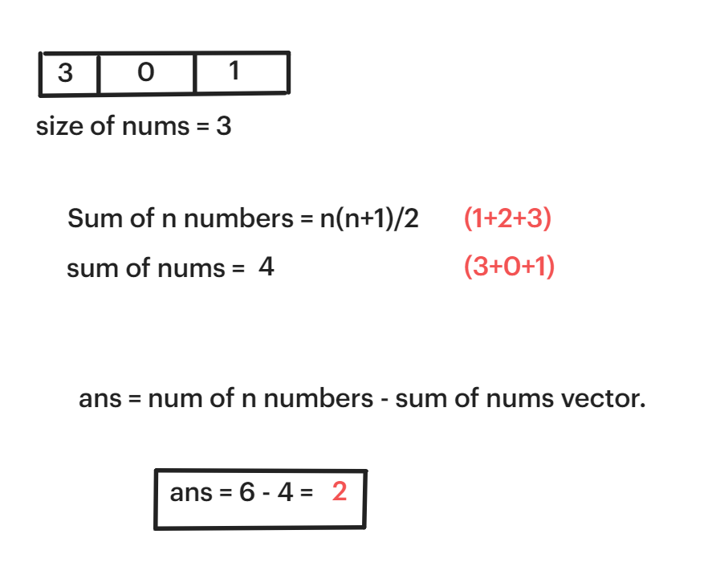
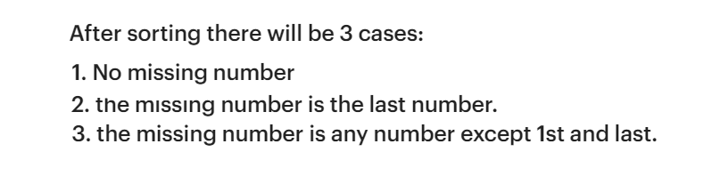
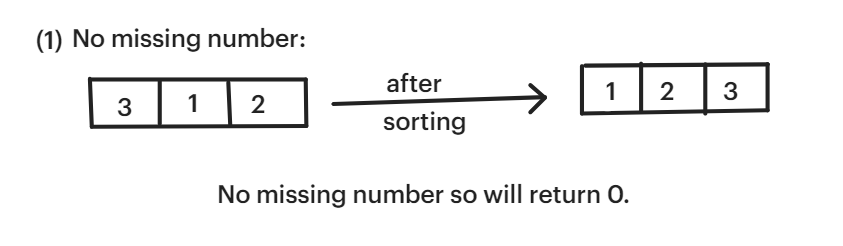
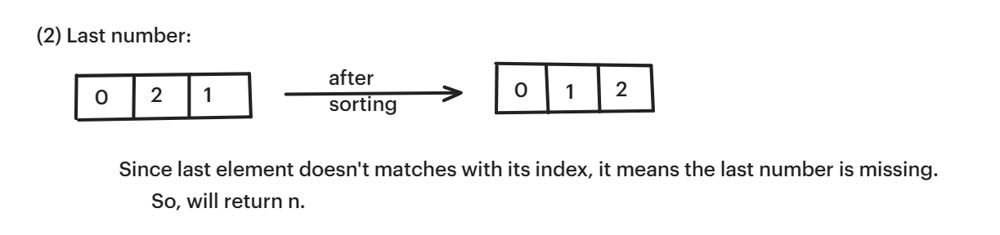
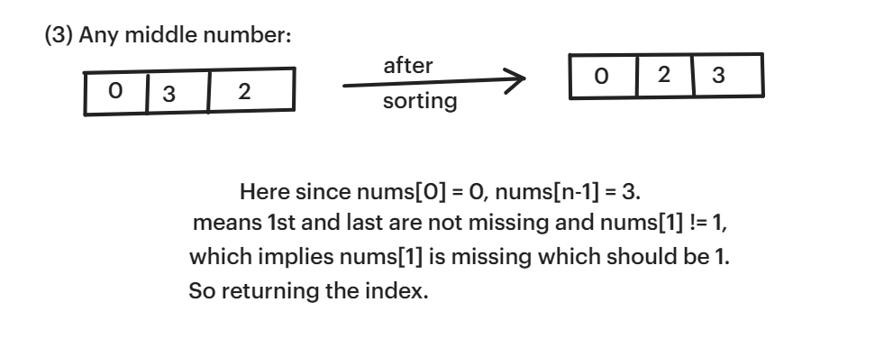

# ✅☑Beats 98% Users || 4 Approaches || [C++/Java/Python/JavaScript] || EXPLAINED🔥

**Author:** MarkSPhilip31
**Votes:** 543
**Link:** [https://leetcode.com/problems/missing-number/solutions/4754401/](https://leetcode.com/problems/missing-number/solutions/4754401/)

---

# DO GIVE IT A LIKE IF THAT WAS HELPFUL\uD83E\uDEE1\uD83D\uDC47


---


---


# Approaches
(Also explained in the code)

#### ***Approach 1(Using Vectors)***
1. Will iterate over the nums and will put elements in the v vector(size of n+1).


1. At last will iterate in v and  will return index of the element which is still -1. 

# Complexity
- Time complexity:
   $$O(n)$$
    

- Space complexity:
   $$O(n)$$
    


# Code
```C++ []
class Solution {
public:
    int missingNumber(vector<int>& nums) {
        int n = nums.size();
        vector<int>v(n+1,-1);
        for(int i =0;i<nums.size();i++){
            v[nums[i]] = nums[i];
        }
        for(int i =0;i<v.size();i++){
            if(v[i]==-1)return i;
        }
        return 0;
    }
};


```
```Java []
class Solution {
    public int missingNumber(int[] nums) {
        int n = nums.length;
        int[] v = new int[n+1];
        Arrays.fill(v, -1);
        for(int i = 0; i < nums.length; i++) {
            v[nums[i]] = nums[i];
        }
        for(int i = 0; i < v.length; i++) {
            if(v[i] == -1) return i;
        }
        return 0;
    }
}


```
```python3 []
class Solution:
    def missingNumber(self, nums: List[int]) -> int:
        n = len(nums)
        v = [-1] * (n + 1)
        for num in nums:
            v[num] = num
        for i in range(len(v)):
            if v[i] == -1:
                return i
        return 0


```
```javascript []
var missingNumber = function(nums) {
    let n = nums.length;
    let v = new Array(n+1).fill(-1);
    for(let i = 0; i < nums.length; i++) {
        v[nums[i]] = nums[i];
    }
    for(let i = 0; i < v.length; i++) {
        if(v[i] == -1) return i;
    }
    return 0;
};


```
---

#### ***Approach 2(XOR Operation)***
1. **XOR operation we should be known:**


1. We will xor each number present in the nums to itself.
1. Then will xor it with every number present in the range [0,n].


# Complexity
- Time complexity:
   $$O(n)$$
    

- Space complexity:
   $$O(1)$$
    


# Code
```C++ []
class Solution {
public:
    int missingNumber(vector<int>& nums) {
        int n = nums.size();
        int ans =0;
        for(int i =1;i<=n;i++){
            ans = ans ^ i;
        }
        for(int i =0;i<nums.size();i++){
            ans= ans^nums[i];
        }
        return ans;
    }
};


```
```Java []
public class Solution {
    public int missingNumber(int[] nums) {
        int n = nums.length;
        int ans = 0;
        for (int i = 1; i <= n; i++) {
            ans = ans ^ i;
        }
        for (int i = 0; i < nums.length; i++) {
            ans = ans ^ nums[i];
        }
        return ans;
    }
}


```
```python3 []
class Solution:
    def missingNumber(self, nums: List[int]) -> int:
        n = len(nums)
        ans = 0
        for i in range(1, n + 1):
            ans ^= i
        for num in nums:
            ans ^= num
        return ans


```
```javascript []
var missingNumber = function(nums) {
    const n = nums.length;
    let ans = 0;
    for (let i = 1; i <= n; i++) {
        ans ^= i;
    }
    for (let i = 0; i < nums.length; i++) {
        ans ^= nums[i];
    }
    return ans;
};


```
---

#### ***Approach 3(Sum of all elememnts)***
1. sum of all elements in the range[0,n].
1. sum of nums.
1. If we subtrate both we will get the missing number



# Complexity
- Time complexity:
   $$O(n)$$
    

- Space complexity:
   $$O(1)$$
    


# Code
```C++ []
class Solution {
public:
    int missingNumber(vector<int>& nums) {
        
        int n = nums.size();
        int Tsum = (n*(n+1))/2;
        return  Tsum - accumulate(nums.begin(),nums.end(),0);
        
    }
}; 


```
```Java []


class Solution {
    public int missingNumber(int[] nums) {
        int n = nums.length;
        int Tsum = (n * (n + 1)) / 2;
        int actualSum = Arrays.stream(nums).sum();
        return Tsum - actualSum;
    }
}


```
```python3 []
class Solution:
    def missingNumber(self, nums: List[int]) -> int:
        n = len(nums)
        Tsum = (n * (n + 1)) // 2
        actual_sum = sum(nums)
        return Tsum - actual_sum


```
```javascript []
var missingNumber = function(nums) {
    const n = nums.length;
    const Tsum = (n * (n + 1)) / 2;
    const actualSum = nums.reduce((acc, num) => acc + num, 0);
    return Tsum - actualSum;
};


```
---
#### ***Approach 4(Sorting)***
1. cases after sorting


1. If starting number isnt 0 after sorting which implies there is no missing number.


1. If last number is missing then the index will never match with the last element.


1. If any number other than 1st and last is missing it, then return i.



# Complexity
- Time complexity:
   $$O(nlogn)$$
    

- Space complexity:
   $$O(1)$$
    


# Code
```C++ []
class Solution {
public:
    int missingNumber(vector<int>& nums) {
        sort(nums.begin(),nums.end());
        int n = nums.size();
        //case 1
        if(nums[0] != 0)return 0;
        //case 2 
        if(nums[n-1] != n)return n;
        for(int i =1;i<nums.size();i++){
            if(nums[i] != i){
            //case 3
            return i;
            }
        }
        return 0;
    }
};


```
```Java []
import java.util.Arrays;

class Solution {
    public int missingNumber(int[] nums) {
        Arrays.sort(nums);
        int n = nums.length;
        
        // Case 1
        if (nums[0] != 0) return 0;
        
        // Case 2
        if (nums[n - 1] != n) return n;
        
        // Case 3
        for (int i = 1; i < nums.length; i++) {
            if (nums[i] != i) return i;
        }
        
        return 0;
    }
}


```
```python3 []
class Solution:
    def missingNumber(self, nums: List[int]) -> int:
        nums.sort()
        n = len(nums)
        
        # Case 1
        if nums[0] != 0:
            return 0
        
        # Case 2
        if nums[-1] != n:
            return n
        
        # Case 3
        for i in range(1, len(nums)):
            if nums[i] != i:
                return i
        
        return 0


```
```javascript []
var missingNumber = function(nums) {
    nums.sort((a, b) => a - b);
    const n = nums.length;
    
    // Case 1
    if (nums[0] !== 0) return 0;
    
    // Case 2
    if (nums[n - 1] !== n) return n;
    
    // Case 3
    for (let i = 1; i < nums.length; i++) {
        if (nums[i] !== i) return i;
    }
    
    return 0;
};


```
---


# DO GIVE IT A LIKE IF THAT WAS HELPFUL\uD83E\uDEE1\uD83D\uDC47

---
---


---