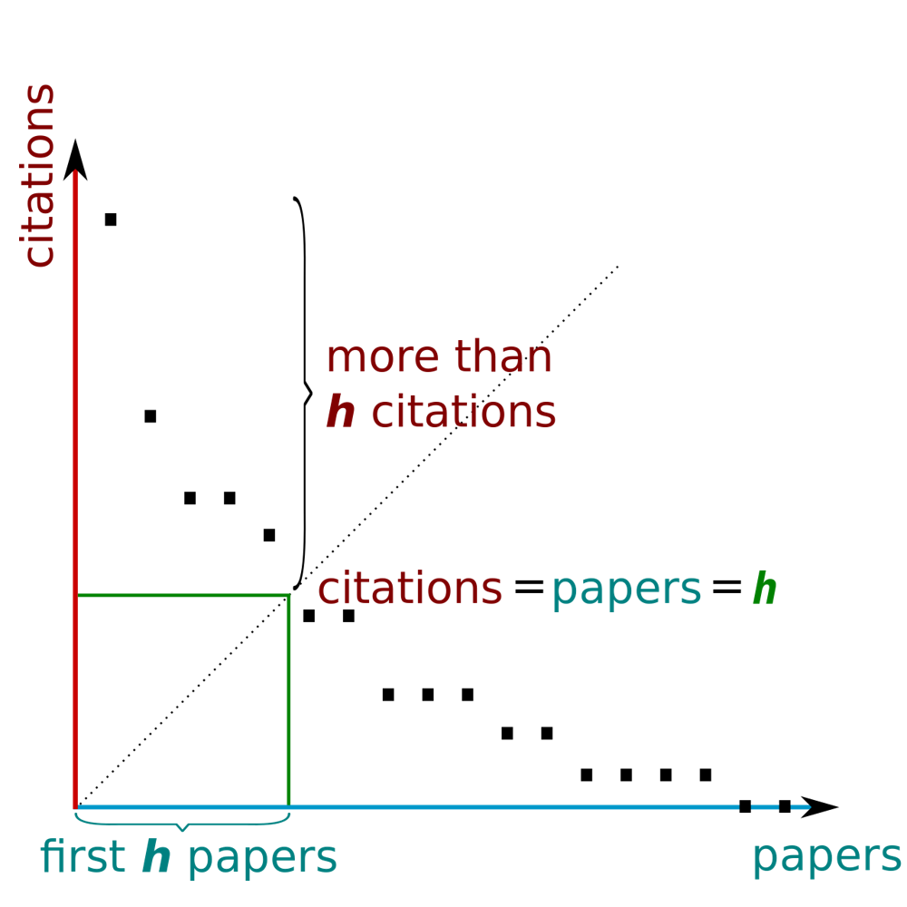

# 🍀 Clean and Well-explained Solution [beats 100% runtime]

**Author:** silvermete0r
**Votes:** 24
**Link:** [https://leetcode.com/problems/h-index/solutions/4908801/](https://leetcode.com/problems/h-index/solutions/4908801/)

---

# Intuition
**Carefully read an article about H-index (Hirsch index):**
> The h-index is defined as the maximum value of h such that the given author/journal has published at least h papers that have each been cited at least h times.[4][5] The index is designed to improve upon simpler measures such as the total number of citations or publications. The index works best when comparing scholars working in the same field, since citation conventions differ widely among different fields.



**Source:** https://en.wikipedia.org/wiki/H-index 

# Approach
1. First of all, we need to sort a `citations` array in ascending order.
2. Next, we iterate through the `citations` array and track the case where `citations[i]` is greater than `n - i` which means that we have at least `n - i` articles with `n - i` citations which is our `h-index` value.
3. Finally, we just return the answer `n - i` in that case.

# Complexity
- **Time complexity:** $$O(n * log(n))$$

- **Space complexity:** $$O(log(n))$$


**\uD83C\uDF40 Good luck! If you like my explanation, please don't forget to upvote and comment!** 

# Code
``` C++ []
class Solution {
public:
    int hIndex(vector<int>& citations) {
        int n = citations.size();
        sort(citations.begin(), citations.end());
        for(int i=0; i<n; i++) {
            if(citations[i] >= n - i) return n - i;
        }
        return 0;
    }
};
```

``` Python []
class Solution:
    def hIndex(self, citations: List[int]) -> int:
        n = len(citations)
        citations.sort()
        for i in range(n):
            if citations[i] >= n - i:
                return n - i
        return 0
```

``` PHP []
class Solution {
    function hIndex($citations) {
        $n = count($citations);
        sort($citations);
        for ($i = 0; $i < $n; $i++) {
            if($citations[$i] >= $n - $i) return $n - $i;
        }
        return 0;
    }
}
```

``` Java []
class Solution {
    public int hIndex(int[] citations) {
        int n = citations.length;
        Arrays.sort(citations);
        for(int i=0; i<n; i++) {
            if(citations[i] >= n - i) return n - i;
        }
        return 0;
    }
}
```

``` C# []
public class Solution {
    public int HIndex(int[] citations) {
        int n = citations.Length;
        Array.Sort(citations);
        for (int i = 0; i < n; i++) {
            if(citations[i] >= n - i) return n - i;
        }
        return 0;
    }
}
```

``` C []
int cmp(const void* a, const void* b) {
    return (*(int*)a - *(int*)b);
}

int hIndex(int* citations, int n) {
    qsort(citations, n, sizeof(int), cmp);
    for (int i = 0; i < n; i++) {
        if(citations[i] >= n - i) return n - i;
    }
    return 0;
}
```

``` Rust []
impl Solution {
    pub fn h_index(citations: Vec<i32>) -> i32 {
        let n = citations.len();
        citations.sort_unstable();
        for (i, &citation) in citations.iter().enumerate() {
            if citation as usize >= n - i {
                return (n - i) as i32;
            }
        }
        0
    }
}
```

``` JavaScript []
var hIndex = function(citations) {
    let n = citations.length;

    citations.sort((a, b) => a - b);

    for (let i = 0; i < n; i++) {
        if(citations[i] >= n - i) return n - i;
    }

    return 0;
};
```

``` TypeScript []
function hIndex(citations: number[]): number {
    const n: number = citations.length;

    citations.sort((a, b) => a - b);

    for (let i = 0; i < n; i++) {
        if(citations[i] >= n - i) return n - i;
    }

    return 0;
};
```
