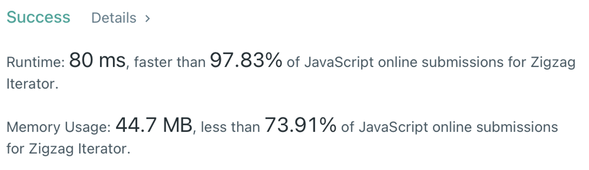

# simple solution faster than 97%

**Author:** Eukey
**Votes:** 1
**Link:** [https://leetcode.com/problems/zigzag-iterator/solutions/2228986/](https://leetcode.com/problems/zigzag-iterator/solutions/2228986/)

---

```
var ZigzagIterator = function ZigzagIterator(v1, v2) {
    this.iterator = []
    let i = 0
    while(v1[i] !== undefined && v2[i] !== undefined){
        this.iterator.push(v1[i])
        this.iterator.push(v2[i])
        i++
    }
    while(v1[i] !== undefined) {
        this.iterator.push(v1[i])
        i++
    }
    while(v2[i] !== undefined) {
        this.iterator.push(v2[i])
        i++
    }
    this.index = 0
};

ZigzagIterator.prototype.hasNext = function hasNext() {
    return this.iterator[this.index] !== undefined
};

ZigzagIterator.prototype.next = function next() {
    return this.iterator[this.index++]
};
```

