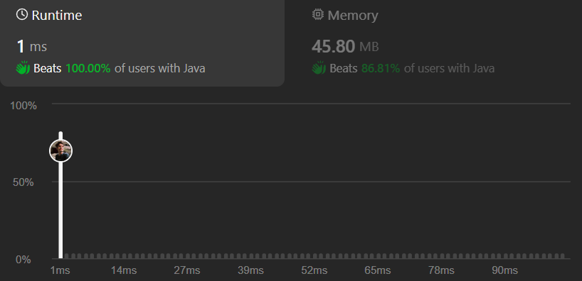

# Simple, Beginner friendly & Dry Run || Tow Pointer Approach || Time O(N) & space O(1) || Gits✅✅✅😊

**Author:** GiteshSK_12
**Votes:** 17
**Link:** [https://leetcode.com/problems/move-zeroes/solutions/4769244/](https://leetcode.com/problems/move-zeroes/solutions/4769244/)

---




# Intuition \uD83D\uDC48

In the given question, we have an array of numbers in which we need to move all the zeros to the end of the array without changing the relative order.

# Approach \uD83D\uDC48
To solve this question, we will use a two-pointer approach, which is the best and most readable solution.

# Code Explanation \uD83D\uDC48
*   **Initialization**: Two pointers, `slow` and `fast`, are initialized to 0. The `slow` pointer will track the position where the next non-zero element should be moved, while the `fast` pointer will scan through the array looking for non-zero elements.
    
*   **Traverse the array**: The `while` loop runs as long as `fast` is less than the length of the array (`len`). This ensures that every element is checked.
    
*   **Moving non-zero elements**: Inside the loop, if the element at the `fast` pointer (`nums[fast]`) is not zero, it is assigned to the position pointed by `slow` (`nums[slow]`), and then `slow` is incremented. This effectively shifts all non-zero elements to the front of the array, in their original relative order.
    
*   **Filling remaining positions with zeros**: Once the loop is done, all non-zero elements have been moved to the beginning of the array. The `for` loop starting from `slow` to the end of the array (`len`) sets all remaining elements to zero, as `slow` marks the start of where the zeros should be placed.

# Complexity \uD83D\uDC48
- Time complexity: O(N)

- Space complexity: O(1)


# Code \uD83D\uDC48
```C []
void moveZeroes(int* nums, int numsSize) {
        int slow = 0;
        int fast = 0;
        while(fast < numsSize){
            if(nums[fast] != 0){
                nums[slow] = nums[fast];
                slow++;
            }
            fast++;
        }
        for(int i=slow; i<numsSize; i++) nums[i] = 0;
}
```
```C++ []
class Solution {
public:
    void moveZeroes(vector<int>& nums) {
        int len = nums.size();
        int slow = 0;
        int fast = 0;
        while(fast < len){
            if(nums[fast] != 0){
                nums[slow] = nums[fast];
                slow++;
            }
            fast++;
        }
        for(int i=slow; i<len; i++) nums[i] = 0;
    }
};
```
```Java []
class Solution {
    public void moveZeroes(int[] nums) {
        int len = nums.length;
        int slow = 0;
        int fast = 0;
        while(fast < len){
            if(nums[fast] != 0){
                nums[slow] = nums[fast];
                slow++;
            }
            fast++;
        }
        for(int i=slow; i<len; i++) nums[i] = 0;
    }
}
```
```javascript []
let len = nums.length;
        let slow = 0;
        let fast = 0;
        while (fast < len) {
            if (nums[fast] !== 0) {
                nums[slow] = nums[fast];
                slow++;
            }
            fast++;
        }
        for (let i = slow; i < len; i++) nums[i] = 0;
```
```C# []
public class Solution {
    public void MoveZeroes(int[] nums) {
        int len = nums.Length;
        int slow = 0;
        int fast = 0;
        while(fast < len){
            if(nums[fast] != 0){
                nums[slow] = nums[fast];
                slow++;
            }
            fast++;
        }
        for(int i=slow; i<len; i++) nums[i] = 0;
    }
}
```
```python []
class Solution(object):
    def moveZeroes(self, nums):
        """
        :type nums: List[int]
        :rtype: None Do not return anything, modify nums in-place instead.
        """
        leng = len(nums)
        slow = 0
        fast = 0
        while fast < leng:
            if nums[fast] != 0:
                nums[slow] = nums[fast]
                slow+=1
            fast+=1
        for i in range(slow,leng):
            nums[i] = 0
```
```ruby []
# @param {Integer[]} nums
# @return {Void} Do not return anything, modify nums in-place instead.
def move_zeroes(nums)
    len = nums.length()
    slow = 0
    fast = 0
    while fast < len
        if nums[fast] != 0
            nums[slow] = nums[fast]
            slow+=1
        end
        fast+=1
    end
    for i in slow..len-1 do
        nums[i] = 0
    end
end
```

# Dry Run \uD83D\uDC48
**Initial State:**

*   `nums = [0, 1, 0, 3, 12]`
*   `len = 5` (length of the array)
*   `slow = 0`
*   `fast = 0`

**Step-by-Step Execution:**

1.  **Iteration 1:**
    
    *   `fast = 0`, `nums[fast] = 0`
    *   Since `nums[fast]` is `0`, do nothing and increment `fast` to `1`.
2.  **Iteration 2:**
    
    *   `fast = 1`, `nums[fast] = 1`
    *   Since `nums[fast]` is not `0`, move `nums[fast]` to `nums[slow]`, so `nums[slow] = nums[fast] = 1`.
    *   Increment `slow` to `1`.
    *   Increment `fast` to `2`.
    *   Array state: `[1, 1, 0, 3, 12]` (Note: the duplication is temporary and will be resolved as the algorithm progresses).
3.  **Iteration 3:**
    
    *   `fast = 2`, `nums[fast] = 0`
    *   Since `nums[fast]` is `0`, do nothing and increment `fast` to `3`.
4.  **Iteration 4:**
    
    *   `fast = 3`, `nums[fast] = 3`
    *   Since `nums[fast]` is not `0`, move `nums[fast]` to `nums[slow]`, so `nums[slow] = nums[fast] = 3`.
    *   Increment `slow` to `2`.
    *   Increment `fast` to `4`.
    *   Array state: `[1, 3, 0, 3, 12]`.
5.  **Iteration 5:**
    
    *   `fast = 4`, `nums[fast] = 12`
    *   Since `nums[fast]` is not `0`, move `nums[fast]` to `nums[slow]`, so `nums[slow] = nums[fast] = 12`.
    *   Increment `slow` to `3`.
    *   Increment `fast` to `5`.
    *   Array state: `[1, 3, 12, 3, 12]`.


**Filling Remaining Positions with Zeros:**

*   Now, `fast` has reached `len`, so we exit the `while` loop.
*   Start filling the rest of the array with zeros starting from `slow` (which is `3`) until the end of the array (`len` which is `5`).
*   Set `nums[3] = 0` and `nums[4] = 0`.
*   Final array state: `[1, 3, 12, 0, 0]`.

**Conclusion:**

The algorithm successfully moves all zeros to the end of the array `[1, 3, 12, 0, 0]`, maintaining the relative order of the non-zero elements `[1, 3, 12]`.

# If the solution and explanation are helpful, please upvote me.\u2764\uFE0F\u2764\uFE0F\u2764\uFE0F\u2764\uFE0F\u2764\uFE0F\u2764\uFE0F\u2764\uFE0F\u2764\uFE0F


