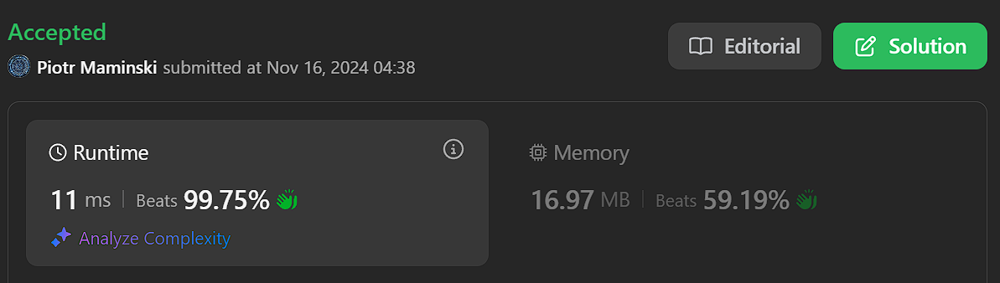

# 🚀 Video Solution | Short and Simple

**Author:** Piotr_Maminski
**Votes:** 11
**Link:** [https://leetcode.com/problems/move-zeroes/solutions/6049565/](https://leetcode.com/problems/move-zeroes/solutions/6049565/)

---


https://youtu.be/aayNRwUN3Do?si=r9yNb7GpYCWRJgbC


```python3 []
class Solution:
    def moveZeroes(self, nums: List[int]) -> None:
        """
        Do not return anything, modify nums in-place instead.
        """
        l = 0
        for r in range(len(nums)):
            if nums[r]:
                nums[l], nums[r] = nums[r], nums[l]
                l += 1
        return nums
```
```cpp []
class Solution {
public:
    void moveZeroes(vector<int>& nums) {
        int l = 0;
        
        for (int r = 0; r < nums.size(); r++) {
            if (nums[r]) {
                swap(nums[l], nums[r]);
                l++;
            }
        }
    }
};
```
```java []
class Solution {
    public void moveZeroes(int[] nums) {
        int left = 0;
        for (int right = 0; right < nums.length; right++) {
            if (nums[right] != 0) {
                int temp = nums[left];
                nums[left] = nums[right];
                nums[right] = temp;
                left++;
            }
        }
    }
}
```
```csharp []
public class Solution {
    public void MoveZeroes(int[] nums) {
        int left = 0;
        for (int right = 0; right < nums.Length; right++) {
            if (nums[right] != 0) {
                int temp = nums[left];
                nums[left] = nums[right];
                nums[right] = temp;
                left++;
            }
        }
    }
}
```
```golang []
func moveZeroes(nums []int) {
    left := 0
    for right := 0; right < len(nums); right++ {
        if nums[right] != 0 {
            nums[left], nums[right] = nums[right], nums[left]
            left++
        }
    }
}
```
```swift []
class Solution {
    func moveZeroes(_ nums: inout [Int]) {
        var left = 0
        for right in 0..<nums.count {
            if nums[right] != 0 {
                (nums[left], nums[right]) = (nums[right], nums[left])
                left += 1
            }
        }
    }
}
```
```javascript [JS]
// JavaScript

var moveZeroes = function(nums) {
    let left = 0;
    for (let right = 0; right < nums.length; right++) {
        if (nums[right] !== 0) {
            [nums[left], nums[right]] = [nums[right], nums[left]];
            left++;
        }
    }
    return nums;
};
```
```typescript [TS]
// TypeScript

function moveZeroes(nums: number[]): void {
    let left: number = 0;
    for (let right = 0; right < nums.length; right++) {
        if (nums[right] !== 0) {
            [nums[left], nums[right]] = [nums[right], nums[left]];
            left++;
        }
    }
}
```
```rust []
impl Solution {
    pub fn move_zeroes(nums: &mut Vec<i32>) {
        let mut left = 0;
        for right in 0..nums.len() {
            if nums[right] != 0 {
                nums.swap(left, right);
                left += 1;
            }
        }
    }
}
```
```ruby []
def move_zeroes(nums)
    left = 0
    (0...nums.length).each do |right|
        if nums[right] != 0
            nums[left], nums[right] = nums[right], nums[left]
            left += 1
        end
    end
    nums
end
```
- Complexy: Time O(n) & Space O(1)


---




