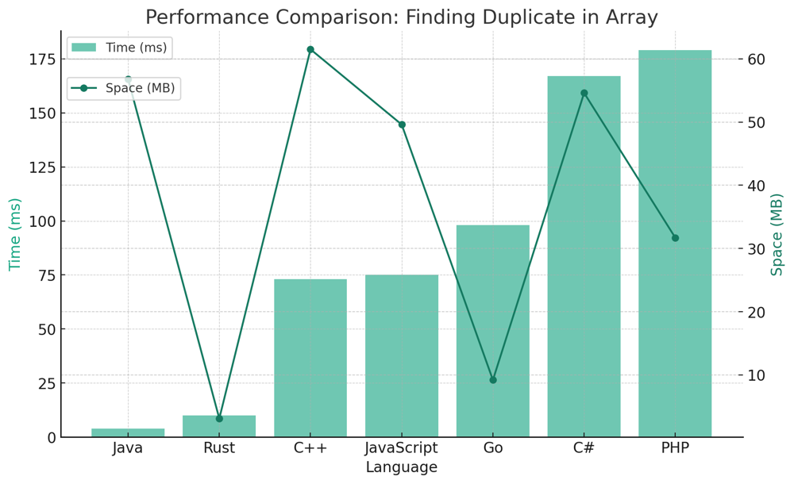

# ✅ 97.77% 6 Approaches Set, Count, Binary Search, Fast Slow, Mark, Sort

**Author:** vanAmsen
**Votes:** 301
**Link:** [https://leetcode.com/problems/find-the-duplicate-number/solutions/4062141/](https://leetcode.com/problems/find-the-duplicate-number/solutions/4062141/)

---

# Comprehensive Guide to Solving "Find the Duplicate Number"

## Introduction & Problem Statement

Given an array of integers, $$ \	ext{nums} $$, containing $$ n + 1 $$ integers where each integer is in the range $$[1, n]$$ inclusive, find the one repeated number in the array. The challenge lies in solving the problem without modifying the array $$ \	ext{nums} $$ and using only constant extra space. This problem is a classic example of array manipulation and number theory combined, making it an interesting problem to tackle.

## Key Concepts and Constraints

### What Makes This Problem Unique?

1. **Array Representation**:  
   The array contains $$ n + 1 $$ integers, each falling within the range $$[1, n]$$.

2. **Single Duplication**:  
   Only one integer is repeated in the array, and it can be repeated more than once.

3. **Constraints**:  
   - Array length: $$ n + 1 $$, where $$ 1 \\leq n \\leq 10^5 $$
   - $$ 1 \\leq \	ext{nums}[i] \\leq n $$

## Six Primary Strategies to Solve the Problem:

1. **Set/Hash Table**: Use a hash table to track the numbers that have appeared so far.
2. **Count Array**: Use an auxiliary array to count the frequency of each number.
3. **Marking in Array**: Negate the value at the index corresponding to each number in the array.
4. **Floyd's Cycle Detection (Fast-Slow Pointers)**: Treat the array as a linked list to find a cycle.
5. **Binary Search**: Count the numbers less than or equal to the middle element to find the duplicate.
6. **Sort**: Sort the array and check adjacent elements for duplicates.

---

# In-Depth Strategies for Finding the Duplicate Number in an Array

## Live Coding & comparing 6 Approaches
https://youtu.be/J3qIbJA7t9Q?si=1H3cjdkBb7QQ8D7x

## 1. Set/Hash Table Approach

#### Detailed Logic:
1. Initialize an empty set `seen`.
2. Traverse through the array `nums`.
3. For each element `num` in `nums`, check if it exists in `seen`.
    - If it does, return `num` as the duplicate.
    - Otherwise, add `num` to `seen`.

#### Pros:
- Extremely straightforward to implement.
- No need to sort or modify the original array.

#### Cons:
- This approach requires extra space for the set, which violates the problem's constraint of constant extra space.

#### Time and Space Complexity:
- **Time Complexity**: $$O(n)$$ because we iterate through the array once.
- **Space Complexity**: $$O(n)$$ for storing the set.

## Code Set
``` Python []
class Solution:
    def findDuplicate(self, nums: List[int]) -> int:
        seen = set()
        for num in nums:
            if num in seen:
                return num
            seen.add(num)

```
``` Go []
func findDuplicate(nums []int) int {
    seen := make(map[int]bool)
    for _, num := range nums {
        if seen[num] {
            return num
        }
        seen[num] = true
    }
    return -1  // Just to satisfy the compiler, this should never be reached
}
```
``` Rust []
use std::collections::HashSet;

impl Solution {
    pub fn find_duplicate(nums: Vec<i32>) -> i32 {
    let mut seen = HashSet::new();
    for &num in nums.iter() {
        if seen.contains(&num) {
            return num;
        }
        seen.insert(num);
    }
    -1  // Just to satisfy the compiler, this should never be reached
}
}
```
``` C++ []
class Solution {
public:
    int findDuplicate(std::vector<int>& nums) {
        std::unordered_set<int> seen;
        for (int num : nums) {
            if (seen.find(num) != seen.end()) {
                return num;
            }
            seen.insert(num);
        }
        return -1;  // Just to satisfy the compiler, this should never be reached
    }
};
```
``` Java []
class Solution {
    public int findDuplicate(int[] nums) {
    HashSet<Integer> seen = new HashSet<>();
    for (int num : nums) {
        if (seen.contains(num)) {
            return num;
        }
        seen.add(num);
    }
    return -1;  // Just to satisfy the compiler, this should never be reached
}
}
```
``` JavaScript []
/**
 * @param {number[]} nums
 * @return {number}
 */
var findDuplicate = function(nums) {
    const seen = new Set();
    for (const num of nums) {
        if (seen.has(num)) {
            return num;
        }
        seen.add(num);
    }
    return -1;  // Just to satisfy the compiler, this should never be reached
}
```
``` C# []
public class Solution {
    public int FindDuplicate(int[] nums) {
        HashSet<int> seen = new HashSet<int>();
        foreach (int num in nums) {
            if (seen.Contains(num)) {
                return num;
            }
            seen.Add(num);
        }
        return -1;  // Just to satisfy the compiler, this should never be reached
    }
}
```

---

## 2. Count Array Approach

#### Detailed Logic:
1. Initialize an auxiliary count array `cnt` with zeros. Its size will be $$ n+1 $$ to accommodate all possible numbers.
2. Traverse through the array `nums`.
3. For each element `num` in `nums`, increment `cnt[num]` by 1.
4. Check if `cnt[num]` exceeds 1; if yes, return `num` as the duplicate.

#### Pros:
- Implementation is simple and direct.
  
#### Cons:
- Extra space is used for the count array, which contradicts the constraint of constant extra space.

#### Time and Space Complexity:
- **Time Complexity**: $$O(n)$$ due to a single pass through the array.
- **Space Complexity**: $$O(n)$$ for the count array.


## Code Count
``` Python []
class Solution:
    def findDuplicate(self, nums: List[int]) -> int:
        cnt = [0] * (len(nums) + 1)
        for num in nums:
            cnt[num] += 1
            if cnt[num] > 1:
                return num
        return len(nums)
```

---

## 3. Marking in Array Approach

#### Detailed Logic:
1. Traverse the array `nums`.
2. For each element `num`, take its absolute value as an index (`idx = abs(num)`).
3. If `nums[idx]` is negative, then `idx` is the duplicate number.
4. Otherwise, negate `nums[idx]`.

#### Pros:
- Doesn't use any extra space other than the input array.
  
#### Cons:
- Modifies the original array, which is disallowed by the problem constraints.

#### Time and Space Complexity:
- **Time Complexity**: $$O(n)$$ for a single pass through the array.
- **Space Complexity**: $$O(1)$$ as no extra space is used.

## Code Mark
``` Python []
class Solution:
    def findDuplicate(self, nums: List[int]) -> int:
        for num in nums:
            idx = abs(num)
            if nums[idx] < 0:
                return idx
            nums[idx] = -nums[idx]
        return len(nums)
```

---

## 4. Fast-Slow Pointers Approach (Floyd's Cycle Detection)

### Detailed Logic Behind the Fast-Slow Pointers Approach

**Step 1: Initialize Pointers**
First, we initialize two pointers, `slow` and `fast`, both set to `nums[0]`. This is the starting point for both pointers, and it's done to set up the conditions for Floyd's cycle detection algorithm.

**Step 2: Detect a Cycle**
In this step, we enter a `while` loop where the `slow` pointer moves one step at a time (`slow = nums[slow]`), while the `fast` pointer moves two steps (`fast = nums[nums[fast]]`). The loop continues until both pointers meet at some point within the cycle. Note that this meeting point is not necessarily the duplicate number; it's just a point inside the cycle.

Why does this happen? Because there is a duplicate number, there must be a cycle in the 'linked list' created by following `nums[i]` as next elements. Once a cycle is detected, the algorithm breaks out of this loop.

**Step 3: Find the Start of the Cycle (Duplicate Number)**
After identifying a meeting point inside the cycle, we reinitialize the `slow` pointer back to `nums[0]`. The `fast` pointer stays at the last meeting point. Now, we enter another `while` loop where both pointers move one step at a time. The reason behind this is mathematical: according to Floyd's cycle detection algorithm, when both pointers move at the same speed, they will eventually meet at the starting point of the cycle. This is the duplicate number we are looking for.

**Step 4: Return the Duplicate Number**
Finally, when the `slow` and `fast` pointers meet again, the meeting point will be the duplicate number, and we return it as the output.

#### Pros:
- Adheres to the constant space constraint.
- Doesn't modify the original array.

#### Cons:
- The logic can be slightly tricky to grasp initially.

#### Time and Space Complexity:
- **Time Complexity**: $$O(n)$$, where $$ n $$ is the length of the array.
- **Space Complexity**: $$O(1)$$ as no extra space is required.

## Code Fast Slow Pointers
``` Python []
class Solution:
    def findDuplicate(self, nums: List[int]) -> int:
        slow = nums[0]
        fast = nums[0]

        while True:
            slow = nums[slow]
            fast = nums[nums[fast]]
            if slow == fast:
                break

        slow = nums[0]
        while slow != fast:
            slow = nums[slow]
            fast = nums[fast]
            
        return slow
```
``` Go []
func findDuplicate(nums []int) int {
    slow := nums[0]
    fast := nums[0]
    
    for {
        slow = nums[slow]
        fast = nums[nums[fast]]
        
        if slow == fast {
            break
        }
    }
    
    slow = nums[0]
    for slow != fast {
        slow = nums[slow]
        fast = nums[fast]
    }
    
    return slow
}
```
``` Rust []
impl Solution {
    pub fn find_duplicate(nums: Vec<i32>) -> i32 {
        let mut slow = nums[0];
        let mut fast = nums[0];
        
        loop {
            slow = nums[slow as usize];
            fast = nums[nums[fast as usize] as usize];
            
            if slow == fast {
                break;
            }
        }
        
        slow = nums[0];
        while slow != fast {
            slow = nums[slow as usize];
            fast = nums[fast as usize];
        }
        
        slow
    }
}
```
``` C++ []
class Solution {
public:
    int findDuplicate(vector<int>& nums) {
        int slow = nums[0];
        int fast = nums[0];

        do {
            slow = nums[slow];
            fast = nums[nums[fast]];
        } while (slow != fast);

        slow = nums[0];
        while (slow != fast) {
            slow = nums[slow];
            fast = nums[fast];
        }

        return slow;
    }
};
```
``` Java []
public class Solution {
    public int findDuplicate(int[] nums) {
        int slow = nums[0];
        int fast = nums[0];
        
        do {
            slow = nums[slow];
            fast = nums[nums[fast]];
        } while (slow != fast);
        
        slow = nums[0];
        while (slow != fast) {
            slow = nums[slow];
            fast = nums[fast];
        }
        
        return slow;
    }
}
```
``` JavaScript []
/**
 * @param {number[]} nums
 * @return {number}
 */
var findDuplicate = function(nums) {
    let slow = nums[0];
    let fast = nums[0];
    
    do {
        slow = nums[slow];
        fast = nums[nums[fast]];
    } while (slow !== fast);
    
    slow = nums[0];
    while (slow !== fast) {
        slow = nums[slow];
        fast = nums[fast];
    }
    
    return slow;
};
```
``` PHP []
class Solution {
    function findDuplicate($nums) {
        $slow = $nums[0];
        $fast = $nums[0];
        
        do {
            $slow = $nums[$slow];
            $fast = $nums[$nums[$fast]];
        } while ($slow != $fast);
        
        $slow = $nums[0];
        while ($slow != $fast) {
            $slow = $nums[$slow];
            $fast = $nums[$fast];
        }
        
        return $slow;
    }
}
```
``` C# []
public class Solution {
    public int FindDuplicate(int[] nums) {
        int slow = nums[0];
        int fast = nums[0];
        
        do {
            slow = nums[slow];
            fast = nums[nums[fast]];
        } while (slow != fast);
        
        slow = nums[0];
        while (slow != fast) {
            slow = nums[slow];
            fast = nums[fast];
        }
        
        return slow;
    }
}
```

---

### 5. Binary Search Approach

#### Detailed Logic:
1. Initialize `low` to 1 and `high` to $$ n $$.
2. Run a binary search loop until `low < high`:
    - Calculate `mid` as the midpoint between `low` and `high`.
    - Count elements in the array that are less than or equal to `mid`.
    - If the count is greater than `mid`, set `high = mid`. Otherwise, set `low = mid + 1`.

#### Pros:
- No modification to the original array.
  
#### Cons:
- Somewhat more complex to understand due to binary search mechanics.

#### Time and Space Complexity:
- **Time Complexity**: $$O(n \\log n)$$ due to binary search combined with array scanning.
- **Space Complexity**: $$O(1)$$ as no extra space is needed.


## Code Binary Search
``` Python 
class Solution:
    def findDuplicate(self, nums: List[int]) -> int:
        low, high = 1, len(nums) - 1
        
        while low < high:
            mid = (low + high) // 2
            count = 0
            for num in nums:
                if num <= mid:
                    count += 1
            if count > mid:
                high = mid
            else:
                low = mid + 1
                
        return low

```

## 6. Sort Approach

#### Detailed Logic:
1. Sort the `nums` array in ascending order.
2. Traverse the sorted array and compare adjacent elements.
    - If two adjacent elements are equal, return one of them as the duplicate.
3. If no duplicate is found, return the length of the array (this should not happen under the problem constraints).

#### Pros:
- Simple to understand and implement.
- Utilizes Python's efficient built-in sorting algorithm.

#### Cons:
- Modifies the original array by sorting it.
- Not the most time-efficient solution for this problem.

#### Time and Space Complexity:
- **Time Complexity**: $$ O(n \\log n) $$ due to sorting.
- **Space Complexity**: $$ O(1) $$ if sorting is done in-place, otherwise $$ O(n) $$.

---


## Code Sort
``` Python []
class Solution:
    def findDuplicate(self, nums: List[int]) -> int:
        nums.sort()
        for i in range(1, len(nums)):
            if nums[i] == nums[i-1]:
                return nums[i]
        return len(nums)
```

## Performance

| Language  | Time (ms) | Space (MB) | Approach         | 
|-----------|-----------|------------|------------------|
| Java      | 4         | 56.8       | Fast Slow Pointers|                  |
| Rust      | 10        | 3.1        | Fast Slow Pointers|                  |
| JavaScript| 75        | 49.6       | Fast Slow Pointers|                  |
| C++       | 73        | 61.5       | Fast Slow Pointers
| Go        | 98        | 9.2        | Fast Slow Pointers|                  |
| C#        | 167       | 54.6       | Fast Slow Pointers|                  |
| PHP       | 179       | 31.7       | Fast Slow Pointers|                  |
| Java      | 20        | 61.2       | Set               |                  |
| Rust      | 26        | 4.1        | Set               |                  |
| C#        | 193       | 50.7       | Set               |                  |
| Go        | 100       | 9.2        | Set               |                  |
| JavaScript| 92        | 61.3       | Set               |                  |
| C++       | 135       | 84.2       | Set               |                  |
| Python3   | 495       | 32.3       | Set               |                  |
| Python3   | 518       | 31.1       | Fast Slow Pointers|                  |
| Python3   | 518       | 30.9       | Count             |                  |
| Python3   | 522       | 31.0       | Mark              |                  |
| Python3   | 564       | 31.1       | Sort              |                  |
| Python3   | 724       | 31.0       | Binary Search     |                  |




## Conclusion

Each strategy has its merits and demerits, and the choice of approach depends on the specific constraints of the problem. Understanding these methods not only helps in solving this problem but also broadens one's array manipulation and algorithmic skills. Happy coding!