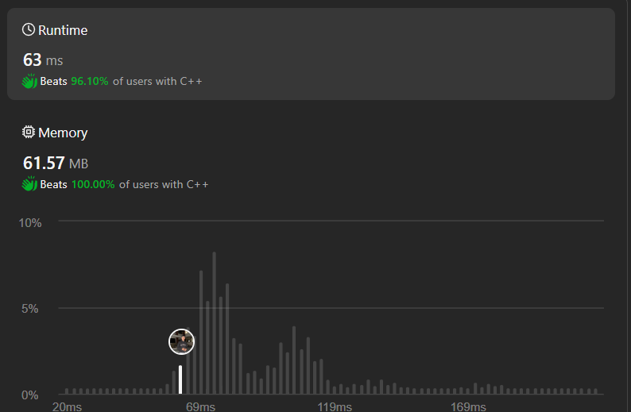

# Floyd's Cycle Detection | | Slow-Fast Pointer | | C++ | | Java | | Python3 | | Kotlin | | ✅✅✅🔥🔥🔥

**Author:** Hunter_0718
**Votes:** 23
**Link:** [https://leetcode.com/problems/find-the-duplicate-number/solutions/4916338/](https://leetcode.com/problems/find-the-duplicate-number/solutions/4916338/)

---



## Intuition

Imagine two runners on a circular track. One runner (slow) moves one step at a time, while the other runner (fast) moves two steps at a time. If there are no duplicates (no loops in the track), the fast runner will eventually lap the slow runner. However, if there's a duplicate (a loop), the fast runner will eventually catch up to the slow runner inside the loop.

## Approach

This problem uses the Floyd's Cycle Finding Algorithm. We utilize two pointers, `slow` and `fast`, to iterate through the array. 

1. **Finding the Meeting Point:**
    - Initialize both `slow` and `fast` to point to the first element of the array (`nums[0]`).
    - Use a `do-while` loop to iterate:
        - Move `slow` one step forward: `slow = nums[slow]`.
        - Move `fast` two steps forward: `fast = nums[nums[fast]]`. This effectively jumps two positions ahead.
    - The loop continues as long as `slow` and `fast` don't meet (`slow != fast`). When they meet inside the loop formed by the duplicate element, it signifies a cycle.

2. **Finding the Duplicate:**
    - Once `slow` and `fast` meet, reset `fast` back to the first element (`nums[0]`).
    - Now, iterate using a `while` loop:
        - Move both `slow` and `fast` one step forward in each iteration: `slow = nums[slow]` and `fast = nums[fast]`.
    - Since `slow` and `fast` are starting from different points on the loop now, they will eventually meet at the duplicate element. This element is the duplicate we're looking for.

## Complexity

- **Time Complexity:** O(n). The loop iterates a maximum of `n` times in the worst case.
- **Space Complexity:** O(1). We only use constant extra space for the two pointers `slow` and `fast`.

```C++ []
class Solution {
public:
    int findDuplicate(vector<int>& nums) {
        int slow = nums[0];
        int fast = nums[0];
        do{
            slow = nums[slow];
            fast = nums[nums[fast]];
        } while(slow!=fast);

        fast = nums[0];
        while(slow!=fast){
            slow = nums[slow];
            fast = nums[fast];
        }
        return slow;
    }
};
```

```C []
int findDuplicate(int* nums, int numsSize) {
    int slow = nums[0];
    int fast = nums[0];
    do {
        slow = nums[slow];
        fast = nums[nums[fast]];
    } while (slow != fast);

    fast = nums[0];
    while (slow != fast) {
        slow = nums[slow];
        fast = nums[fast];
    }
    return slow;
}

```
```Java []
class Solution {
  public int findDuplicate(int[] nums) {
    int slow = nums[0];
    int fast = nums[0];
    do {
      slow = nums[slow];
      fast = nums[nums[fast]];
    } while (slow != fast);

    fast = nums[0];
    while (slow != fast) {
      slow = nums[slow];
      fast = nums[fast];
    }
    return slow;
  }
}

```
```Python3 []
class Solution:
    def findDuplicate(self, nums: List[int]) -> int:
        slow = nums[0]
        fast = nums[0]
        while True:
            slow = nums[slow]
            fast = nums[nums[fast]]
            if slow == fast:
                break
        
        fast = nums[0]
        while slow != fast:
            slow = nums[slow]
            fast = nums[fast]
        return slow

```
```Kotlin []
class Solution {
  fun findDuplicate(nums: IntArray): Int {
    var slow = nums[0]
    var fast = nums[0]
    do {
      slow = nums[slow]
      fast = nums[nums[fast]]
    } while (slow != fast)

    fast = nums[0]
    while (slow != fast) {
      slow = nums[slow]
      fast = nums[fast]
    }
    return slow
  }
}

```
```javascript []
/**
 * @param {number[]} nums
 * @return {number}
 */
var findDuplicate = function(nums) {
    let slow = nums[0];
    let fast = nums[0];
    do {
        slow = nums[slow];
        fast = nums[nums[fast]];
    } while (slow !== fast);

    fast = nums[0];
    while (slow !== fast) {
        slow = nums[slow];
        fast = nums[fast];
    }
    return slow;
};

```


## Dry Run (Example 1: nums = [1,3,4,2,2])

1. **Finding the Meeting Point:**
   - Initially, `slow` and `fast` both point to `nums[0] = 1`.
   - Iteration 1: `slow = nums[slow] = nums[1] = 3`, `fast = nums[nums[fast]] = nums[nums[1]] = nums[3] = 4`.
   - Iteration 2: `slow = nums[slow] = nums[3] = 4`, `fast = nums[nums[fast]] = nums[nums[4]] = nums[2] = 2`.
   - Iteration 3: `slow = nums[slow] = nums[4] = 2`, `fast = nums[nums[fast]] = nums[nums[2]] = nums[2] = 2`. (Here, `slow` and `fast` meet at `2`).

2. **Finding the Duplicate:**
   - Reset `fast` to `nums[0] = 1`.
   - Iteration 1: `slow = nums[slow] = nums[2] = 2`, `fast = nums[fast] = nums[1] = 3`.
   - Iteration 2: `slow = nums[slow] = nums[2] = 2`, `fast = nums[fast] = nums[3] = 4`.
   - Iteration 3: `slow = nums[slow] = nums[2] = 2`, `fast = nums[fast] = nums[4] = 2`. (Here, `slow` and `fast` meet again at the duplicate element `2`).

Therefore, the duplicate number is `2`.