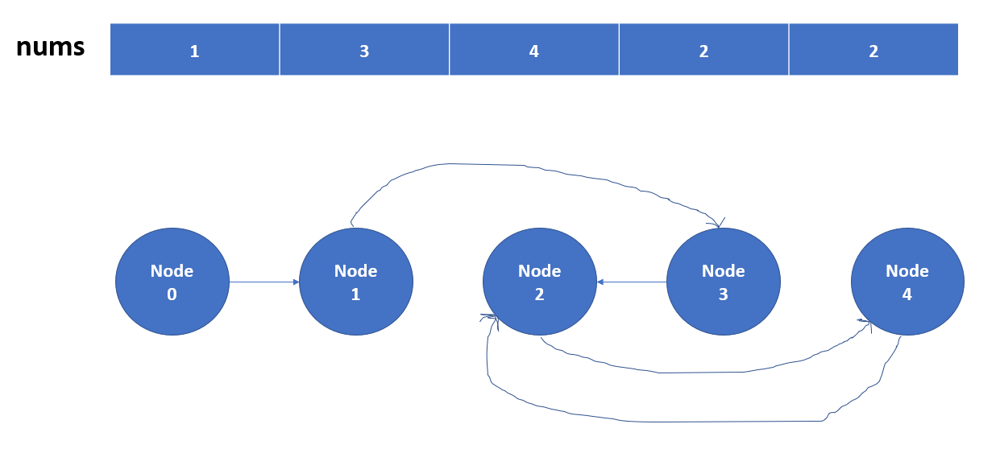

# Python/JS/Java/Go/C++ O(1) aux space by hopping. [ w/ Visualization]

**Author:** brianchiang_tw
**Votes:** 70
**Link:** [https://leetcode.com/problems/find-the-duplicate-number/solutions/515872/](https://leetcode.com/problems/find-the-duplicate-number/solutions/515872/)

---

Python O(1) aux space, O(n) time sol. by hopping.

---

**Hint**:

#1. 
Think of model of **linked list**, and **algorithm of cycle detection**.
A common and practical one is [Tortoise and Hare algorithm](https://www.techiedelight.com/detect-cycle-linked-list-floyds-cycle-detection-algorithm/), also known as [Floyd's algorithm](https://en.wikipedia.org/wiki/Cycle_detection).

---

#2.
Convert  this challenge into **cycle detection in linked list**, and locating of **start node of cycle**.

Each **array cell** denotes a **node** in linked list.
And the **value of each array cell** points to the **next node** in linked list.


Finally, what we want to know is the **duplicate number**, which also is the **start node of cycle**, and vice versa.

We take the demo input as example, please refer to the diagram as following.

---

#3.

Remeber that [description](https://leetcode.com/problems/find-the-duplicate-number/) asks us **not** to modify the array.
(assume the array is read only).

---

**Illustration**:

Input: 
nums = [1,3,4,2,2]




Duplicate number is 2.
Also, Node_2 is the start node of cycle in linked list.

---

```
class Solution:
    def findDuplicate(self, nums: List[int]) -> int:
        
        # start hopping from Node_#0
        slow, fast = 0, 0
		
		# for locating start node of cycle
        check = 0
        
		# Step_#1
		# Cycle detection
        # Let slow jumper and fast jumper meet somewhere in the cycle 
		
        while True:
            
			# slow jumper hops 1 step, while fast jumper hops two steps forward.
            slow = nums[ slow ]
            fast = nums[ nums[fast] ]
            
            if slow == fast:
                break
        
		
		# Step_#2
        # Locate the start node of cycle (i.e., the duplicate number)
        while True:
            
            slow = nums[ slow ]
            check = nums[ check ]
            
            if slow == check:
                break
        
        return check
```

---

Javascript:

```
var findDuplicate = function(nums) {
    
    // start hopping from Node_#0
    let [slow, fast] = [0,0];
    
    // for locating start node of cycle
    let check = 0;
    
    // Step_#1
    // Cycle detection
    // Let slow jumper and fast jumper meet somewhere in the cycle
    
    while( true ){
        
        // slow jumpper hops 1 step, while fast jumpper hops two steps forward
        slow = nums[ slow ];
        fast = nums[ nums[ fast ] ];
        
        if( slow == fast ){
            break;
        }
    }
    
    // Step_#2
    // Locate the start node of cycle (i.e., the duplicate number)
    while( true ){
        
        slow = nums[ slow ];
        check = nums[ check ];
        
        if( slow == check ){
            break;
        }
    }
    
    return check;
    
};
```

---

Java:

```
class Solution {
    public int findDuplicate(int[] nums) {

        
        // start hopping from Node_#0
        int slow=0, fast=0;
            
        int check = 0;
            
        // Step_#1
        // Cycle detection
        // Implement Tortoise and Hare algorithm
        while( true ){
            slow = nums[slow];
            fast = nums[ nums[fast] ];
            
            if( slow == fast ){
                break;
            }
        }
        
        
        // Step_#2
        // Locate the start node of cycle (i.e., the duplicate number)
        while( true ){
            slow = nums[slow];
            check = nums[check];
            
            if( slow == check ){
                break;
            }
        }
        
        return check;
            
        
    }
}
```

---

Go:

```
func findDuplicate(nums []int) int {
    
    // start hoppoing from Node_0
    slow, fast := 0, 0
    
    // for locating start node of cycle
    check := 0
    
    // Step_#1
    // Cycle detection
    // Implement Tortoise and Hare algorithm
    for true {
        
        slow = nums[ slow ]
        fast = nums[ nums[fast] ]
        
        if slow == fast {
            break
        }
    }
    
    // Step_#2
    // Locate the start node of cycle (i.e., the duplicate number)
    for true {
        
        slow = nums[slow]
        check = nums[check]
        
        if slow == check{
            break
        }
    }
    
    return check
    
}
```

---


C++

```
class Solution {
public:
    int findDuplicate(vector<int>& nums) {
        
        // start hopping from Node_#0
        int slow=0, fast=0;
            
        int check = 0;
            
        // Step_#1
        // Cycle detection
        // Implement Tortoise and Hare algorithm
        while( true ){
            slow = nums[slow];
            fast = nums[ nums[fast] ];
            
            if( slow == fast ){
                break;
            }
        }
        
        
        // Step_#2
        // Locate the start node of cycle (i.e., the duplicate number)
        while( true ){
            slow = nums[slow];
            check = nums[check];
            
            if( slow == check ){
                break;
            }
        }
        
        return check;
    }
};
```

---

Related leetcode challenge:

About cycle detection:
[Leetcode #141 Linked List Cycle](https://leetcode.com/problems/linked-list-cycle/)

[Leetcode #142 Linked List Cycle II](https://leetcode.com/problems/linked-list-cycle-ii/)


---

Reference:

[1] [Techie Delight: Cycle detection implementation](https://www.techiedelight.com/detect-cycle-linked-list-floyds-cycle-detection-algorithm/)

[2] [Wiki: Cycle detection and Floyd's algorithm](https://en.wikipedia.org/wiki/Cycle_detection)