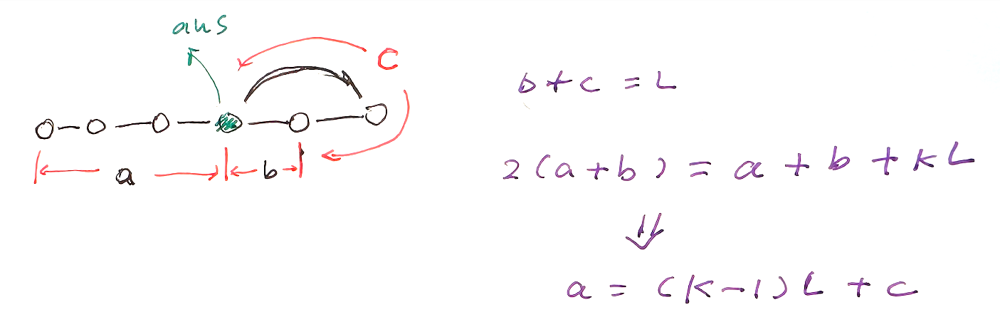

# Folyd's Algorithm Explained in Diagram

**Author:** al_lea
**Votes:** 2
**Link:** [https://leetcode.com/problems/find-the-duplicate-number/solutions/4649601/](https://leetcode.com/problems/find-the-duplicate-number/solutions/4649601/)

---

Here's how [Floyd's algorithm](https://en.wikipedia.org/wiki/Robert_W._Floyd) works for detecting a loop in a linked list:

**Initialization**: 
- Start with two pointers at the beginning of the linked list. Commonly, these pointers are called slow and fast.

**Movement**:
- In each step of the algorithm, the slow pointer moves one node forward (slow = slow.next).
- The fast pointer moves two nodes forward (fast = fast.next.next).
- This means the fast pointer moves twice as fast as the slow pointer.

**Detection**:
- If the linked list has no cycle, the fast pointer will eventually reach the end of the list and we can conclude there is no cycle.
- If the linked list has a cycle, the fast pointer will eventually meet the slow pointer within the cycle. This is because each step reduces the gap between them by one (as slow moves one step and fast moves two steps). When they meet, it's guaranteed that there's a loop.

**Finding the Entry Point of the Loop** (optional):
- If you need to find the node where the loop starts, keep the slow pointer where it is when the meet-up happens.
- Move the fast pointer to the start of the list.
- Move both slow and fast one step at a time. The point at which they meet again is the start of the loop.



Check [https://starthrower.me/floyds-algorithm-for-cycle-detection-in-linked-list/](https://starthrower.me/floyds-algorithm-for-cycle-detection-in-linked-list/) for proof and applications. 

> btw. This is the same Floyd in Floyd\u2013Warshall algorithm.

# Code
```
object Solution {
    def findDuplicate(nums: Array[Int]): Int = {
        var (slow, fast) = (0, 0)
        do {
            slow = nums(slow)
            fast = nums(nums(fast)) // next.next, 2 steps
        } while (slow != fast)
        slow = 0
        while (slow != fast) {
            slow = nums(slow)
            fast = nums(fast)
        }
        slow
    }
}
```