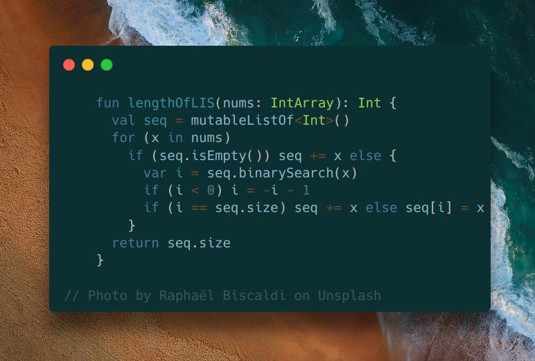

# Kotlin

**Author:** SamoylenkoDmitry
**Votes:** 5
**Link:** [https://leetcode.com/problems/longest-increasing-subsequence/solutions/4510388/](https://leetcode.com/problems/longest-increasing-subsequence/solutions/4510388/)

---


https://youtu.be/uDZ9_YyWdH4
#### Join me on Telegram

https://t.me/leetcode_daily_unstoppable/462

#### Problem TLDR

Longest increasing subsequence length.

#### Intuition

This is a classical problem that has the optimal algorithm that you must know https://en.wikipedia.org/wiki/Longest_increasing_subsequence.

For every new number, check it's position in a increasing sequence by Binary Search:
* already in a sequence, do nothing
* bigger than the last, insert
* interesting part: in the middle, replace the insertion position (next after the closest smaller)

```
increasing sequence 
1 3 5 7 9           insert 6
      ^

1 3 5 6 9 
```

As we do not care about the actual numbers, only the length, this would work. (To restore the actual subsequence we must remember each predecessor, see the wiki)

#### Approach

If you didn't remember how to restore the insertion point from `binarySearch` (-i-1), better implement it yourself:
* use inclusive `lo` and `hi`
* always check the result `if (x == nums[mid]) pos = mid
* always move the borders `lo = mid + 1`, `hi = mid - 1`

#### Complexity

- Time complexity:
$$O(nlog(n))$$

- Space complexity:
$$O(n)$$

#### Code

```kotlin

    fun lengthOfLIS(nums: IntArray): Int {
      val seq = mutableListOf<Int>()
      for (x in nums) 
        if (seq.isEmpty()) seq += x else {
          var i = seq.binarySearch(x)
          if (i < 0) i = -i - 1
          if (i == seq.size) seq += x else seq[i] = x
        }
      return seq.size
    }

```