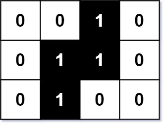

# [302. Smallest Rectangle Enclosing Black Pixels](https://leetcode.com/problems/smallest-rectangle-enclosing-black-pixels/)

| Category | Difficulty | Likes | Dislikes |
| :------: | :--------: | :---: | :------: |
| Algorithms | Hard | 561 | 107 |

**Tags:** [`array`](https://leetcode.com/tag/array), [`binary-search`](https://leetcode.com/tag/binary-search), [`depth-first-search`](https://leetcode.com/tag/depth-first-search), [`breadth-first-search`](https://leetcode.com/tag/breadth-first-search), [`matrix`](https://leetcode.com/tag/matrix)

**Companies:** `google`

## Description

You are given an `m x n` binary matrix `image` where `0` represents a white pixel and `1` represents a black pixel.

The black pixels are connected (i.e., there is only one black region). Pixels are connected horizontally and vertically.

Given two integers `x` and `y` that represents the location of one of the black pixels, return *the area of the smallest (axis-aligned) rectangle that encloses all black pixels*.

You must write an algorithm with less than `O(mn)` runtime complexity

 

**Example 1:**


```

Input: image = [[&quot;0&quot;,&quot;0&quot;,&quot;1&quot;,&quot;0&quot;],[&quot;0&quot;,&quot;1&quot;,&quot;1&quot;,&quot;0&quot;],[&quot;0&quot;,&quot;1&quot;,&quot;0&quot;,&quot;0&quot;]], x = 0, y = 2
Output: 6

```

**Example 2:**

```

Input: image = [[&quot;1&quot;]], x = 0, y = 0
Output: 1

```

 

**Constraints:**

	- `m == image.length`

	- `n == image[i].length`

	- `1 <= m, n <= 100`

	- `image[i][j]` is either `'0'` or `'1'`.

	- `0 <= x < m`

	- `0 <= y < n`

	- `image[x][y] == '1'.`

	- The black pixels in the `image` only form **one component**.

---

**Links:** [Submissions](https://leetcode.com/problems/smallest-rectangle-enclosing-black-pixels/) | [Solutions](https://leetcode.com/problems/smallest-rectangle-enclosing-black-pixels/)
