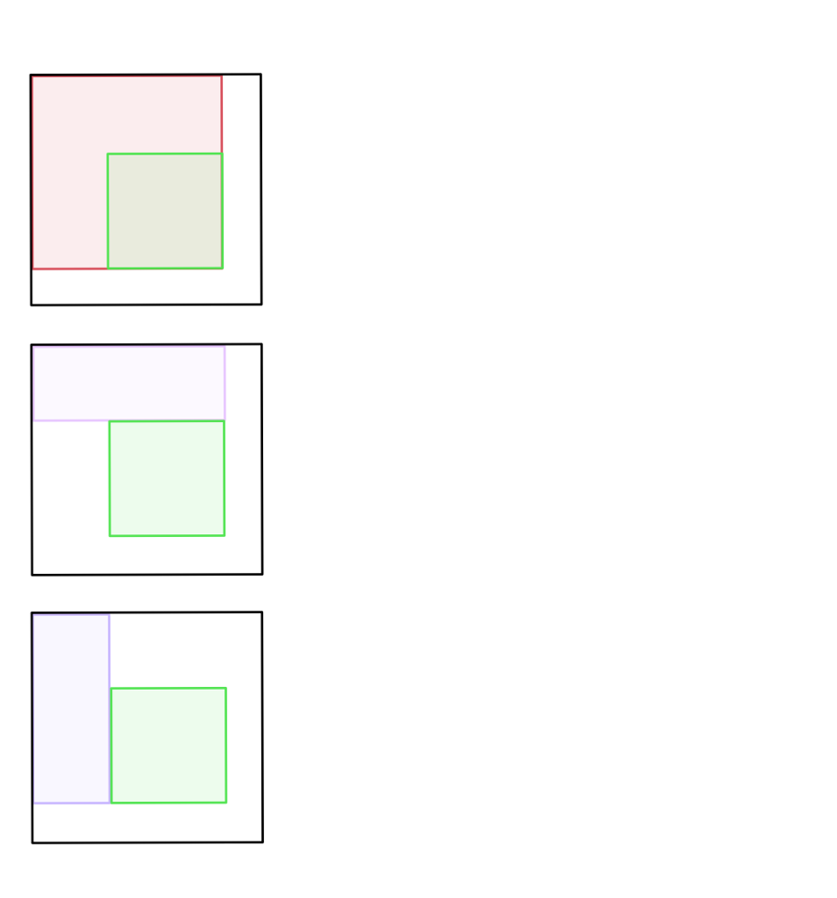
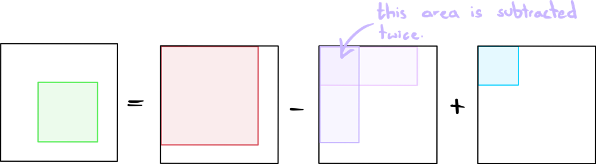

# DP Visualised + Interview Tips

**Author:** ciote
**Votes:** 102
**Link:** [https://leetcode.com/problems/range-sum-query-2d-immutable/solutions/2104317/](https://leetcode.com/problems/range-sum-query-2d-immutable/solutions/2104317/)

---

# Logic:
If you're a bit unclear on how the dynamic programming relationship works, hopefully the below diagrams clear it up. I also included a section in this post that describes how you might discover this relationship during an interview.

Below are the other ranges we need to compute the green area, which is our range query:



And the relationship between the coloured rectangles to attain the green range is this:
The blue rectangle above is included since the purple rectangle's intersection is subtracted twice! So we add the intersection once more to nullify this effect.

___

# How do we come up with this during an interview?
It's not necessarily obvious how we might come to this conclusion, especially during an interview. Let's start by thinking about brute force approaches:

One most obvious solution that you probably came up with is attaining the sum manually each time by adding all values in the required range. As you might have also realised, this is quite inefficient. We know we would greatly benefit from precomputation. If we already understood the values of ALL the possible ranges, for example, we could just return that range when queried. This is probably not the solution, but it's a good start. 

> Interview tip: If you come across a brute force solution that performs a lot of repetitive tasks, consider DP and precomputation.

We've already ruled out the possibility of precomputing literally every possible range. So let's see if there's any way we can precompute values *to get the range query some other way*.

> Interview tip: Think out loud! If you describe to your interviewer the brute force you've thought up and the inefficiencies of the brute force that could be improved, you're already doing great. Plus, it gives your interviewer the opportunity to give you better hints if you get stuck.

Now you start thinking about what else you can precompute:
* Row and column sums
* Partial ranges
* etc...

Think about each possibility and how they might help you get an answer. From here, it's all about pattern recognition. But you've made your life a lot easier by breaking down the possibilities first and then thinking about patterns. 

> Interview tip: If you're still unable to think of anything, be sure to summarise your findings to your interviewer. Give them all the information they need and they might be able to nudge you in the right direction. Remember that they care a lot more about how you tackle the problem than whether you managed to miraculously come up with the solution in 1 minute.

As you can see, the best way to come up with an optimal solution is to not think of the optimal solution *first*. Think of brute force approaches, understand their flaws and work your way towards the gold. Hope this helps! 
___
### Code:
If you have any questions, suggestions or improvements, feel free to let me know! Thanks for reading.
```java
class NumMatrix {
    private int[][] sums;
    
    public NumMatrix(int[][] matrix) {
        int n = matrix.length;
        int m = matrix[0].length;
        sums = new int[n+1][m+1];
        for (int i=1; i<=n; i++)
            for (int j=1; j<=m; j++)
                sums[i][j] = sums[i-1][j] + sums[i][j-1] + matrix[i-1][j-1] - sums[i-1][j-1];
    }
    
    public int sumRegion(int row1, int col1, int row2, int col2) {
        int RED_RECTANGLE = sums[row2+1][col2+1];
        int PURPLE_RECTANGLES = sums[row1][col2+1] + sums[row2+1][col1];
        int BLUE_RECTANGLE = sums[row1][col1];
        return RED_RECTANGLE - PURPLE_RECTANGLES + BLUE_RECTANGLE;
    }
}
 ```
 **Time Complexity:**
 > NumMatrix: `O(n*m)` to create the `sums` matrix.
 > sumRegion: `O(1)`
 
 **Space Complexity:** `O(n*m)`