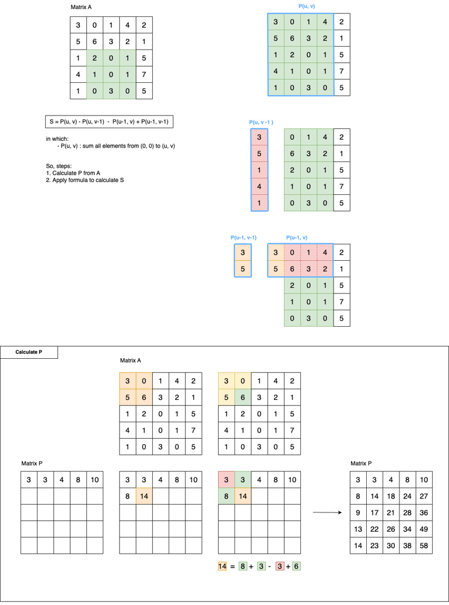

# 2D Prefix Sum

**Author:** nganluu0903
**Votes:** 0
**Link:** [https://leetcode.com/problems/range-sum-query-2d-immutable/solutions/6062624/](https://leetcode.com/problems/range-sum-query-2d-immutable/solutions/6062624/)

---




# Code
```ruby []
class NumMatrix

=begin
    :type matrix: Integer[][]
=end
    def initialize(matrix)
        @matrix = matrix
        @prefix_sum = cal_prefix_sum
    end

    def cal_prefix_sum
        tmp_max = matrix.clone
        (0...matrix.length).each do |i|
            (0...matrix[0].length).each do |j|
                tmp_max[i][j] = value_at(tmp_max, i-1, j) + value_at(tmp_max, i, j-1) - value_at(tmp_max, i-1, j-1) + value_at(matrix, i, j)
            end
        end
        tmp_max
    end

    def value_at(input, i, j)
        return 0 if i < 0 || j < 0

        return input[i][j]
    end

=begin
    :type row1: Integer
    :type col1: Integer
    :type row2: Integer
    :type col2: Integer
    :rtype: Integer
=end
    def sum_region(row1, col1, row2, col2)
        return value_at(prefix_sum, row2, col2) \\
                - value_at(prefix_sum, row1-1, col2) \\
                - value_at(prefix_sum, row2, col1-1) \\
                + value_at(prefix_sum, row1-1, col1-1)
    end

    private

    attr_reader :matrix, :prefix_sum
end

# Your NumMatrix object will be instantiated and called as such:
# obj = NumMatrix.new(matrix)
# param_1 = obj.sum_region(row1, col1, row2, col2)
```