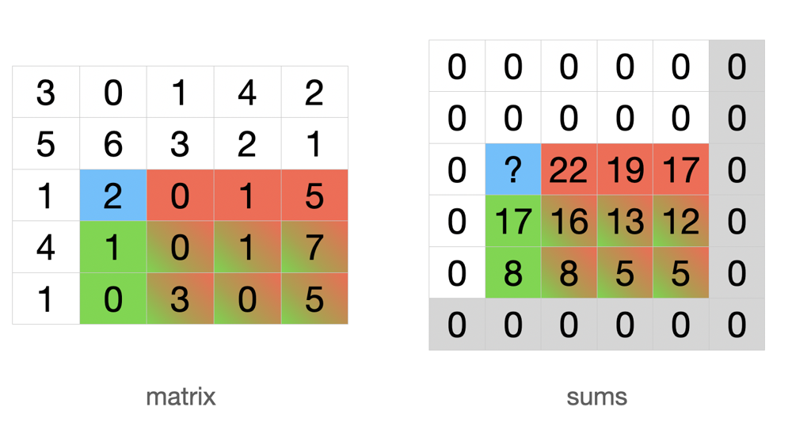

# Swift concise solution (15 lines of code) with pictures ❤️😁

**Author:** sivykh
**Votes:** 7
**Link:** [https://leetcode.com/problems/range-sum-query-2d-immutable/solutions/3371949/](https://leetcode.com/problems/range-sum-query-2d-immutable/solutions/3371949/)

---

# Intuition
The problem can be solved by precomputing the sum of all elements of the submatrix with the upper left corner at the point $(i, j)$ and the lower right corner of the initial matrix; let's call it $submatrix_{[i][j]}$.

# Approach

Allocate one more row and one more column to get rid of out of bounds condition. Fill this extra lines with zero.

### init
Iterate from the right bottom corner to the left top corner of the matrix:
To calculate the sum of $submatrix_{[i][j]}$ we need to get the $matrix[i][j]$ value and append to it already computed sums of $submatrix_{[i + 1][j]}$ and $submatrix_{[i][j + 1]}$ without the sum of $submatrix_{[i + 1][j + 1]}$ because it's presented twice.

##### example
On the picture: i = 2, j = 1. The sum of all cells with red color ($submatrix_{[2][2]}$) in the matrix is 22. The sum of all cells with green color ($submatrix_{[3][1]}$) is 17. The common part ($submatrix_{[3][2]}$) of these submatrices has sum 16. 

Desired value is 2 + 22 + 17 - 16 = 25
{:style='width:600px'}

### sumRegion 
The function works with the same logic as sums calculation.

# Complexity
- Time complexity of the init: $O(m*n)$

- Time complexity of sumRegion: $O(1)$

- Space complexity: $O(m*n)$

# Code
```
final class NumMatrix {
    private var sums: [[Int]]
    init(_ matrix: [[Int]]) {
        self.sums = Array(repeating: Array(repeating: 0, count: matrix[0].count + 1), count: matrix.count + 1)
        for i in (0..<matrix.count).reversed() {
            for j in (0..<matrix[0].count).reversed() {
                sums[i][j] = matrix[i][j] + sums[i + 1][j] + sums[i][j + 1] - sums[i + 1][j + 1]
            }
        }
    }
    
    func sumRegion(_ row1: Int, _ col1: Int, _ row2: Int, _ col2: Int) -> Int {
        sums[row1][col1] - sums[row2 + 1][col1] - sums[row1][col2 + 1] + sums[row2 + 1][col2 + 1]
    }
}
```