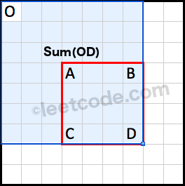
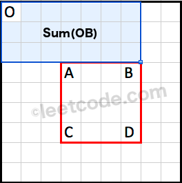
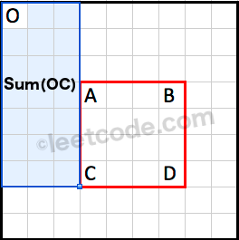
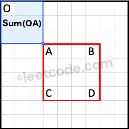

# Official Solution

**Link:** [https://leetcode.com/problems/range-sum-query-2d-immutable/solution/](https://leetcode.com/problems/range-sum-query-2d-immutable/solution/)

---

[TOC]

## Video Solution

 ---

 

   

     <iframe src="https://player.vimeo.com/video/731152296?texttrack=en-x-autogenerated" frameborder="0"
       allow="autoplay; fullscreen"></iframe>
   

 

 

## Solution

---

### Approach 1: Brute Force

**Algorithm**

Each time *sumRegion* is called, we use a double for loop to sum all elements from $$(row1, col1) \rightarrow (row2, col2)$$.

**Implementation**

<iframe src="https://leetcode.com/playground/XRYLUGoX/shared" frameBorder="0" width="100%" height="344" name="XRYLUGoX"></iframe>

**Complexity Analysis**

* Time complexity: $$O(mn)$$ time per query.
Assume that $$m$$ and $$n$$ represents the number of rows and columns respectively, each *sumRegion* query can go through at most $$m \times n$$ elements.

* Space complexity: $$O(1)$$. Note that `data` is a *reference* to `matrix` and is not a copy of it.

---

### Approach 2: Caching [Memory Limit Exceeded]

**Intuition**

Since *sumRegion* could be called many times, we definitely need to do some pre-processing.

**Algorithm**

We could trade in extra space for speed by pre-calculating all possible rectangular region sum and store them in a hash table. Each *sumRegion* query now takes only constant time complexity.

**Complexity Analysis**

* Time complexity: $$O(1)$$ time per query, $$O(m^2n^2)$$ time pre-computation.
Each *sumRegion* query takes $$O(1)$$ time as the hash table lookup's time complexity is constant. The pre-computation will take $$O(m^2n^2)$$ time as there are a total of $$m^2 \times n^2$$ possibilities need to be cached.

* Space complexity: $$O(m^2n^2)$$.
Since there are $$mn$$ different possibilities for both top left and bottom right points of the rectangular region, the extra space required is $$O(m^2n^2)$$.

---

### Approach 3: Caching Rows

**Intuition**

Remember from the [1D version](https://leetcode.com/problems/range-sum-query-immutable/) where we used a cumulative sum array? Could we apply that directly to solve this 2D version?

**Algorithm**

Try to see the 2D matrix as $$m$$ rows of 1D arrays. To find the region sum, we just accumulate the sum in the region row by row.

**Implementation**

<iframe src="https://leetcode.com/playground/XEjRuMif/shared" frameBorder="0" width="100%" height="412" name="XEjRuMif"></iframe>

**Complexity Analysis**

* Time complexity: $$O(m)$$ time per query, $$O(mn)$$ time pre-computation.
The pre-computation in the constructor takes $$O(mn)$$ time. The *sumRegion* query takes $$O(m)$$ time.

* Space complexity: $$O(mn)$$.
The algorithm uses $$O(mn)$$ space to store the cumulative sum of all rows.

---
### Approach 4: Caching Smarter

**Algorithm**

We used a cumulative sum array in the [1D version](https://leetcode.com/problems/range-sum-query-immutable/). We notice that the cumulative sum is computed with respect to the origin at index 0. Extending this analogy to the 2D case, we could pre-compute a cumulative region sum with respect to the origin at $$(0, 0)$$.

  
<small>Sum(OD) is the cumulative region sum with respect to the origin at (0, 0).</small>

How do we derive $$Sum(ABCD)$$ using the pre-computed cumulative region sum?

  
<small>Sum(OB) is the cumulative region sum on top of the rectangle.</small>

  
<small>Sum(OC) is the cumulative region sum to the left of the rectangle.</small>

  
<small>Sum(OA) is the cumulative region sum to the top left corner of the rectangle.</small>

Note that the region $$Sum(OA)$$ is covered twice by both $$Sum(OB)$$ and $$Sum(OC)$$. We could use the principle of inclusion-exclusion to calculate $$Sum(ABCD)$$ as following:

$$
Sum(ABCD) = Sum(OD) - Sum(OB) - Sum(OC) + Sum(OA)
$$

**Implementation**

<iframe src="https://leetcode.com/playground/2JerEwYd/shared" frameBorder="0" width="100%" height="344" name="2JerEwYd"></iframe>

**Complexity Analysis**

* Time complexity: $$O(1)$$ time per query, $$O(mn)$$ time pre-computation.
The pre-computation in the constructor takes $$O(mn)$$ time. Each *sumRegion* query takes $$O(1)$$ time.

* Space complexity: $$O(mn)$$.
The algorithm uses $$O(mn)$$ space to store the cumulative region sum.