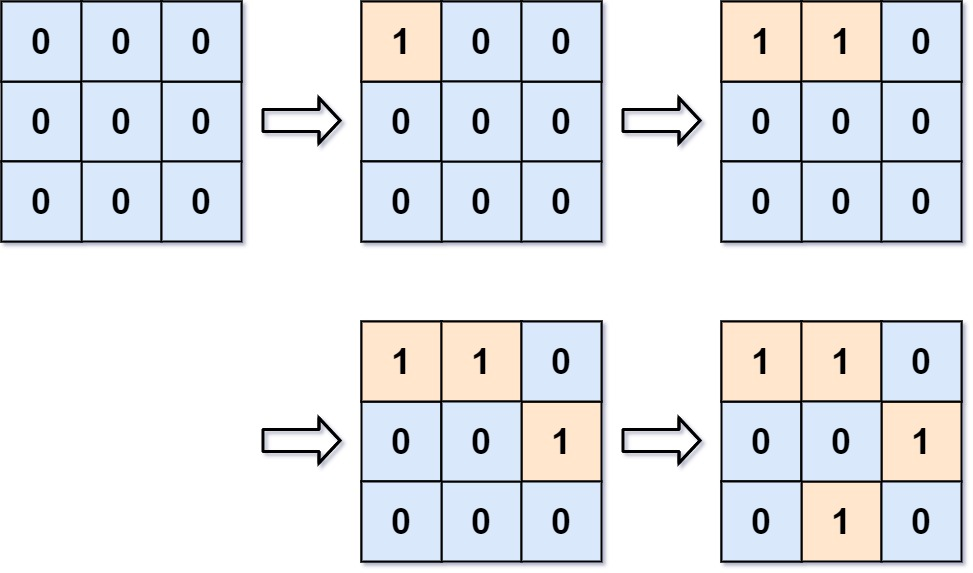

# [305. Number of Islands II](https://leetcode.com/problems/number-of-islands-ii/)

| Category | Difficulty | Likes | Dislikes |
| :------: | :--------: | :---: | :------: |
| Algorithms | Hard | 1967 | 76 |

**Tags:** [`array`](https://leetcode.com/tag/array), [`hash-table`](https://leetcode.com/tag/hash-table), [`union-find`](https://leetcode.com/tag/union-find)

**Companies:** `uber`, `google`, `facebook`, `tiktok`

## Description

You are given an empty 2D binary grid `grid` of size `m x n`. The grid represents a map where `0`'s represent water and `1`'s represent land. Initially, all the cells of `grid` are water cells (i.e., all the cells are `0`'s).

We may perform an add land operation which turns the water at position into a land. You are given an array `positions` where `positions[i] = [r_i, c_i]` is the position `(r_i, c_i)` at which we should operate the `i^th` operation.

Return *an array of integers* `answer` *where* `answer[i]` *is the number of islands after turning the cell* `(r_i, c_i)` *into a land*.

An **island** is surrounded by water and is formed by connecting adjacent lands horizontally or vertically. You may assume all four edges of the grid are all surrounded by water.

 

**Example 1:**


```

Input: m = 3, n = 3, positions = [[0,0],[0,1],[1,2],[2,1]]
Output: [1,1,2,3]
Explanation:
Initially, the 2d grid is filled with water.
- Operation #1: addLand(0, 0) turns the water at grid[0][0] into a land. We have 1 island.
- Operation #2: addLand(0, 1) turns the water at grid[0][1] into a land. We still have 1 island.
- Operation #3: addLand(1, 2) turns the water at grid[1][2] into a land. We have 2 islands.
- Operation #4: addLand(2, 1) turns the water at grid[2][1] into a land. We have 3 islands.

```

**Example 2:**

```

Input: m = 1, n = 1, positions = [[0,0]]
Output: [1]

```

 

**Constraints:**

	- `1 <= m, n, positions.length <= 10^4`

	- `1 <= m * n <= 10^4`

	- `positions[i].length == 2`

	- `0 <= r_i < m`

	- `0 <= c_i < n`

 

**Follow up:** Could you solve it in time complexity `O(k log(mn))`, where `k == positions.length`?

---

**Links:** [Submissions](https://leetcode.com/problems/number-of-islands-ii/) | [Solutions](https://leetcode.com/problems/number-of-islands-ii/)
