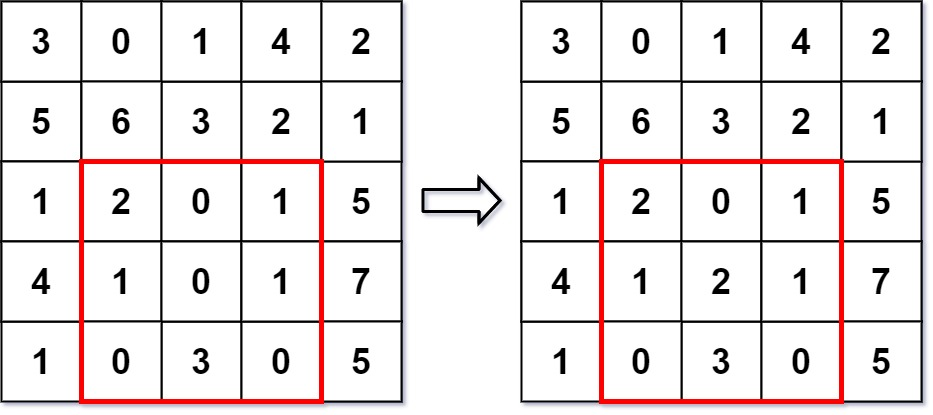

# [308. Range Sum Query 2D - Mutable](https://leetcode.com/problems/range-sum-query-2d-mutable/)

| Category | Difficulty | Likes | Dislikes |
| :------: | :--------: | :---: | :------: |
| Algorithms | Medium | 819 | 97 |

**Tags:** [`array`](https://leetcode.com/tag/array), [`design`](https://leetcode.com/tag/design), [`binary-indexed-tree`](https://leetcode.com/tag/binary-indexed-tree), [`segment-tree`](https://leetcode.com/tag/segment-tree), [`matrix`](https://leetcode.com/tag/matrix)

**Companies:** `bloomberg`, `google`

## Description

Given a 2D matrix `matrix`, handle multiple queries of the following types:

	- **Update** the value of a cell in `matrix`.

	- Calculate the **sum** of the elements of `matrix` inside the rectangle defined by its **upper left corner** `(row1, col1)` and **lower right corner** `(row2, col2)`.

Implement the NumMatrix class:

	- `NumMatrix(int[][] matrix)` Initializes the object with the integer matrix `matrix`.

	- `void update(int row, int col, int val)` **Updates** the value of `matrix[row][col]` to be `val`.

	- `int sumRegion(int row1, int col1, int row2, int col2)` Returns the **sum** of the elements of `matrix` inside the rectangle defined by its **upper left corner** `(row1, col1)` and **lower right corner** `(row2, col2)`.

 

**Example 1:**


```

Input
[&quot;NumMatrix&quot;, &quot;sumRegion&quot;, &quot;update&quot;, &quot;sumRegion&quot;]
[[[[3, 0, 1, 4, 2], [5, 6, 3, 2, 1], [1, 2, 0, 1, 5], [4, 1, 0, 1, 7], [1, 0, 3, 0, 5]]], [2, 1, 4, 3], [3, 2, 2], [2, 1, 4, 3]]
Output
[null, 8, null, 10]

Explanation
NumMatrix numMatrix = new NumMatrix([[3, 0, 1, 4, 2], [5, 6, 3, 2, 1], [1, 2, 0, 1, 5], [4, 1, 0, 1, 7], [1, 0, 3, 0, 5]]);
numMatrix.sumRegion(2, 1, 4, 3); // return 8 (i.e. sum of the left red rectangle)
numMatrix.update(3, 2, 2);       // matrix changes from left image to right image
numMatrix.sumRegion(2, 1, 4, 3); // return 10 (i.e. sum of the right red rectangle)

```

 

**Constraints:**

	- `m == matrix.length`

	- `n == matrix[i].length`

	- `1 <= m, n <= 200`

	- `-1000 <= matrix[i][j] <= 1000`

	- `0 <= row < m`

	- `0 <= col < n`

	- `-1000 <= val <= 1000`

	- `0 <= row1 <= row2 < m`

	- `0 <= col1 <= col2 < n`

	- At most `5000` calls will be made to `sumRegion` and `update`.

---

**Links:** [Submissions](https://leetcode.com/problems/range-sum-query-2d-mutable/) | [Solutions](https://leetcode.com/problems/range-sum-query-2d-mutable/)
