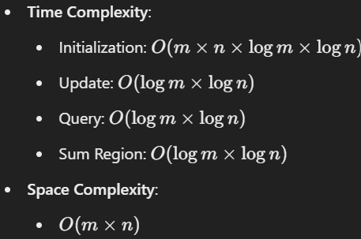

# Binary Indexed Tree

**Author:** Asyncy99
**Votes:** 0
**Link:** [https://leetcode.com/problems/range-sum-query-2d-mutable/solutions/5785531/](https://leetcode.com/problems/range-sum-query-2d-mutable/solutions/5785531/)

---




# Code
```javascript []
class NumMatrix {
    constructor(matrix) {
        this.m = matrix.length;
        this.n = matrix[0].length;
        this.tree = Array.from({ length: this.m + 1 }, () => Array(this.n + 1).fill(0));
        this.matrix = Array.from({ length: this.m }, () => Array(this.n).fill(0));

        // Build the BIT
        for (let i = 0; i < this.m; i++) {
            for (let j = 0; j < this.n; j++) {
                this.update(i, j, matrix[i][j]);
            }
        }
    }

    // Update BIT with delta
    update(x, y, delta) {
        const diff = delta - this.matrix[x][y];
        this.matrix[x][y] = delta;
        for (let i = x + 1; i <= this.m; i += i & -i) {
            for (let j = y + 1; j <= this.n; j += j & -j) {
                this.tree[i][j] += diff;
            }
        }
    }

    // Query sum from (1,1) to (x,y)
    query(x, y) {
        let sum = 0;
        for (let i = x + 1; i > 0; i -= i & -i) {
            for (let j = y + 1; j > 0; j -= j & -j) {
                sum += this.tree[i][j];
            }
        }
        return sum;
    }

    // Calculate sum for the submatrix
    sumRegion(row1, col1, row2, col2) {
        return this.query(row2, col2)
            - (row1 > 0 ? this.query(row1 - 1, col2) : 0)
            - (col1 > 0 ? this.query(row2, col1 - 1) : 0)
            + (row1 > 0 && col1 > 0 ? this.query(row1 - 1, col1 - 1) : 0);
    }
}
```